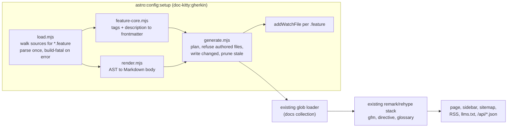
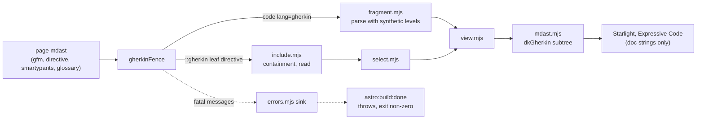

# Gherkin feature pages

The opt-in `gherkin` preset reads a repository's Gherkin `.feature` files, parses
each one once with the official `@cucumber/gherkin` parser, and writes one
`kind: Specification` Markdown page per feature into the docs collection, plus a
hub page per directory that holds a published feature. From there the pages are ordinary collection files. The
sidebar, sitemap, RSS, `llms.txt`, the agent API, glossary auto-linking and the
`related`/`audience` blocks all pick them up with no new wiring. This page maps
the surface. The decision behind it is
[ADR-0046](../adr/0046-gherkin-feature-pages.md), and that record stays
authoritative. The same preset also renders Gherkin inside ordinary pages, from a
```` ```gherkin ```` fence or a `::gherkin{src=…}` include; that half is
[ADR-0051](../adr/0051-gherkin-in-any-page.md) and is mapped in
[In-page scenarios](#in-page-scenarios).

Audience: contributors working on `src/lib/gherkin/`, and site maintainers who
want to know what the preset does to their tree. How to write the `.feature` files
is in [Authoring behaviour specs](../guides/authoring.md#authoring-behaviour-specs);
how to switch the preset on is in
[consumer setup](../guides/consumer-setup.md#optional-gherkin-feature-pages).

## Pipeline



Everything after `generate.mjs` is existing code. Generated pages add **no**
remark or rehype plugins. The one remark stage the preset does add is for
in-page Gherkin, registered by a separate integration (see
[In-page scenarios](#in-page-scenarios)).

The modules are plain JSDoc-typed `.mjs` with no Astro imports:

| Module | Role | Imports |
|--------|------|---------|
| `load.mjs` | Discover and parse. Walks each source directory in code-unit order, skipping dot-directories and `node_modules` and following symlinks without revisiting a directory (so which path reaches a shared directory first never depends on filesystem order). Parses each file with a fresh `IdGenerator.incrementing()`. Collects **every** syntax error in every file, then throws one `[dk-gherkin] <path>:<line>:<col> <message>` error. A missing source directory is fatal. A file with no `Feature:` is skipped with a warning. | `node:*`, `vocabulary-core.mjs`, `parse.mjs`, `text.mjs` |
| `feature-core.mjs` | Pure tag and description mapping to ordered frontmatter. Returns warnings; never throws on author input. | `vocabulary-core.mjs`, `text.mjs` |
| `view.mjs` | Pure view model: the one walk over a parsed document (titles, narrative, sorted tags, summary counts, step text split into prose, quoted arguments and outline placeholders, rules, backgrounds, the line of each Examples row), the tags an embed shows (`displayTags`, no `@dk:*`) and the heading-level plan, shared by both emitters (ADR-0051). | `vocabulary-core.mjs`, `text.mjs` |
| `render.mjs` | Pure view to Markdown body, including escaping. `baseLevel`, `header`, `embed` (tags laid out as the HTML shows them), `inContainer` (bold lines for headings) and `results` serve the agent Markdown of an include; the defaults are the generated page, which never gets results. A caller may pass the `view` it already built. | `text.mjs`, `view.mjs`, `results.mjs` |
| `mdast.mjs` | Pure view to the in-page mdast subtree of an embedded feature (ADR-0051), with its results when given (ADR-0055). Description and narrative Markdown is parsed by an injected function. | `view.mjs`, `results.mjs` |
| `results.mjs` | Pure: parses a Cucumber Messages or Cucumber JSON report into per-file results keyed by line, applies the final-attempt and severity rules, matches a report URI to a rendered file, and returns a feature's scenario, row and summary outcomes, or `stale` (ADR-0055). | `node:path`, `node:url`, `text.mjs` |
| `results-load.mjs` | Reads the configured report with a size limit and an mtime/size memo, and builds its file index once per `root`. | `node:*`, `results.mjs`, `text.mjs` |
| `results-overlay.mjs` | Adds results to a generated page's mdast at render time: result lines after the scenario headings, the `Result` column, the summary line. | `mdast.mjs`, `text.mjs`, `view.mjs` |
| `parse.mjs` | `parseGherkin()`: the one place a Gherkin string is parsed, with errors as `[dk-gherkin] <path>:<line>:<col>` and an optional line offset (a fence's position in its page). `load.mjs` and the in-page stage both call it. `formatProblem()` is the same error text without the prefix, which an include message quotes. | `@cucumber/gherkin`, `@cucumber/messages`, `text.mjs` |
| `fragment.mjs` | `parseFragment()`: parses a fence, wrapping a Feature-less fragment in a synthetic Feature when the parser's first error asks for a `Feature:` line, and a Scenario-less one in a synthetic Scenario when its first content line is a step line (classified as the parser's token matcher does), then maps lines back to the page. It also reports steps written under a real `Feature:` line, which the parser reads as description. | `@cucumber/gherkin`, `parse.mjs` |
| `select.mjs` | `selectScenarios()`: prunes a parsed document to a `scenario` name or an any-of `tags` list, using pickle tags for inheritance. Its AST walk is a transform before the view is built, not a second rendering walk. | `@cucumber/gherkin`, `@cucumber/messages` |
| `include.mjs` | `resolveInclude()`: the `.feature` rule, realpath containment in `includeRoots` (a missing root fails only the includes below it), the size limit, read, and an mtime/size memo. | `node:*`, `load.mjs`, `text.mjs`, `include-path.mjs` |
| `include-path.mjs` | `isInside()`, the one containment predicate, and `MAX_INCLUDE_BYTES` (1 MiB), shared by the resolver and the loader's include scan without pulling the parser into every site. | `node:path` |
| `include-scan.mjs` | The docs loader's include scan: `gherkinIncludeSources()` and the guarded per-file hash folded into the page digest, plus the report hash and the "may show results" test for `gherkin.results` (ADR-0055). Its `.feature` checks (the extension and the size limit) are a deliberate twin of `include.mjs` and `load.mjs`, kept in step by sharing `text.mjs` and `include-path.mjs` rather than importing the parser. Not reachable from the public `./schema` entry. | `node:*`, `unified`, `remark-parse`, `remark-directive`, `vocabulary-core.mjs`, `text.mjs`, `include-path.mjs`, `results.mjs` |
| `errors.mjs` | The process-wide error sink that makes in-page errors build-fatal. | `vocabulary-core.mjs`, `text.mjs` |
| `agent-includes.mjs` | Reads the include records a page's render left behind and splices them into the agent payload. | none |
| `generate.mjs` | `planFeaturePages()` builds the path-to-contents map. `generateFeaturePages()` writes it. `diffFeaturePages()` compares it with the tree for `--check`. | `node:*`, `gray-matter`, `vocabulary-loader.mjs`, the modules above |
| `options.mjs` | `normalizeGherkinOptions()` (the integration), `validateGherkinPages()` (the generated-pages rules, which the CLI calls directly) and `validateIndexBasenames()`: the one validator for the `gherkin` option and the index basenames. | `vocabulary-core.mjs`, `text.mjs` |

`text.mjs` imports nothing. It holds the `[dk-gherkin]` log prefix, the `@dk:`
metadata-tag namespace, the one dedent and narrative-split rule, and the one
unnamed-feature title fallback, all shared by the metadata core and the
renderers, the one relative-path rule (`isRelativePosixPath`) shared by the
option validator, the include resolver and the loader's include scan, and the one
`.feature` file-name rule (`FEATURE_FILE`) shared by the source walk, the resolver
and the scan, and the heading-text fold (`headingKey`) the scenario index and the
results overlay match headings with. Orderings use `compareCodeUnit` and
path slugs use `slug()`, both from `vocabulary-core.mjs`; no module carries its
own copy.

## The generation seam

The preset reuses the glossary's seam
([ADR-0026](../adr/0026-glossary-source-and-generation-seam.md)): it writes real
`.md` files under `<docsDir>/<section>/` in `astro:config:setup`. Astro's
content-layer glob runs after every config hook, so the files are on disk before
`getCollection('docs')` reads them. The bare-Node gates walk files on disk, so they
see the pages too. An injected route or a composite content loader would hide the
pages from both. ADR-0046 records the rejected alternatives.

The integration, `doc-kitty:gherkin`, exists only when the `gherkin` option is
set. With the option absent the integrations array and the markdown config are
byte-identical to a site without it (the TOC target-size rule in `toc-rail.css`
ships to every site regardless). When present, it sits immediately after the
glossary integration and before Starlight, so the log reads glossary, then
gherkin. Its section id is appended to the registry sidebar's build-generated ids,
so a first build with no committed output doesn't warn about a missing section.

The option is validated when `defineDocKittyIntegrations` runs, before any hook,
by `normalizeGherkinOptions()` in `options.mjs`, which applies
`validateGherkinPages()` when `sources` is set. The generator script runs
`validateGherkinPages()` on its flags, so `--section ../../x` fails there too:

- `sources` must be a non-empty array of non-empty strings.
- `allowEmpty`, when present, must be `true` or `false`. A value of another type is
  rejected by name.
- `section` must be a single path segment: not empty, no `/` or `\`, no leading
  `.`. It can't be `_meta` or another generator's section (`glossary`).

## Paths, pages and hubs

`<source>/shipping/book-consignment.feature` becomes
`<docsDir>/<section>/shipping/book-consignment.md`. Each path segment goes through
the toolkit's single `slug()` rule in `vocabulary-core.mjs`. Every source directory
is generated under the same section root.

Hubs are written for the section root and for every directory that holds a
feature anywhere below it ([ADR-0054](../adr/0054-gherkin-draft-hubs-titles-and-scenario-route.md)).
The hub file is `<first indexBasename>.md`, so
`README.md` by default. Using the first configured basename makes the hub collapse
to its directory route under either loader setting. The basename list and the
index-name test come from `vocabulary-core.mjs` (`normalizeIndexBasenames`,
`isIndexPath`), the same rule the loader and the frontmatter gate use. A hub has
`kind: Hub`, `doc_status: active` (or `draft`, below), a one-line intro and a list of its children
(`- [<title>](./<slug>/) — <description>`), sorted by output path. If every
feature in the section is a draft, the root hub is still written, with the intro
and no list.

A hub lists sub-directory hubs and every feature that isn't a draft. A draft
feature (`@wip` or `@dk:status=draft`) still gets its page, but its hub leaves it
out. The hub layout's own child listing already drops drafts, and the hub's raw
Markdown is served to agents through `/api/pages/<hub>.json`, so a listed draft
would get past draft gating. A directory with no published feature below it
gets a **draft** hub: `doc_status: draft`, the intro and no list, and no
published hub links it, so its name isn't published either. Draft gating builds
that hub exactly when it builds the directory's pages, so with drafts published
the sidebar has an index for them. The planner never reads `DK_PUBLISH_DRAFTS`:
the hub is generated in both modes, so the committed tree and the `--check` gate
are the same for every build. The section root hub is always published.

The root hub's title is the section's label in the section registry, or the
humanised section id. A directory hub's title is its entry in `gherkin.titles`
(keyed by the directory relative to its source, as written on disk), else the
humanised directory name, and
its description reads "Behaviour specifications for `<Title>`, generated from
Gherkin feature files." A nested directory is humanised with the sidebar's rule
(`humaniseDirectoryName` in `vocabulary-core.mjs`, sentence case: `shipping-ops`
becomes "Shipping ops"), so a hub and its sidebar group agree. Only the root hub's
fallback title, from the section id, is Title Case. A directory name is literal text: in the
parent hub's list line and in the hub's `#` heading it is escaped like a step, so
a folder called `<b>x` or `[x](y)` can't inject HTML or a link. The hub
frontmatter keeps the name as a quoted string.

These are fatal, and name the files involved:

- **Output collision.** Two sources map to the same output path.
- **Index collision.** A feature whose slugged file name is an index basename
  (`README.feature`, or `index.feature` on any setting) would be routed as its
  directory's index and clash with the generated hub. `index.feature` is rejected
  even when `indexBasename` does not list `index`, because the site serves
  `index.md` at its folder address.
- **Route collision.** A feature page and a directory hub on the same route, such
  as `features/shipping.feature` beside `features/shipping/…`. The page
  `shipping.md` and the hub `shipping/README.md` both route to
  `<section>/shipping`, and the loader would silently keep only one. This is
  fatal in either source order, and the error names both files.
- **Reserved name.** A feature whose slugged file name is `log` (`log.feature`,
  `Log.feature`). The docs loader excludes every `log.md` as the reserved change
  log, so the page would never be built and its hub link would dangle.
- **Unsluggable path.** A path segment with no slug-able characters.

## Ownership and pruning

Feature files get renamed and deleted, so unlike the glossary the generator also
removes pages. It never deletes authored content:

1. Every generated page and hub carries `generated.by: "doc-kitty/gherkin"`.
2. Before writing, the generator scans the section folder. A `.md` with that stamp
   is **owned**. Any other file (dotfiles aside) is **authored**, and the run fails
   before any write, naming it. A generated section has a single owner. A symlink
   is always authored, even one pointing at a stamped page: it is never followed,
   so the writer can't write or prune outside the section through it. A file whose
   frontmatter doesn't parse is also authored, which is the safe default. The same
   rule covers the section folder itself: a symlinked `<docsDir>/<section>` stops
   the run. Ownership is by stamp only: a hand-written page that carries
   `generated.by: doc-kitty/gherkin` counts as generated, and is pruned when no
   feature maps to it.
3. It writes the planned files whose bytes changed, deletes owned files that are no
   longer planned, then removes directories left empty.
4. When no source yields a `.feature` file and generated pages exist, it stops
   before any write and removes nothing. The error names the source directories and
   the usual cause, a directory that is not checked out, such as an uninitialised git
   submodule. To remove the pages on purpose, set `gherkin.allowEmpty: true` or pass
   `--allow-empty`: it then warns once and removes them, as it did before. The stop
   applies only to a source set that yields nothing at all. A first run with no
   pages, and a set where only some directories are empty, behave as before.
   `--check` is unchanged: with empty sources and pages present it already exits 1
   and lists them as `stale`, with or without the flag.

Step 2 would lock a section if the generator ever wrote a page it couldn't read
back as owned: every later run would refuse to write. Two defences stop that. The
`doc_status` value is validated (see the mapping contract below), and the planner
re-parses the frontmatter of every page it plans. If a block doesn't parse, or has
lost the stamp, planning fails with an internal error before anything is written.

## Determinism

Generation is a pure function of the sources and the docs tree it reads (the ADR
listing and the section registry). Files are ordered by source index, then by
code-unit order of the path. Every ordering inside a page uses the same code-unit
comparison, never locale or filesystem order. No clock is read.

`generated.at` holds a content hash, not a timestamp: `sha256:<first 12 hex>` of
the raw source bytes for a feature page, and of the sorted child-path list for a
hub. An agent can tell which version of the source a page reflects, and unchanged
input gives byte-identical output. Because the hash covers the raw bytes, a
checkout that converts line endings (Windows `autocrlf`) changes the hash and
`--check` reports drift. This repository pins `*.feature text eol=lf` in
`.gitattributes`; a consumer repository should add the same line.

The writer skips files whose bytes are unchanged. That matters in dev. Each loaded
`.feature` is registered with `addWatchFile`, so editing one restarts the dev
server, which re-runs the generator. Byte-stable output means the restart doesn't
retrigger itself.

## The mapping contract, in brief

Feature-level tags in the reserved `@dk:<key>=<value>` namespace are the only
metadata channel. The value is everything after the first `=`.

| Tag | Frontmatter |
|-----|-------------|
| `@dk:context=<ctx>` | `glossary_context` |
| `@dk:status=<s>` | `doc_status`, when `<s>` is a lower-case slug; a rejected or conflicting status gives `draft` |
| `@wip` / `@deprecated` | `doc_status: draft` / `deprecated`, when no `@dk:status` |
| none of the above | `doc_status: active` |
| `@dk:persona=<slug>` | an `audience` entry; `guidance_text` is the feature's narrative |
| `@dk:mission=<slug>` | `related: <mission prefix>/<slug>` |
| `@dk:adr=<n>` | `related: adr/<NNNN-…>`, resolved against `<docsRoot>/adr/` |
| `@dk:related=<slug>` | `related: <slug>` |
| `@dk:updated=<YYYY-MM-DD>` | `updated` |
| `@dk:autolink=false` | `glossary_autolink: false` |
| `@dk:priority=<0..1>` | `agent.priority` |
| any other feature tag | `tags`, without the `@` |

The full rules, with examples, are in
[Authoring behaviour specs](../guides/authoring.md#authoring-behaviour-specs). The
points that matter for maintainers:

- **Warnings, not failures.** An unknown `@dk:` key (with a did-you-mean
  suggestion), a missing value, a repeated single-valued key (the first wins), or
  an invalid `updated`, `priority` or `autolink` value warns and is ignored. The
  exception is `status`, which fails closed (see below). A dangling persona, mission, ADR or related ref fails through the
  existing link and audience gates, not here.
- **Status values.** A `@dk:status` value must match `^[a-z][a-z0-9-]*$` and not
  be a YAML keyword such as `null` or `true`. A value rejected only for its case
  (`Draft`) gets a did-you-mean hint with the lower-case form. That still admits charter-defined
  statuses like `in-review`, which pass through and get the frontmatter gate's
  usual warning. A `@dk:status` the generator cannot honour makes the page a
  **draft**, with a warning that says so, so a page meant to stay hidden never
  ships on a live build. That covers a malformed value (`Draft`, `!x`, `[x]`,
  `foo:`, `*a`, `1e3`), a tag with no value, a mis-cased key (`@dk:Status`), and
  two `@dk:status` tags that disagree. A well-formed value the vocabulary does not
  list (`drfat`) is a custom status, not an error. `@wip` and `@deprecated` match
  case-sensitively, as before. As a
  second line of defence the serialiser quotes any `doc_status` that isn't such a
  slug, so the frontmatter always parses.
- **Section registry.** The generator resolves the registry the way the build
  does (`resolveSectionRegistryEntries` in `vocabulary-loader.mjs`, the bare-Node
  twin of `resolveSectionRegistry`). A `_meta/charter.yaml` that declares
  `sections` wins, using its `entries`. Otherwise the legacy `_meta/sections.yaml`
  applies. The registry supplies the root hub label and the mission prefix.
- **Mission prefix.** The first section with a `subtypes` rule of `type: Mission`
  gives `<section>/<match>`, so `plans/missions` in the example. Without one it
  falls back to `plans` and warns.
- **Unnamed feature.** A bare `Feature:` line uses its keyword as written
  (`Feature`, `Functionaliteit`, …) for the title, the `#` heading and the hub
  entry, and warns `[dk-gherkin] <file>:<line> Feature has no name`.
- **`type` is not emitted.** The section's registry entry supplies
  `type: Specification`, keeping the type authority in one place.
- **Description.** The first sentence of the feature description after any leading
  `As a / I want / So that / In order to` narrative. A narrative-only description
  uses the joined narrative. An empty one uses
  "Behaviour specification for `<name>`." with a warning. Over 180 characters it is
  cut at a word boundary with `…` and a warning.

The body puts the feature at `#`. Rules are `##` with their children at `###`;
without rules, backgrounds and scenarios are `##`. Steps are list items
(`- **Given** …`), which keeps them prose so glossary auto-linking reaches them.
Double-quoted step arguments (quotes kept) and outline placeholders become inline
code, so typography never rewrites an argument (ADR-0051); so do the quoted
arguments in a data-table or Examples cell (`cellSegments`). Data tables become
nested GFM tables, and
docstrings become nested fences. Examples are a bold label and a table, not a
heading, so the table of contents lists rules and scenarios only. Rule, scenario
and examples tags render inline as code, de-duplicated and in code-unit order.
Comments aren't rendered.

The renderer departs from, or extends, the plan's contract in a few places, each
for a lint or parser reason:

- A docstring with no media type gets the `text` info string (markdownlint MD040).
- In literal text, `~` is backslash-escaped (GFM strikethrough). So is a `:` that
  precedes a character able to start a directive name, such as a letter or digit,
  because `remark-directive` reads `word:name` and even `10:30` as a text directive
  without any `[label]`.
- A name that looks like an ordered-list item (`1. …`) escapes the `.` or `)`, and a
  trailing `#` run in a heading is escaped so it isn't read as a closing sequence.
- A newline in a table cell renders as `<br>`.
- GFM autolink literals in literal text (`https://…`, `www.example.com`,
  `someone@example.com`) would become live links, and markdownlint's MD034 would
  flag them as bare URLs. A backslash escape doesn't help, because
  `mdast-util-gfm-autolink-literal` re-scans the decoded text of each text node
  after parsing. So the escaper splits the text node with an empty HTML comment,
  `<!---->`, inserted before the `.` of `www.`, the `:` of `http(s)://`, or the `@`
  of an email address. The comment renders as nothing. Visible text, copy and
  paste, heading ids and the table of contents are unchanged. It is the only raw
  HTML the escaper emits, and it does show up in the raw Markdown served to agents.

Duplicate scenario names under one parent produce duplicate sibling headings. The
generator warns with both line numbers, and markdownlint's MD024 fails CI, so the
author fixes the name at source.

## Gate parity and the drift gate

The pages are committed, like the glossary's. Two gates keep them honest:

- **Frontmatter parity.** `validate-frontmatter.mjs` recognises a generated page by
  its `generated.by: "doc-kitty/gherkin"` stamp, imported from `feature-core.mjs`
  rather than repeated, or by the legacy glossary path rule (a `kind: Glossary` or
  `kind: Hub` page under `glossary/`). The glossary codegen writes no stamp, so a
  `doc-kitty/glossary` stamp grants no exemption. Accepting one would only let an
  authored page anywhere opt out of the rules by claiming it. Generated pages are
  exempt from `type`, and from `updated` unless a `@dk:updated` tag supplied one,
  in which case the value is checked normally. `check-links.mjs` needs no change: generated `related` refs are
  ordinary slugs, so a dangling one fails like any other.
- **Drift gate.** `src/scripts/generate-feature-pages.mjs`, shipped as the
  `dockitty-generate-feature-pages` binary, calls the same `loadFeatures` and
  `planFeaturePages` the integration calls, so the bytes it compares are the bytes
  the build writes. With `--check` it writes nothing and exits 1 listing every
  `added`, `changed`, `stale` and `authored` path. Its flags mirror the `gherkin`
  option (including `--allow-empty`) because the script can't evaluate
  `astro.config.mjs`; `--help` lists them. In this repo,
  `pnpm validate:features` runs it against the example in the CI doc-sanity lane,
  and `pnpm generate:features` regenerates.

## Drafts and the sitemap

A draft feature page is generated like any other page, and the existing draft
gating keeps it out of the published surfaces. The sitemap's draft filter is the
one piece that has to account for generation order. It reads the docs tree for
draft routes lazily, on its first call during the build, not when
`defineDocKittyIntegrations` runs. By then `astro:config:setup` has regenerated the
section, so a feature that has just gained `@wip` is excluded on the same build
rather than one build later.

## Agent surface

The pages reach `llms.txt` and `/api/index.json` under the section's registry
label. `/api/pages/<id>.json` returns the generated Markdown plus
`sources: [{ resource, title: "Gherkin source" }]`. The resource is the source path
relative to `gherkin.sourceRoot`, prefixed with `gherkin.sourceUrlPrefix` when set,
so an agent can fetch the executable `.feature` itself.

Sites with `gherkin.sources` also serve `/api/scenarios.json` (the integration injects
`scenarioIndexRoute()`; a hand-mounted `src/pages/api/scenarios.json.ts` is kept): `{ version, generated_from: "doc-kitty/gherkin", count,
features[] }`. It has one record per published, agent-discoverable generated page,
ordered by id, carrying `id`, `title`, `url`, `source`, `doc_status`,
`glossary_context`, `tags` and `related`, plus `scenarios[]` in document order.
Each scenario has `name`, `rule` (`null` outside a rule), `anchor`, `line`, its own
`tags` (without `@`, sorted), `outline`, `steps` (`{ keyword, text }`, keyword
trimmed) and `examples` (`{ name, tags, header, rows }`; rows are not expanded).
The route re-parses each page's `.feature` with the same loader, using the
`sourceRoot` and `sourceUrlPrefix` of `gherkin`. It reads each anchor from the
page's rendered headings and never computes a slug. Scenarios are matched to
headings in document order, after folding both sides the same way: Astro's
heading text turns `{` into `${`, and smartypants curls quotes and rewrites dashes
and ellipses. A missing source, a source
changed since generation, or a scenario with no rendered heading fails the build.
`llms.txt` adds a `Scenario index:` line only when at least one such page exists,
so a site without Gherkin pages is unaffected. The route exists whenever
`gherkin.sources` is set, so the line never points at a 404 (ADR-0054).

## The RSS feed

Whether the pages reach `rss.xml` is the section's choice: the example site's
`behaviour` section lists `rss` in `feeds` (`example/docs/_meta/sections.yaml`), and
a site drops it to keep specs out. The feed ranks by `updated`, newest first, with
undated items last in slug order (`rankForFeed` in `metadata.ts`), and omits
`<pubDate>` when there is no date. A generated page has no `updated` unless its
feature carries `@dk:updated=<date>`, so by default:

- every feature page and every hub is an item, each without a `<pubDate>`;
- a new `.feature` file is a new undated item;
- a new scenario in an existing feature changes nothing a subscriber sees,
  unless the author also sets or bumps `@dk:updated`;
- a draft feature is not in the feed.

## In-page scenarios

With the `gherkin` option set (`true` or an object) and `fences` not `false`,
a ```` ```gherkin ```` fence on any docs page renders as a structured scenario,
and a `::gherkin{src scenario tags}` leaf directive renders a `.feature` file, or
the scenarios it selects, in place. This needs no `sources`: `gherkin: true` is
in-page Gherkin with no generated pages. How to write them is in
[Gherkin in any page](../guides/authoring.md#gherkin-in-any-page).

### Pipeline position

One remark stage, `gherkinFence` (`src/lib/remark/gherkin-fence.ts`), registered
by the `doc-kitty:gherkin-fence` integration after the glossary and the codegen
hook and immediately before Starlight. It therefore runs after Astro's
smartypants and glossary auto-linking, and before Starlight's directive
restoration, Expressive Code and `deckSplit`. `config-invariants.test.ts` pins
that position, and the re-derive parity test lists the stage as an inert
exclusion.



The stage swaps each match for a `dkGherkin` node (`<div class="dk-gherkin">`),
so Expressive Code never sees the fence; only the doc strings inside it stay
`code` nodes and are highlighted. The subtree goes through `remark-smartypants`
so its prose matches the page; a double-quoted step argument is inline code, on
every surface, so it keeps its straight quotes and `--` flags. An empty or
comment-only fence stays a code block; a fence whose content would only become
the description of an untitled Feature (prose, a bare table) is fatal. Headings take `max(2, preceding depth + 1)`, capped
at 6. Inside a list item, quote or aside they become `p[role=heading]`. A fence
with `raw` in its info string, a fence on a generated page (`generated.by:
doc-kitty/gherkin`) and every fence on a deck stay code. A directive on a deck is
fatal.

### The error sink

Astro's `glob()` loader renders each entry inside a `try` and only logs a render
error, storing the entry with no HTML: a throwing stage alone would build an
empty page and exit 0. So the stage records every fatal message for the page in
`errors.mjs` (a sink on `globalThis`, keyed by page, replaced on each render)
before throwing, and the integration's `astro:build:done` throws one aggregated
error listing every page and message. The loader persists the failed entry in
`<cacheDir>/data-store.json` and skips unchanged entries on the next sync, so a
second build of the same broken page, or a build after `astro sync`/`astro
check`, would exit 0. Two mechanisms (ADR-0051 decision 5):

- **Primary** (`docKittyDocsLoader` collections): the loader
  (`createGherkinTracker` in `schema.ts`) notes each entry whose render throws
  and stores it, when its body mentions `gherkin`, under a digest that never
  matches, so every later sync renders it again. This covers a second build, a
  build after `astro sync`/`astro check`, a build that died before
  `astro:build:done`, and a dev restart.
- **Fallback** (any other loader, such as a plain `glob()`): when
  `astro:build:done` fails the build it deletes `<cacheDir>/data-store.json`,
  so the next build re-renders everything and fails again. A sync before the
  build never reaches that hook, so it is covered only for `docKittyDocsLoader`
  collections.

In dev the sink is only logged, and it is reset in `astro:config:setup`.
`gherkin-fence-build.test.ts` proves the non-zero exit on a real build: twice in
a row, after `astro sync`, and twice in a plain `glob()` collection.

### Freshness

The loader caches each page by its own contents, which an include does not
change. `docKittyDocsLoader` (`src/lib/schema.ts`) therefore finds each page's
`::gherkin` sources with a plain directive parse (`gherkinIncludeSources` in
`include-scan.mjs`), folds the sha256 of each included file into the page digest
(a page with no include keeps `glob()`'s digest byte for byte), and in dev
re-emits a `change` for every page that includes a changed, added or deleted
file. The loader never sees `includeRoots`, so it is not the trust boundary, but
it reads nothing the stage would refuse: a `src` that is not a relative POSIX
path to a `.feature` file, or names anything but a regular file of at most
1 MiB, is folded as unreadable without being read or watched. The loader is part
of every site, so it does this even where the preset is off. `include.mjs` memoises file
reads on path, mtime and size. This is the only part of the feature built on
Astro 5 `glob()` internals, and it has to be re-checked for Astro 7 (#119).

### Agent surface

`/api/pages/<id>.json` would otherwise hand an agent a bare `::gherkin{…}` line.
The stage, which has already resolved and selected each include, also renders it
as the Markdown a generated page holds (`renderFeatureBody` in its `embed`
layout, so the tags match the HTML, plus `renderSourceLine`) and records `{ start, end, src, scenario?, tags?, markdown }`
under `dkGherkinIncludes` in the render-time frontmatter. Astro keeps that as the
entry's `rendered.metadata.frontmatter`, apart from the validated `entry.data`.
The route splices the records into the body by offset (`agent-includes.mjs`,
which imports nothing, so the route never loads the parser) and lists them under
`includes: [{ src, scenario?, tags? }]`, with `tags` as the attribute string.
Fences reach agents as fences. Embedded scenarios are not in
`/api/scenarios.json`.

## Scenario results

`gherkin.results` names a Cucumber report the site's CI writes
([ADR-0055](../adr/0055-gherkin-scenario-results.md); the research is in
[Gherkin scenario results](./research/gherkin-results.md)). Every scenario the
site renders **from a `.feature` file** then shows its result: on generated
feature pages and in `::gherkin` includes. A fence has no file, so it shows none.

### From report to outcome

`results.mjs` reads Cucumber Messages (NDJSON, protocol 15 to 34) and Cucumber JSON
(cucumber-js, cucumber-jvm, godog and behave dialects), told apart by the first
character. Both are reduced to entries `{ line, names, status, retried }` per
reported file, where `line` is the scenario's line or, for an outline row, the
row's line. A runner gives AST nodes random UUIDs, so ids only join messages
inside one report; the line is the key both sides compute. A Messages pickle's
lines come from the report's **own** `gherkinDocument`.

The status of a test case is the most severe step result, hooks included, of its
final attempt (`willBeRetried` false, else the highest `attempt`), in Cucumber's
order. `UNKNOWN`, an attempt that never finished, a pickle with no test case and a
scenario the report leaves out of a file it covers are all **Not run**. A pass
after a failed attempt is **Passed on retry** (Messages only; JSON hides retries).

Only status words, lines, names, the run's date and a hex commit id are kept.
Messages, stack traces, attachments, step-definition locations and environment
details never leave the parser.

### Matching and staleness

A report URI is normalised (`file:` URLs, `classpath:`, backslashes, `.`/`..`),
then:

- a relative URI resolves against `results.root`, the directory Cucumber ran in
  (default the project root);
- an absolute URI inside the project root is made relative to it;
- any other (another machine's CI path, `classpath:`) matches a file only by its
  tail, and only when exactly one reported file does. Two candidates is a
  warning, not a guess.

A report older than the file would put results on the wrong scenarios, so a stale
report is never matched by line. Messages carries each file's text
(`source.data`), which must equal the rendered file (BOM and line endings aside).
JSON carries none, so every entry's line must be a scenario or outline-row line of
the **whole** file (even for a selection) with a matching name, and the steps it
ran must be that scenario's (Background steps first or not, as runners differ),
placeholders filled in from the row, so a reordered or edited Examples row is
stale too. A stale file shows no badges, a "Results not shown" note where a
feature header is shown, and one build warning.

### Where the results are added

- **Includes.** The stage passes the file's results to `featureMdast` and to
  `renderFeatureBody`'s embed layout, so the HTML and the agent Markdown agree.
- **Generated pages.** Their Markdown is committed and drift-gated, so it never
  holds results. The stage, which otherwise leaves a generated page as emitted,
  re-reads the page's source (`sources[0].resource`, the inverse of `sourceLink`),
  checks it against `generated.at`, and `results-overlay.mjs` inserts the same
  nodes into the page's mdast: each scenario takes the next heading at its level
  whose text folds to its title (`headingKey`, as the scenario index matches
  headings), each Examples block the next root-level table of its shape. A
  scenario with no heading is warned about, never guessed. With `fences: false`
  the stage is still registered when `results` is set, and does only this.
- **The scenario index.** `scenarioIndexRoute({ results })` adds `result` to each
  scenario, `results` to each Examples table, `results: 'current' | 'stale'` to
  each feature, and a top-level `results` block naming the report, format, run
  date and commit. The injected route takes the option from the
  integration; a hand-mounted route repeats it, as it repeats `sourceRoot`.

The markup is a `p.dk-gherkin__result` right after the heading, never inside it,
so the table of contents and the slugs do not change. Its badge,
`span.dk-gherkin__status[data-status]`, holds the status word after a visually
hidden "Result:". A glyph and a tinted bar only reinforce the word (WCAG 1.4.1).
The rules are in the global component sheet, unscoped, because a generated page
has no `.dk-gherkin` container.

### Errors and freshness

The report is read in `astro:config:setup`: missing is a warning (a local build
has no CI report), unreadable is a thrown error naming the report and, for an
NDJSON envelope, its line. An all-skipped report warns that it looks like a
`--dry-run`. The stage reads it again through a memo, so a report that becomes
unreadable under a dev server fails the pages that show results through the error
sink.

The integration names the report to the docs loader in `DK_GHERKIN_RESULTS`. A
page that may show results (it holds `::gherkin` or the generated-page stamp)
folds the report's hash into its digest, and a change to the report re-emits a
`change` for each such page in dev. With no report every digest is what it was.
`gherkin-results-build.test.ts` proves the fold with two real builds over one
content cache.

## Limits

- **New files need a restart.** Only the `.feature` files loaded at startup are
  watched, so a new file appears after the next dev-server restart.
- **English-only narrative detection.** The `As a / I want / So that / In order to`
  lines are matched in English. Keywords such as `Given` render as written, so
  localised features keep their keywords, but a localised narrative is treated as
  ordinary description text.
- **No outline expansion.** A Scenario Outline renders once with its examples
  table. With results, each row's result is a cell in a `Result` column; the rows
  are not expanded into scenarios.
- **Empty sources stop the build.** With generated pages present and no feature
  found in any source, the generator throws instead of deleting the pages. Set
  `gherkin.allowEmpty: true` (or `--allow-empty`) to remove them on purpose, and
  remove the setting once they are gone. [ADR-0048](../adr/0048-generated-page-names-and-empty-sources.md)
  records the decision and amends ADR-0046 on this point.
- **Turning the preset off freezes the pages.** With no integration, nothing
  prunes the section, so the last generated pages keep building as ordinary
  content. Removing the feature means deleting the section folder. If CI still runs
  the `--check` gate, it reports the drift.
- **Feature descriptions are a trust boundary.** A description is Markdown
  passthrough, so raw HTML in one lands on the page, on the hub and in the page's
  `description`. Names, steps and table cells are escaped. Pull `.feature` files
  only from sources you trust as much as your docs.
- **Only Feature-level tags gate publication.** A `@wip` on a single Scenario does
  not hide it; the tag is shown on the page.
- **A draft hub lists nothing.** A directory whose features are all drafts gets a
  draft hub with the intro only: hubs leave drafts out in both draft modes.
- **In-page freshness rests on Astro 5 internals.** The include digest fold, the
  dev re-emit, and the never-matching digest of a failed render depend on how
  Astro 5's `glob()` loader stores and re-syncs entries. They have to be re-checked
  under #119 (Astro 7).
- **Includes in `.mdx` pages are not expanded for agents.** Astro 5 renders MDX
  entries outside the loader, so no include records reach
  `rendered.metadata.frontmatter` and the agent payload keeps the directive line.
- **Only the leaf form is an include.** `:gherkin{…}` or `:gherkin[…]` (a text
  directive with attributes or a label) and `:::gherkin` are fatal, but a bare
  `:gherkin` is ordinary prose (`lang:gherkin`) and stays literal text.
- **Embedded steps are not glossary-linked.** The stage runs after the glossary,
  so only generated pages link terms in step text, until #113.
- **Only quoted arguments escape typography.** A double-quoted argument, in step
  text or in a table cell, is code; a `--flag` or an apostrophe outside quotes is
  typeset like the rest of the page (`--force` becomes a dash). Quote a command
  or flag to keep it copyable.
- **A quoted cell argument holding `\|` stays text.** A GFM table cannot hold
  `\|` inside a code span, so on a generated page and in the agent Markdown such
  an argument is escaped text and is typeset.
- **Doc-string languages are stripped to safe characters.** A media type keeps
  only letters, digits and `+.#-`, so `"""application/json` becomes the language
  `applicationjson` (unhighlighted). Use `"""json`. This is inherited from
  generated pages.
- **The scenario index is injected (#126).** `llms.txt` advertises
  `/api/scenarios.json` whenever at least one published, agent-discoverable
  generated feature page exists, and the integration serves it whenever
  `gherkin.sources` is set. A site that removed the `gherkin` option but kept its
  frozen generated pages gets no route and must mount `scenarioIndexRoute` itself.

- **Results are a snapshot of one report.** They are as fresh as the last build
  that read the report, and one report is read: several runs (one per suite or
  platform) must be merged into one file before the build. History across runs
  is out of scope.
- **A stale report shows nothing for that file.** Any change to a `.feature` file
  (a comment included, for a Messages report) hides its results until the tests
  run again. A JSON report is checked by lines, names and step texts, so a change
  to only a data table, a doc string or a tag is not detected.
- **Fences never show results.** Only a scenario rendered from a file can be tied
  to a report.

## Related notes and follow-ups

- The glossary generator also follows `indexBasename`, but prefers `index` when the
  site lists it, while the Gherkin hubs use the site's first index name. One site
  can therefore hold a `README.md` Gherkin hub and an `index.md` glossary hub; the
  setting `indexBasename: ['README', 'index']` produces exactly that. The setting
  exists once, in `defineDocKittyIntegrations`, and every script and the loader read
  it from there. Two files on one address are a fatal route collision, not a
  winner-and-demotion. See
  [ADR-0048](../adr/0048-generated-page-names-and-empty-sources.md) and
  [ADR-0050](../adr/0050-route-collisions-and-single-index-setting.md).
- Phase 2 of the [QA portal research](./research/qa-portal.md), pass/fail results
  per scenario from a Cucumber report, is delivered by
  [ADR-0055](../adr/0055-gherkin-scenario-results.md); see
  [Scenario results](#scenario-results). A results summary page across features
  and history across runs are not part of it.
