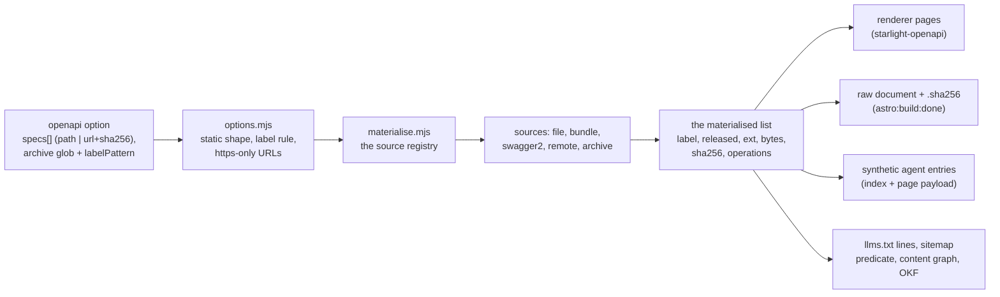

# OpenAPI pages

The opt-in `openapi` option builds versioned API reference pages from OpenAPI
definitions and publishes each version's raw document byte for byte with a
checksum. The pages themselves come from the pinned `starlight-openapi`
integration (ADR-0049); everything around them — validation, materialisation,
the raw-document publisher, the machine surfaces — is DocKitty's. This page maps
that machinery. The surface decisions are
[ADR-0078](../adr/0078-openapi-surface-matrix.md); that record stays
authoritative. The consumer view, including the error table and the content
security policy hashes, is the [guide](../guides/openapi-reference.md).

Audience: contributors working on `src/lib/openapi/` and
`src/lib/integrations/openapi-*.ts`, and maintainers who want to know what the
option does to their build.

## One materialised list

Everything starts at config time, before any page renders:

`normaliseOpenApiOptions` (`src/lib/openapi/options.mjs`) validates everything
that needs no filesystem or network: types, the route-safe label rule (a dot is
refused — the renderer drops dots from routes), `https:`-only remote URLs with
their required sha256, the archive glob and label pattern, and the flags
(`llmsOperations`, `offline`). `materialiseOpenApiSpecs`
(`src/lib/openapi/materialise.mjs`) then dispatches each spec to its source and
returns the one list every surface reads. Each source returns the version's
`bytes` (the exact bytes the raw document publishes) and its parsed operations:

| Source | Kind | Notes |
|--------|------|-------|
| `file` | `specs[].path` | One self-contained document. An optional `sha256` pin is verified. |
| `bundle` | detected | Relative `$ref`s across local files are bundled into one document; the published bytes are the bundle (they match no single source file). `$ref` targets are realpath-contained in the definition folder. |
| `swagger2` | detected | Swagger 2.0 input; original bytes published, conversion in memory only. |
| `remote` | `specs[].url` | `https:` only, sha256 required, at most five redirects, 30 s timeout, 10 MB cap. Fetched through a small child process so materialisation stays synchronous. Cached under `node_modules/.cache/doc-kitty/openapi/` keyed by the digest. |
| `archive` | `archive.glob` | One version per matched file, label from `labelPattern`'s capturing group, sorted by POSIX relative path after the explicit specs. |

A corrupted cache entry is refetched online and fails closed offline
(`DOCKITTY_OFFLINE=1` or `offline: true` makes zero requests). Ordering is
stable end to end: config order for explicit specs, archive matches after them,
operations by path then uppercase method, bytewise.

## The surfaces

The materialised list feeds the surface matrix of ADR-0078. The mechanisms:

- **Renderer pages.** The adopter's `starlight-openapi` factory receives the
  materialised specs. The pages render inside the DocKitty frame with `--dk-*`
  theming; the renderer's own stylesheet is filtered out.
- **Version switcher.** `openapi-switcher` middleware injects a native
  disclosure of plain links into every page, marking the current version and
  unreleased ones. A link from an operation page targets the same operation in
  the other version when that version routes one (mapped by the renderer's own
  slug rules), else that version's overview.
- **Raw documents.** The `astro:build:done` publisher
  (`src/lib/integrations/openapi-publish.ts`) writes each version's bytes and a
  `sha256sum`-format checksum, refuses an authored file at an output path,
  prunes the output of removed versions, and hands the publication to the
  routes through an internal environment handoff. In `astro dev`, a middleware
  handler serves the raw routes with the same bytes, from an exact route
  allowlist, GET and HEAD only.
- **Synthetic agent entries.** `agent-index.ts` and `agent-page.ts` project
  each version into `/api/index.json` (appended after the docs records, never
  ranked) and `/api/pages/<section>/<label>.json`, through **one** shared
  projection (`toOpenApiVersionRecord`) so the two cannot drift. The records
  carry `released`, `rawDocumentUrl` and `sha256`.
- **Feeds and discovery.** `llms.txt` gains one line per version (plus the
  opt-in operation lines). A sitemap predicate adds released pages to the
  sitemap; unreleased pages are built and served but held back from the
  sitemap and from Pagefind (no `data-pagefind-body`, no search fragment). The
  content graph gains one `resource` node per version; the OKF bundle one file
  per version.
- **Deliberate exclusions.** RSS/Atom feeds, the glossary autolinker and the
  frontmatter gate never see the pages (ADR-0078 §2). The spec input is
  validated at materialisation instead.

The build-time link check (`openapi-link-check.ts`) runs after the publisher:
it reads the built HTML, decodes HTML entities, and fails the build on
relative Markdown, root-relative and fragment targets that do not resolve, and
on `javascript:`, `data:` and `vbscript:` schemes — including
entity-encoded spellings. Query strings are redacted from diagnostics.

## The seams

The adapters (`src/lib/openapi/adapters.ts`) register the publisher, the dev
handler, the link check and the sitemap predicate with the registries in
`materialise.mjs` through **keyed** registration helpers
(`registerBuildDoneHook`, `registerDevHandler`, `registerSitemapPredicate`): a
repeated registration replaces its own entry instead of appending, so a dev
server restart or a second config pass cannot double the hooks.

The sources are a registry too, so a kind that a future build drops is refused
with a "not supported" message rather than crashing.

## The gates

`src/scripts/assert-openapi-artifacts.mjs` (run by `pnpm assert:artifacts`, or
alone as `pnpm assert:openapi`) re-derives the expected output from the
configured specs and fails on any drift: pages and names, version links with
the same-operation mapping, the unreleased badge and its absence from
sitemap/search, raw documents and checksums byte for byte, the synthetic agent
records and page payloads (entry count, digest, raw document route), the
`llms.txt` lines (operation lines required when opted in, refused otherwise),
and the NFR-002 inline allowlist. The suite
`src/tests/openapi-raw-document.test.ts` drives each check against a crafted
site with a negative control per check.

The Playwright a11y lane also covers the reference pages
(`tests/a11y/openapi.spec.ts`, and the axe scans of both colour modes): it
serves the built dists, so `pnpm build:test-dists` must run before
`pnpm test:a11y`.

## Security posture

Spec inputs are owner-trusted (ADR-0078 §4): no renderer-HTML sanitisation,
intranet hosts allowed, integrity from the sha256 pin. The FR-028 bounds make
hostile input fail closed — realpath containment, size, alias and ref-count
caps, timeouts, no URL userinfo, a verified atomic cache — and spec-derived
text in DocKitty's own outputs is flattened and link-escaped. The trust model
and each adversarial disposition live in ADR-0078.
