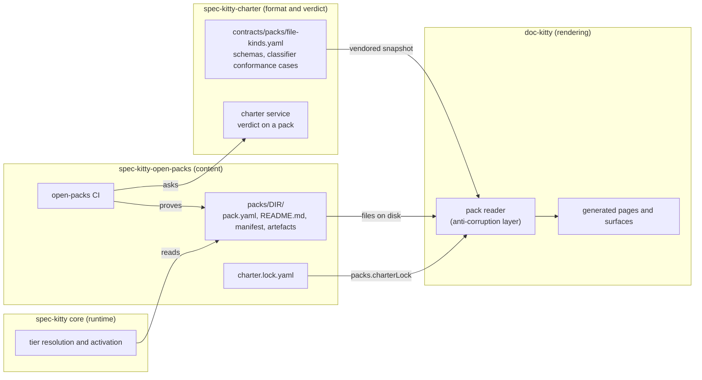
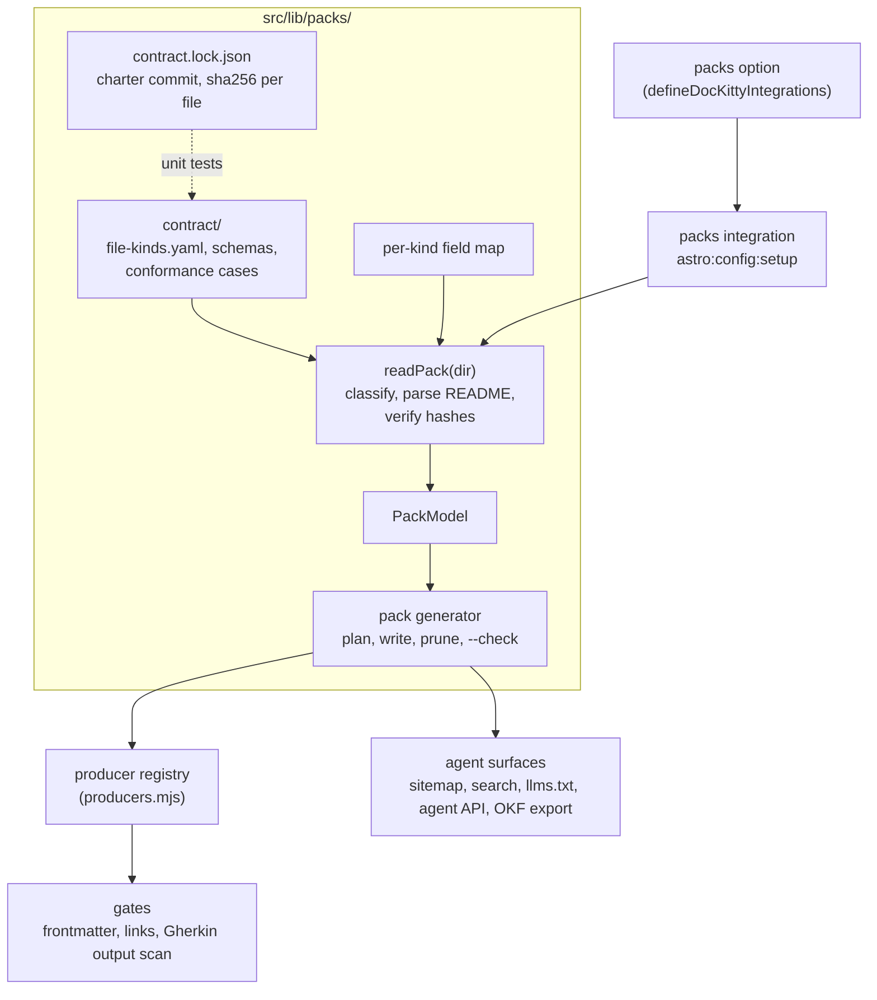
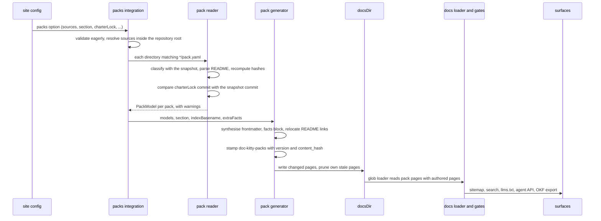
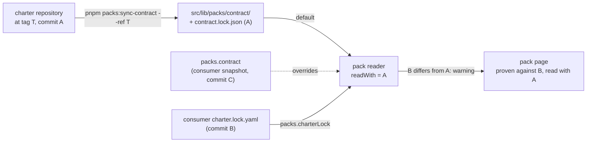

# Kitty packs

> **Partly built.** This page describes kitty-packs support as decided in
> [ADR-0079](../adr/0079-kitty-packs-through-a-charter-contract-reader.md).
> Slice 2 (#330) is built: the pack reader, its contract snapshot, the
> `packs.charterLock` and `packs.contract` options, `dockitty-read-pack` and the
> producer registry ([ADR-0083](../adr/0083-producer-registry-and-ownership-scopes.md)).
> Pack pages, the generator and the rest of the `packs` option are the target
> design (#338 onward). [What is built](#what-is-built) lists the difference.
> Where this page and the ADRs differ, the ADRs are authoritative. The findings behind it are in the
> [research](./research/packs.md), and the delivery order is in the
> [feature plan](../plans/features/packs.md).

A site lists its pack directories in config. doc-kitty reads each pack through one
adapter pinned to a snapshot of the charter's packs contract. It then writes one
generated page per pack into the docs tree. From there the pages are ordinary
collection files, as Gherkin feature pages are.

Audience: contributors who will build `src/lib/packs/`, and maintainers of a packs
repository who want to know what the option will do to their tree.

## Bounded contexts

Four repositories touch packs. Each is its own bounded context with its own
vocabulary. doc-kitty meets the others at one seam: the pack reader.



| Context | Owns | Relation to doc-kitty |
|---|---|---|
| spec-kitty-charter | The pack format and the verdict on a pack | Upstream. doc-kitty conforms to its contract through a vendored snapshot |
| spec-kitty-open-packs | Pack content, its CI gates and its digest sidecars | A consumer site, and the source of pack directories |
| spec-kitty core | Runtime resolution and activation | A future consumer site. It shares no code with doc-kitty |
| doc-kitty | Rendering a docs tree, its gates and agent surfaces | Downstream. It renders and never judges a pack |

The anti-corruption seam is deliberate (DIRECTIVE_031). Only the reader knows the
pack format. Everything after it works on `PackModel`, doc-kitty's own view of a
pack. The reader imports no Spec Kitty code and calls no service at build time
(ADR-0042). It reads files only.

## Components



| Component | Role |
|---|---|
| Contract snapshot | `src/lib/packs/contract/` holds `file-kinds.yaml`, the five pack-level schemas the reader uses, and the charter's classifier conformance cases (`conformance/classifier-cases.yaml`), copied byte for byte from the release tag `contract-packs-v0.1.0-rc.2`. The charter publishes the cases as data (spec-kitty-charter#559), so none are transcribed. `pnpm packs:sync-contract --ref <tag or full commit>` refreshes every locked file. |
| Contract lock | `contract.lock.json` records the source, the tag, the charter commit and each snapshot file's sha256. A unit test fails when the bytes and the lock disagree, or a file is added or removed. Loading a snapshot verifies its lock and refuses a symlink in it. |
| Pack reader | `readPack(dir)` turns a pack directory into a `PackModel`. It reimplements classification only and is held to the charter's conformance cases. It parses the README into the codec's shape with doc-kitty's own Markdown pipeline. It recomputes each manifest constituent's `content_hash`. |
| Per-kind field map | Which fields give an artefact its title and summary, such as a directive's `title` and `intent`. It lives beside the snapshot, not in page templates. |
| `PackModel` | Identity, document, manifest, presets, policy, inventory, problems and the two contract commits. The shape is in ADR-0079 D4. |
| Packs integration | Validates the `packs` option eagerly, runs the generator at `astro:config:setup` and watches pack files in dev. Errors carry a `[dk-packs]` prefix. |
| Pack generator | Plans the page tree, writes changed pages, prunes only its own stale pages, and backs `dockitty-generate-pack-pages --check`. |
| Producer registry | `src/lib/producers.mjs`: one list of producers, each with a role and an ownership scope ([ADR-0083](../adr/0083-producer-registry-and-ownership-scopes.md)). `PRODUCERS` in `src/lib/generator-stamp.mjs`, `isGeneratedPage` in `src/scripts/validate-frontmatter.mjs` and the Gherkin output scan (`scanProducerOutput` in `src/lib/producer-output.mjs`) read it. |
| Gates | The frontmatter gate and the links gate run on pack pages as on any page, through the registry. A pack directory scope takes effect in the gate once the scopes are resolved from site config and passed as `producerScopes` (#338; see [ADR-0083](../adr/0083-producer-registry-and-ownership-scopes.md#negative)). |
| Agent surfaces | The sitemap, search, `llms.txt`, the agent API and the OKF export list pack pages as ordinary entries. None of them gets packs-specific code. |

Slice 2 also adds a `dockitty-read-pack <dir> --json` CLI that prints the model.
It is a debugging aid and the first consumer of the reader.

## Build-time data flow



The generator runs in `astro:config:setup`, the seam the Gherkin and glossary
generators use (ADR-0026). Astro's content-layer glob runs after every config
hook, so the pages are on disk before the collection is read. The bare-Node gates
walk files on disk, so they see the pages too.

Discovery is the contract's `*/pack.yaml` glob, relative to each source root.
Source roots resolve against the site root and must stay inside the repository
root after `realpath`. An escape is refused. A source with no pack fails unless
`allowEmpty` is set, so a checkout without its packs cannot prune every page.

The reader warns and never fails the build on pack content. It reports a file the
contract classifies as `retired` or does not classify, a manifest and directory
that disagree, an unknown key or `content_form`, and a README link that does not
resolve after relocation. An unknown key or descriptor major gets a facts-only
page. Configuration errors are the only fatal class, apart from the ownership
collisions below.

## Generated page tree and ownership

With `section: 'packs'` and the default index basename, a packs repository
renders like this:

```text
<docsDir>/packs/
  README.md                 authored section landing (or index.md)
  catalog-proposal.md       authored page, untouched
  built-in/README.md        generated, stamped doc-kitty-packs/<version>
  qa/README.md              generated; pack.yaml name is quality-assurance
  go/README.md              generated; no manifest, inventory from file-kinds
```

The file name is the site's first `indexBasename`, so each pack page collapses to
`/<section>/<dir>/`. The slug is the pack's directory name, never its `pack.yaml`
`name`. That keeps open-packs' current URLs, such as `/packs/qa/`.

Each page has synthesised frontmatter: `title` from the README H1 or the name,
`description` from the preamble's first sentence, `kind: Pack`,
`doc_status: active`, `updated` from the stamp, `sources:` naming the pack
directory, and the `generated` stamp. Frontmatter in the README is not copied.

The body is a facts block followed by the whole README. The facts block holds the
`pack_id`, version, level, parent, dependencies with their ranges, presets, locked
artefacts, the `manifest_hash` with its verified state, the inventory per kind
with its source, and the two contract commits. A dependency links to a pack of
the same build that holds its `pack_id`, else it shows the bare ULID.

README links are relocated. A link into the pack goes under `sourceUrlPrefix`
until artefact pages exist (slice 4), then to the artefact page. A link that
resolves into `docsDir` becomes a site link. Anything else becomes plain text with
a warning.

Ownership is per pack directory. This amends ADR-0046 decision 4, which assumed a
producer owns a whole section.

- The generator owns `<section>/<dir>/**` for every pack it renders.
- It prunes only pages that carry its stamp.
- An authored file inside an owned pack directory is fatal.
- A pack directory whose slug collides with an authored page is fatal.
- The section landing and other authored pages stay authored. The landing is a
  hub, and `selectHubChildren` in `src/lib/hub-children.mjs` lists the pack pages
  under it as one-level-down children.

Ownership is decided by stamp and scope together: a page is generated only when it
carries a producer's stamp and sits inside that producer's scope, so an authored
page cannot opt out of validation by claiming a stamp. The producer registry
records each producer's scope: a whole section for Gherkin, a set of directories
for packs, and the glossary's existing path rule (it already stamps its pages).
The `packs` section joins the build-generated section ids, so a first build
without pack pages does not warn.

## Contract pinning

Two commits matter, and each page shows both.



- **Read with.** The commit of the snapshot the reader used. By default that is
  doc-kitty's vendored snapshot, moved only by a doc-kitty release.
- **Proven against.** The commit in the consumer's own pin file, named by
  `packs.charterLock`. open-packs proves its packs against that commit in CI.
- A mismatch is a warning. The page records both, so it never claims a contract
  silently.
- `packs.contract` points at another snapshot directory in the vendored layout,
  with its own `contract.lock.json`. The build checks that lock too. A consumer
  can render with the contract it pins without waiting for a doc-kitty release.
- `packs.charterLock` reads the `commit` key of the consumer's pin file.
- doc-kitty never fetches a contract at build time.

The vendored snapshot is pinned to the packs-contract release tag
`contract-packs-v0.1.0-rc.2`, charter commit `33f3ad4` (#418). The sync script accepts a
tag or a full commit only: a branch, `HEAD` or a short sha is refused, so the
lock never records a moving ref as its provenance.

Every key of a `contract.lock.json` must be a relative POSIX path of plain
segments inside the snapshot: no leading `/`, no backslash, no empty, `.` or
`..` segment, and not the lock itself (#423). The sync script checks the keys
before it fetches, reads or writes anything, and stops on the first bad key,
naming it. `verifyContractLock` and `loadContract` refuse the same keys, so a
consumer's `packs.contract` snapshot cannot name a file outside itself.

rc.2 changed the contract in four ways that reach the reader. None needed a code
change; the classifier passes the new conformance cases as it stands:

- `routing_catalog` is a new artefact kind, held as
  `**/*.routing-catalog.yaml`. A manifest can now list one and still verify, and
  presets can activate them.
- A graph shard is held only at the pack root (`*/*.graph.yaml`). One deeper is
  `unmodelled`, except under `assets/` or `templates/`, where it is a payload.
- The `**/charter.yaml` rule is gone, so a stray `charter.yaml` is `unmodelled`.
- The contract now says an unmodelled file is warned as `file_not_held` and not
  held, rather than refused. The reader's `unmodelled` warning already behaves
  that way, so its code is unchanged.

rc.2 carries no case for the case-folded exclusion class
(spec-kitty-charter#645). That gap stays open until a later contract release
adds the cases.

## Extension points

- **`extraFacts`.** An optional list of `{ label, file, key }` rows in the
  `packs` option. Each row reads one YAML key from a file beside the pack, such
  as `{dir}.source.yaml`, so open-packs can show its own tree digest. The rows are
  plain data, so the bare-Node `--check` CLI reads the same option as the build. A
  missing file or key is a warning and an empty cell. doc-kitty computes no digest
  of its own.
- **`PackModel` growth.** Later slices add artefact titles and summaries, DRG
  edges and the active charter to the model. None adds a second reader.
- **A charter-service adapter.** A later adapter could fill the same `PackModel`
  from the charter service or a whole-pack export (charter #543). It is an option
  in slice 7, not part of the design today.
- **Git and bundle sources.** Slice 7 adds sources pinned to a tag or commit, and
  a `bundle` input. They feed the same reader.
- **Vocabulary.** `Pack` and the later artefact kinds are appended to the open
  `KINDS` vocabulary, so a consumer can override them (ADR-0031, ADR-0065).

## Slices

Each slice is a child issue of epic #328. Slice 1, the ADR itself (#329), was
accepted on 2026-11-13 and is done when PR #337 merges.

| Slice | Issue | Builds |
|---|---|---|
| 2 | #330 | The reader, the contract snapshot and lock, `pnpm packs:sync-contract`, `packs.charterLock` and `packs.contract`, the producer registry, and `dockitty-read-pack` |
| 3 | #338 | The `packs` option, the `doc-kitty-packs` producer, the integration, the generator and its `--check` CLI, ownership per pack directory, the facts block, the whole README and relocated links. Parity with open-packs' `gen_pack_reference.py` |
| 4 | #339 | Kind hubs and artefact pages at `/<section>/<dir>/<kind>/<id>/`, the raw YAML beside each page, and README links resolved to artefact pages |
| 5 | #331 | DRG cross-links and backlinks, and pack dependants on the pack page |
| 6 | #332 | The active charter hub from `.kittify/charter/charter.yaml` and `.kittify/config.yaml` |
| 7 | #333 | Git and bundle sources, offline mode, a cache, and a site-level publication allow |
| 8 | #334 | The remaining kinds, search weighting, `llms.txt` grouping and rename aliases |
| 9 | #335 | Several versions of a pack with a version switcher |

Slice 3 is the point where open-packs can switch. Slices 4 and 6 can run in
parallel after 3. Slice 5 builds on 4, and slices 7 to 9 follow.

## What is built

Slice 2 (#330) built the reader and the registry. Pages are not generated yet.

- `src/lib/packs/`: the contract snapshot and lock (`contract.mjs`), the
  classifier (`classify.mjs`), the README parser (`readme.mjs`) and
  `readPack(dir, { contract, charterLock, repoRoot })` (`read.mjs`), with
  `index.mjs` as the public surface.
- The `packs` option accepts `charterLock` and `contract` only. #338 adds
  `sources`, `section`, `include`, `exclude`, `sourceUrlPrefix`, `extraFacts` and
  `allowEmpty`.
- `dockitty-read-pack <dir> [--json]` prints one model.
- The producer registry, with the Gherkin, glossary and scaffold producers. The
  `doc-kitty-packs` producer arrives with #338.
- A `packs-corpus` test project reads every spec-kitty-open-packs pack at a
  pinned commit in CI. At that commit all 19 packs read, and every manifest
  verifies. Run it with `DK_OPEN_PACKS_DIR=<checkout> pnpm --filter
  @spec-kitty/doc-toolkit test:packs-corpus`. The script sets `DK_PACKS_CORPUS=1`
  with POSIX shell syntax; in a Windows shell, set both variables first and run
  `vitest run --project packs-corpus` from `src/`.

How the reader treats pack content, beyond ADR-0079 D3 and D4:

- It reads every pack file as data. YAML is parsed with the failsafe schema and
  known tags off, so `pack_version: 1.10` stays `1.10`, an unquoted all-digit
  hash stays a string, and `!!binary` or `!!timestamp` never becomes an object.
  README frontmatter is split off and parsed with known tags off too, but with
  YAML's core schema, so its numbers and booleans keep their types (an unquoted
  `1.10` there is the number `1.1`). It does not go through gray-matter, which
  caches by input and can evaluate a `---js` block.
- It reads no file through a symlink. A path with a symlinked component is not
  held: a manifest entry behind one counts as missing, and the manifest does not
  verify.
- `PackModel.document` also carries the README's `frontmatter`, an addition to
  D4. The page generator does not copy it into page frontmatter.

Every manifest warning except `manifest-schema-version` leaves the manifest
unverified. The manifest is shown as fact only when its membership matches both
ways, every constituent's `content_hash` matches, and its own `manifest_hash`
matches.

The reader recomputes `manifest_hash` with the schema's recipe (#417): SHA-256,
lower hex, of the UTF-8 bytes of the RFC 8785 canonical JSON of the manifest
without `manifest_hash`. The manifest is the one the reader parsed, so every
scalar is a string, as the schema types it. `canonicalJson`
(`src/lib/packs/canonical-json.mjs`) needs no dependency. It is ECMAScript's own
JSON serialization with keys sorted by UTF-16 code units, and it refuses a lone
surrogate. `PackModel.manifest.hash` is still the value as written, so #338 can
show it, but `verified` is false when the recomputed hash differs.

Two limits follow from that recipe:

- The hash is computed over the all-string view of the manifest. That is right
  while every field the schema declares is a string. If a later schema types a
  field as a number or a boolean, the reader must hash the typed value. Until
  then, a typed scalar a producer writes reads as a mismatch, which fails closed.
- `manifest_hash` has no key. It shows that a manifest has not drifted or been
  edited since it was hashed, not who wrote it: anyone can rehash a manifest
  that is consistent with itself. A pack page should not present it as proof
  of authorship.

The warning codes, each with the pack-relative `file` where there is one:

| Code | When |
|---|---|
| `retired`, `unmodelled` | The contract classifies a file as retired, or no rule takes it |
| `symlink` | A symlink inside the pack; it is not followed |
| `descriptor-missing`, `descriptor-unreadable`, `descriptor-missing-key`, `descriptor-unknown-key`, `descriptor-schema-version` | `pack.yaml` is absent, does not parse, lacks a required key, has a key the contract does not declare, or has another `schema_version` |
| `readme-unreadable`, `readme-frontmatter`, `readme-ambiguous-heading` | The README cannot be read, its frontmatter does not parse, or it has a level-1 heading after its start |
| `descriptor-invalid-value` | A `pack.yaml` value is a mapping or a list where a single value belongs; it is left out |
| `policy-missing`, `policy-unreadable`, `policy-invalid-value` | `mutability_policy` names a file the pack does not hold, or one that does not parse; a level that is not a single value, or a prototype key, is left out |
| `manifest-unreadable`, `manifest-missing-file`, `manifest-hash-mismatch`, `manifest-unlisted`, `manifest-unknown-kind`, `manifest-schema-version` | The manifest does not parse, lists a file the pack lacks, has a stale `content_hash` for a constituent, omits a constituent, names a kind the contract does not know, or has another `schema_version` |
| `manifest-own-hash-mismatch`, `manifest-own-hash-missing` | The manifest's own `manifest_hash` differs from the RFC 8785 recomputation, or is absent or not a single value |
| `manifest-invalid-entry`, `manifest-duplicate-entry`, `manifest-not-a-constituent`, `manifest-kind-mismatch`, `manifest-unreadable-file` | An entry has a field that is not a single value, lists a file twice, lists a file the contract does not classify as a constituent, claims another kind than the contract gives it, or names a file that cannot be read to hash |
| `contract-unknown-key`, `contract-unknown-content-form` | The snapshot's `file-kinds.yaml` has a key or content form the reader does not know |
| `charter-lock-mismatch`, `charter-lock-unreadable` | The consumer's pin names another commit, or has no readable `commit` |

Outside doc-kitty, open-packs still runs `gen_pack_reference.py` until slice 3.
open-packs pins charter `cb9b154` (`service-v0.1.0-rc.3`), so its packs read
with a `charter-lock-mismatch` warning against the vendored `33f3ad4`, as D2
intends. At the pinned open-packs commit, all 19 manifests verify under rc.2,
their own hashes included, and `charter-lock-mismatch` is the only warning any
pack carries. The corpus test (`pnpm test:packs-corpus`) asserts exactly that,
so a contract or corpus bump that changes it fails.
