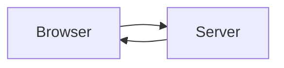

# Consumer setup — build a docsite from the published toolkit

**Audience.** An engineer standing up a net-new documentation site who has
`@spec-kitty/doc-toolkit` from the **GitHub Packages** registry and wants to wire
it exactly as an external adopter would — through the package's published entry
points only, with no reach into the toolkit's own source tree. If you are
migrating an *existing* Common Docs `docs/` tree instead, start at
[Adopting the toolkit](/guides/adopting/) and return here for the configuration
and theming detail.

Every step below references either a **published toolkit entry point**
(`@spec-kitty/doc-toolkit/*`) or a **file you own** in your own project
(`src/…`, `astro.config.mjs`). No step points at `@spec-kitty/doc-toolkit`
package internals or a repository-internal toolkit path — that constraint is the
reuse contract (SC-005) and is machine-checked by
`tests/consumption/scripts/assert-guide-no-internal-paths.mjs`.

> **This path is proven, not aspirational.** The consumption-test fixture builds
> this exact sequence from the *packed* tarball on every CI run: install →
> configure → theme → build, with a gate asserting no toolkit source is on the
> resolution path. Where this guide shows a file, the fixture ships the worked
> equivalent.

## Quick install

If you just want the commands, this is the whole of
[step 1](#1-authenticate-to-github-packages) and
[step 2](#2-install-the-toolkit-and-its-peers) in one place. The toolkit lives on
the **GitHub Packages** registry, so you need a GitHub token with `read:packages`
(while the package is private, your account must also have read access to
`spec-kitty/doc-kitty`). It takes **two** `.npmrc` files, because pnpm expands
`${ENV_VAR}` only in the user-level one:

```ini
# <project>/.npmrc   — maps the scope to the registry; no secret, commit it
@spec-kitty:registry=https://npm.pkg.github.com
```

```ini
# ~/.npmrc           — the credential; never commit this
//npm.pkg.github.com/:_authToken=${GITHUB_TOKEN}
```

```sh
export GITHUB_TOKEN=<your read:packages token>
pnpm add @spec-kitty/doc-toolkit@0.2.0 astro @astrojs/starlight @astrojs/sitemap
```

Getting `401 Unauthorized` from `pnpm add`? The usual causes: the `_authToken`
line is in the project `.npmrc` instead of `~/.npmrc` (pnpm ignores it there),
the token has no `read:packages` scope, or your account has not been granted
access to the package. The sections below walk through each step and then
configure, theme, and build the site.

## Prerequisites

- Node ≥ 22 (the package's `engines` floor) and pnpm (`corepack enable`).
- A GitHub account with a **personal access token** that has the `read:packages`
  scope. GitHub Packages never serves npm packages anonymously, even public ones,
  so you need this to install — see [step 1](#1-authenticate-to-github-packages).
- A project directory with a `docs/` tree that follows the
  [DocKitty](/context/convention/) (section folders, a
  `README.md` section index per folder, required frontmatter). An empty tree is
  fine — the site builds with whatever pages are present.

## 1. Authenticate to GitHub Packages

`@spec-kitty/doc-toolkit` is published to the **GitHub Packages** npm registry
(`npm.pkg.github.com`), not the public npm registry, and GitHub Packages never
serves a package anonymously. Authentication has two parts that belong in two
different files: **map the scope to the registry**, and **supply a
`read:packages` token**.

Put the scope mapping in a project-root `.npmrc`. It carries no secret, so commit
it with the repo:

```ini
# .npmrc  (project root — safe to commit)
@spec-kitty:registry=https://npm.pkg.github.com
```

Put the **token** in your *user-level* `~/.npmrc`, not the project file. pnpm
deliberately does **not** expand `${ENV_VAR}` in a credential read from a project
`.npmrc` — a committed file could otherwise leak the token to an
attacker-controlled registry — so a `_authToken=${GITHUB_TOKEN}` line in the
project `.npmrc` is silently ignored and the install fails with `401`. In the
user-level file the expansion works:

```ini
# ~/.npmrc  (user-level — pnpm expands env vars here)
//npm.pkg.github.com/:_authToken=${GITHUB_TOKEN}
```

```sh
export GITHUB_TOKEN=ghp_your_read_packages_token
```

Equivalently, store the token directly with
`pnpm config set "//npm.pkg.github.com/:_authToken" "<token>"` (it writes to
`~/.npmrc`). See [pnpm's `.npmrc` reference](https://pnpm.io/npmrc). (Plain `npm`
*does* expand env vars in a project `.npmrc`, so the single-file form still works
there — but this toolkit installs with pnpm.)

Create the token as a
[classic PAT with `read:packages`](https://docs.github.com/en/packages/working-with-a-github-packages-registry/working-with-the-npm-registry#authenticating-to-github-packages).
In GitHub Actions, use `actions/setup-node` with
`registry-url: https://npm.pkg.github.com` and `scope: '@spec-kitty'`, pass the
workflow's built-in token as `NODE_AUTH_TOKEN`, and grant
`permissions: packages: read` — setup-node writes the credential to a
runner-level npmrc, so the env expansion works there too. GitHub's reference is
[Installing a package](https://docs.github.com/en/packages/working-with-a-github-packages-registry/working-with-the-npm-registry#installing-a-package).

## 2. Install the toolkit and its peers

The toolkit declares Astro and Starlight as peers, so install them alongside it.
`@astrojs/sitemap` ships as a regular dependency of the toolkit, so listing it
yourself is optional; the command keeps it explicit, as the consumption-test
fixture does. Pin the version you want to track:

```sh
pnpm add @spec-kitty/doc-toolkit astro @astrojs/starlight @astrojs/sitemap
```

Pin a real release (for example `@spec-kitty/doc-toolkit@0.2.0`) rather than a
floating range so your build is reproducible against a known published surface.

## 3. `astro.config.mjs` — wire the integrations

Compose the toolkit's Astro integrations through the published `/config` entry
point. `defineDocKittyIntegrations` returns the integration array Starlight and
the feed/agent-API generators need:

```js
// astro.config.mjs
import { defineConfig } from 'astro/config';
import { defineDocKittyIntegrations } from '@spec-kitty/doc-toolkit/config';
import { myTheme } from './src/theme/index.ts'; // your consumer theme — see step 6

const SITE = 'https://you.example.com';
const BASE = '/docs'; // '' or '/' if you deploy at the domain root

export default defineConfig({
  site: SITE,
  base: BASE,
  integrations: defineDocKittyIntegrations({
    title: 'My Docs',
    description: 'What this documentation set is.',
    // MUST equal the site `base` above — the sitemap draft filter strips this
    // prefix to compare routes. The loader in step 4 must use the same value.
    base: BASE,
    theme: myTheme,
    markua: true,
    indexBasename: ['README', 'index'],
  }),
});
```

Two invariants to hold from the start:

- **`base` appears twice and must match** — once as Astro's `site`-level `base`,
  once inside `defineDocKittyIntegrations`. A based deployment (GitHub Pages, a
  sub-path) exercises the toolkit's base-prefix seam; a mismatch drifts the
  sitemap filter and feed URLs.
- **`indexBasename` is set here, once.** The docs loader in step 4, the scripts and
  the link check all read this value. Do not repeat it anywhere else
  ([ADR-0050](../adr/0050-route-collisions-and-single-index-setting.md)).

The generated glossary pages follow this setting. They are named `index.md` when
your list contains `index`, and otherwise take your first index name (`README.md`
for the default). You do not need to add `index` to the list for the glossary to
work. A `README`-only site gets its glossary hub as `glossary/README.md`, served at
`/glossary/`. The hub sits in the sidebar and lists its contexts like any other
section index.

**The sidebar is generated for you.** With no `sidebar` option, the toolkit
builds one from your section registry and your pages: nested folders are
labelled by their index page's title and ordered by its `sidebar.order`, and
each section's index comes first
([how pages appear in the sidebar](./authoring.md#how-your-pages-appear-in-the-sidebar)).
If you pass your own `sidebar` here, or through the `starlight` option, it is
rendered exactly as you wrote it. A `starlight.routeMiddleware` of your own runs
after the toolkit's, on the route data the toolkit has already shaped.

## 4. `src/content.config.ts` — register the collections

Register the `docs` collection Starlight expects, plus the two citation-catalog
data collections, from the published `/schema` entry point. Keep the loader
`base` equal to the integration `base` from step 3:

```ts
// src/content.config.ts
import { defineCollection } from 'astro:content';
import {
  docKittyDocsSchema,
  docKittyDocsLoader,
  docKittyBibliographySchema,
  docKittyBibliographyLoader,
  docKittyToolsSchema,
  docKittyToolsLoader,
} from '@spec-kitty/doc-toolkit/schema';

export const collections = {
  docs: defineCollection({
    // `base` MUST match astro.config.mjs. Leave `indexBasename` out: the loader
    // reads it from defineDocKittyIntegrations, and a different value stops the build.
    loader: docKittyDocsLoader({ base: 'docs' }),
    schema: docKittyDocsSchema(),
  }),
  bibliography: defineCollection({
    loader: docKittyBibliographyLoader(),
    schema: docKittyBibliographySchema(),
  }),
  tools: defineCollection({
    loader: docKittyToolsLoader(),
    schema: docKittyToolsSchema(),
  }),
};
```

The loader `base: 'docs'` is the *content root* (where your `docs/` tree lives),
which is independent of the *URL* `base` (`/docs`) from step 3 — the former tells
the loader where to read files, the latter tells Astro where the site is served.

**Use `docKittyDocsLoader` for the `docs` collection.** It is where draft pages
are left out of a build that sets `DK_PUBLISH_DRAFTS=off` (step 7). A site that
loads `docs` another way builds its drafts with that setting too, and gets a
warning at the end of the build.

## 5. `src/pages/*` — add the route endpoints

The feeds and agent-API are Astro route endpoints you own, each delegating to a
published `/routes` factory. Add these files under `src/pages/`:

```ts
// src/pages/rss.xml.ts
import { rssRoute } from '@spec-kitty/doc-toolkit/routes';
export const GET = rssRoute({ title: 'My Docs', description: 'Documentation updates.' });
```

```ts
// src/pages/llms.txt.ts
import { llmsTxtRoute } from '@spec-kitty/doc-toolkit/routes';
export const GET = llmsTxtRoute({ title: 'My Docs', description: 'What this documentation set is.' });
```

```ts
// src/pages/api/index.json.ts
import { agentIndexRoute } from '@spec-kitty/doc-toolkit/routes';
export const GET = agentIndexRoute({ title: 'My Docs' });
```

```ts
// src/pages/api/bibliography.json.ts
import { bibliographyRoute } from '@spec-kitty/doc-toolkit/routes';
export const GET = bibliographyRoute();
```

If you turn on generated Gherkin feature pages (the `gherkin` option with
`sources`), there is no route file to add: the integration serves
`/api/scenarios.json` itself, using the `sourceRoot` and `sourceUrlPrefix` you gave
`gherkin`. A site that already has `src/pages/api/scenarios.json.ts` can keep it;
the integration then leaves it alone. If you later remove the `gherkin` option but
keep the generated pages, mount `scenarioIndexRoute()` there yourself.

If you publish reveal.js slide decks (`kind: Presentation` pages under
`presentations/`), add the out-of-frame deck route. It wires the deck layout and
slug helper from their published entry points:

```astro
---
// src/pages/presentations/[...slug].astro
import { getCollection } from 'astro:content';
import type { CollectionEntry } from 'astro:content';
import DeckLayout from '@spec-kitty/doc-toolkit/layouts/DeckLayout.astro';
import { deckRouteParams } from '@spec-kitty/doc-toolkit/deck/deck-slug';

export const prerender = true;

export async function getStaticPaths() {
  const decks = (await getCollection('docs')).filter(
    (entry) => entry.data.kind === 'Presentation' && entry.id.startsWith('presentations/'),
  );
  return decks.map((entry) => ({ params: deckRouteParams(entry), props: { entry } }));
}

interface Props { entry: CollectionEntry<'docs'>; }
const { entry } = Astro.props as Props;
---

<DeckLayout entry={entry} />
```

The route yields nothing until you author a deck, so wiring it early costs
nothing and proves the deck exports resolve.

## 6. A consumer theme — refine `--dk-*`, never `--sl-*`

A consumer theme is a **declarative data record**: it `extends` a brand (or the
shipped default) and shallow-overrides a subset of `--dk-*` tokens the toolkit
folds over the brand, then over the default. There are exactly two placements,
and which one a value takes is decided by whether it varies between light and
dark mode.

**Mode-invariant values** (a font family, a radius, a tracking value that is the
same in both modes) go in the object `tokens` map. The object form is
mandatory here: a string css-path token form would be imported at the *top* of
the generated sheet and then overridden by the later generated `:root`,
inverting consumer precedence.

```ts
// src/theme/index.ts
import { specKittyTheme } from '@spec-kitty/doc-toolkit/themes/spec-kitty/index.ts';
import type { DocKittyOptions } from '@spec-kitty/doc-toolkit/config';

// `DocKittyTheme` is named via the one published surface that carries it — the
// `theme` option of `defineDocKittyIntegrations` — so the theme stays on the
// package's public exports only.
type DocKittyTheme = NonNullable<DocKittyOptions['theme']>;

export const myTheme: DocKittyTheme = {
  name: 'press',
  extends: specKittyTheme, // or omit `extends` to layer straight over the default
  tokens: {
    '--dk-font-display':
      '"Iowan Old Style", "Palatino Linotype", Palatino, "Book Antiqua", Georgia, ui-serif, serif',
    '--dk-radius-md': '0.125rem',
    '--dk-tracking-caps': '0.2em',
  },
  customCss: ['./src/theme/press.css'],
};

export default myTheme;
```

**Mode-varying colour** (surfaces, heading ink, and any accent group the brand
restates per mode) cannot live in the object map — one value per key would
re-emit the light value in dark. It ships in a `customCss` sheet you own, under
**both** `:root` and `:root[data-theme='dark']`:

```css
/* src/theme/press.css */
:root {
  --dk-color-surface-1: #faf7f0;
  --dk-color-text-strong: #1a1410;
  --dk-color-accent: #a6231f;
  --dk-color-accent-text: #ffffff;
}
:root[data-theme='dark'] {
  --dk-color-surface-1: #232019;
  --dk-color-text-strong: #f4efe6;
  --dk-color-accent: #a6231f;
  --dk-color-accent-text: #ffffff;
}
```

Both blocks are mandatory: the toolkit layers your sheet after its generated
token sheet, so a bare `:root` override wins in light by source order — but the
generated sheet re-declares every mode-varying key under its own
`:root[data-theme='dark']` block (specificity `0,2,0`), which out-ranks a bare
`:root` in dark regardless of load order. Matching that selector is what makes
your value win in both modes.

**Never set a `--sl-*` key.** A theme addresses `--dk-*` tokens only; the
`--dk-*` → `--sl-*` bridge is toolkit-owned, and the theme merge rejects a
`--sl-*` key. A distinct set of at least five `--dk-*` overrides is what proves
the consumer layer actually won the cascade in the built output.

### Cap the page width

The page frame holds the sidebar, the reading pane and the "On this page" rail.
The reading pane is the area between sidebar and rail; the reading column is the
text block centred in it, at most 720px. The frame spans the viewport by
default. To cap it, set one token on `:root` in the same sheet:

```css
/* src/theme/press.css */
:root {
  --dk-width-frame: 90rem;
}
```

| | |
|---|---|
| Token | `--dk-width-frame` |
| What it does | sets the width of the page frame |
| Default | `100%` (full width) |
| Accepts | a length (`90rem`, `1440px`) or a percentage (`80%`) |
| Applies from | a 50rem (800px) viewport; below it the frame is never capped |
| Invalid value | behaves as `100%` |

What follows a cap that is narrower than the viewport:

- the frame is exactly that wide and centred;
- the sidebar starts at the frame's start edge, not the viewport's;
- the header bar still spans the viewport, and its content is padded so it lines
  up with the frame's edges;
- the rail ends at the frame's end edge, and its collapse toggle stays on the
  rail's edge;
- on a right-to-left page all of this is mirrored.

With `--dk-width-frame: 90rem` on a 1920px viewport the frame is 1440px wide,
from 240px to 1680px.

Four things to know:

- **Set it on `:root`.** The gutter beside a capped frame is computed on
  `:root`, and the sidebar, the header content and the toggle are moved in by
  it. A token set on an inner element caps the frame and leaves those three at
  the viewport edge.
- **An invalid value is harmless.** The token is a registered property, so
  `--dk-width-frame: banana` behaves as `100%` and the layout is the default.
- **The rail keeps one width.** From a 72rem (1152px) viewport the rail is as
  wide as the sidebar (18rem, 288px). The reading pane takes the rest of the
  frame; its column is at most 720px. With the default frame the column is
  528px at a 1152px viewport, 656px at 1280px and 720px from 1600px.
- **Very wide screens may want a cap.** With the default, the sidebar and the
  rail sit at the two edges of the viewport. On a 2560px screen that leaves the
  720px column centred in a 1984px reading pane. A cap such as `90rem` keeps
  the three together.

The decision and the measurements behind it are in
[ADR-0045](../adr/0045-frame-width-token.md).

### Replace the site header

A theme can supply its own header component through the `dk:site-header` slot.
The toolkit renders it in place of the stock header; a theme that sets no such
slot keeps the stock header unchanged. A replacement must put back the parts it
still wants (site title, search, theme select). See
[Theme header](./theme-header.md).

## 7. Build

```sh
astro build
```

`dist/` then contains the rendered site plus `sitemap*.xml`, `rss.xml`,
`llms.txt`, and the `api/*.json` agent-API. Deploy `dist/` to any static host;
a based deployment (a sub-path) is covered by the `base` you set in step 3.

**Set `DK_PUBLISH_DRAFTS=off` in the build that deploys your live site.** A
page with `doc_status: draft` (or no `doc_status`) is a draft. By default a
build writes the page, lists it in the sidebar, marks it `noindex` and leaves it
out of site search. With `DK_PUBLISH_DRAFTS=off` the page is not built and not
listed. The sitemap, `rss.xml`, `llms.txt` and `api/index.json` never list a
draft, with either value. Set the value in the deploy job's environment, or
commit a `.env.production` file containing `DK_PUBLISH_DRAFTS=off`, which
`astro build` reads and `astro dev` does not. The values, the env-file order
and a deployment check are in [Draft publication](./draft-publication.md).

### Run the gates on your tree

The toolkit ships its bare-Node gates as package binaries, so run them through
your package manager rather than by a path into `node_modules`:

```sh
pnpm exec dockitty-validate-frontmatter docs
pnpm exec dockitty-check-links docs --strict
astro build && pnpm exec dockitty-assert-no-broken-links dist --base /docs --site https://you.example.com
```

The gates read your index names from the `indexBasename` in `astro.config.mjs`, so
they agree with the build. `dockitty-check-links` prints where it got them, once per
root:

```text
index names: README,index (from astro.config.mjs)
```

With no site config next to the root, the check warns on stderr
(`no astro.config.* found for <root>; assuming index names README`) and uses
`README`, the build's default. If your config lives elsewhere, for example because
`docs` sits two folders below the site, pass `--astro-config <path>`. With several
roots the option applies to every strict root. A path that does not exist, or a
config that cannot be loaded, makes the command exit with status 2. Reading the
config takes about one second per run. The same holds for
`dockitty-validate-frontmatter`, `dockitty-check-redirect-coverage`,
`dockitty-generate-feature-pages`, `dockitty-new-doc` and `dockitty-scaffold`, which
all print the same `index names:` line and accept `--astro-config`.

`DK_INDEX_BASENAME` is internal: `defineDocKittyIntegrations` sets it, and you must
not set it by hand.

The other binaries are `dockitty-check-redirect-coverage`,
`dockitty-validate-catalog`, `dockitty-new-doc`, `dockitty-scaffold`, and
`dockitty-generate-feature-pages` (see
[Gherkin feature pages](#optional-gherkin-feature-pages) below). The same files are
also importable as `@spec-kitty/doc-toolkit/scripts/<name>.mjs`.

**Links between pages.** You can write either form. A root-absolute route such as
`/guides/setup/` works as it did. A relative link to another page's Markdown file,
such as `[setup](../guides/setup.md)` or `[setup](./setup.md#install)`, is now
rewritten to that page's route at build, with your `base` applied, and it also
works when a reader opens the file on GitHub. The link is resolved from the folder
of the file that holds it. Only `.md` and `.mdx` targets are rewritten. A link the
build cannot resolve is left as you wrote it, and `dockitty-assert-no-broken-links`
reports it after the build. That covers a target that is not a page (such as a log
file), a draft that is not published, and a path that leaves the docs tree. Raw
HTML anchors are not rewritten. After you rename a page, restart the dev server.

**What `dockitty-check-links` checks.** It reads a root one of two ways.

- **Without `--strict`, a root is read as files**, the way GitHub shows a
  repository's own `docs/` folder. A relative link, a reference-style definition
  (`[label]: target`) or a `related:` ref passes when the file or folder it names
  exists. A missing target is dangling. Nothing else is reported, and draft status
  is not consulted.
- **With `--strict`, a root is read as a built site.** A relative `.md` or `.mdx`
  link passes only when the build would turn it into a route. It uses the same
  function as the build, so it needs your site's index names. It also reports:
  - a link to a file that is not a published page, such as a log file;
  - a path that goes up out of the docs folder and comes back in;
  - a link to an existing file outside the docs tree;
  - a link with a malformed `%` escape;
  - a link to a folder that has no index page;
  - a bare relative link with no extension;
  - a link to a draft page, when drafts are not published (set
    `DK_PUBLISH_DRAFTS=off` for that check).

  A folder link is answered from the route table. A `related:` ref is matched
  against page ids, as the build does. A root-absolute link is checked only for a
  draft target; whether its route exists is left to the built-link gate. Lookup is
  case-sensitive, as in the build.

Pass `--strict` for a site you build with the toolkit, as in the command above.
`example/docs` in the toolkit's own repository is always strict. If an Astro config
file sits next to a root that is not strict, the command prints one note that the
folder looks like a built site and that `--strict` makes the check agree with the
built-link gate. The note does not change the exit code.

`--index-basename` is optional. If you pass it, it must list the same names as your
`astro.config.mjs` (order and letter case are ignored, and the config's order wins),
or the command exits with status 2. A name that is not a plain file name, the
`--name=value` form and an unknown option also exit with status 2. `--help` lists
the options.

**Two files on one address stop the build.** If `guide/README.md` and
`guide/index.md` both exist, or `page.md` beside `page.mdx`, or two pages whose
addresses differ only by letter case, the build, `dockitty-check-links --strict` and
`dockitty-validate-frontmatter` stop and name every file and the address. Drafts
count. The message looks like this:

```text
[dk-routes] 1 route collision(s) in docs: two or more files would be served at the same address.

  /guide/
    docs/guide/README.md
    docs/guide/index.md

Each address can hold one page. Rename or remove all but one file in each group
(for example rename docs/guide/index.md to docs/guide/overview.md), or merge their content.
```

Rename or remove all but one file in each group. Markdown under a `_meta/` folder,
or named `_meta.md`, is not a page: it is not published, linked or checked.

## 8. Govern your docs — the documentation charter

Everything above renders and validates a *default* docsite. To change what
governs your tree — the vocabulary, the sections, the status set, the required
fields — author a single optional file, `docs/_meta/charter.yaml`. It is the one
authoritative surface; an absent or empty charter resolves to the shipped
defaults with no error, and it needs no Spec Kitty runtime to resolve
([ADR-0042](/adr/0042-native-documentation-charter/)). Each axis is independent —
declare only the ones you want to change.

```yaml
# docs/_meta/charter.yaml
version: 1
vocabulary:
  types:
    aliases:   { Feature: Capability }
    forbidden: [ Feature ]
statuses:
  add: [ deprecated ]
required_fields:
  optional: [ updated ]
sections:
  entries:
    - { id: context,      label: Context,          order: 10, type: Context }
    - { id: architecture, label: Architecture,     order: 20, type: Architecture }
    - { id: adr,          label: Decision Records, order: 30, type: ADR }
    - { id: guides,       label: Guides,           order: 40, type: Guide }
```

The governable dimensions:

- **Vocabulary — `type` / `kind`** (*overridable*). Alias, forbid, or pass
  through terms over the canonical sets. A forbidden authored `type` hard-fails
  the gate; an unknown-but-not-forbidden value warns.

  ```yaml
  vocabulary:
    types: { forbidden: [ Feature ], aliases: { Feature: Capability } }
    kinds: { aliases: {}, forbidden: [] }
  ```

- **Sections / information architecture — `sections`** (*overridable*). The section
  registry lives under `sections.entries` — a list of records with the same shape as
  the legacy `_meta/sections.yaml` entries (`id`, `label`, an integer `order`, `type`,
  optional `feeds`, `purpose`, and sub-path `subtypes`). Order is the per-entry
  integer `order` (ascending), not a list of ids. The section-index basename is
  configured in `astro.config.mjs` (`indexBasename`), not in the charter.

  ```yaml
  sections:
    entries:
      - { id: context, label: Context, order: 10, type: Context, purpose: "Why we exist", feeds: [rss] }
      - { id: guides,  label: Guides,  order: 20, type: Guide }
  ```

- **Statuses — `statuses.add`** (*overridable, extend-only*). You may **add**
  values to `doc_status`; the canonical set (`draft`, `active`, `deprecated`,
  `superseded`, `durable`) is reserved. Removing or aliasing-away a canonical
  status fails closed. An unknown-and-not-added status on a page warns.

  ```yaml
  statuses:
    add: [ archived ]
  ```

- **Required-field floor — `required_fields.optional`** (*overridable, with a
  floor*). Relax listed required fields for your consumer — **except `title`**,
  which is always required. Listing `title` fails closed with a floor message.

  ```yaml
  required_fields:
    optional: [ updated ]
  ```

A malformed charter fails the build naming the file and offending key; an unknown
*top-level* key only warns. If you already run a legacy `_meta/vocabulary.yaml`
or `_meta/sections.yaml`, both keep working (you will see one deprecation notice)
— consolidate them with [Migrating to the charter](/guides/migrating-to-charter/).

## Optional: Diagrams

The `diagrams` option decides whether ```` ```mermaid ```` and ```` ```plantuml ````
blocks are drawn as diagrams.

- **`diagrams: true`** draws them.
- **Left out, or `diagrams: false`** (the default), shows them as code blocks.
  Nothing is drawn, in the build or in the browser.

`false` does not mean "render in the browser". Where a diagram is drawn is a
separate choice, the render mode, described below.

### Turn diagrams on

Add one line to the options from [step 3](#3-astroconfigmjs--wire-the-integrations):

```js
// astro.config.mjs
integrations: defineDocKittyIntegrations({
  title: 'My Docs',
  base: BASE,
  diagrams: true,
}),
```

Then write a Mermaid block in any page. The two `%%` lines are optional. They
give the diagram an accessible name and a caption:

````markdown

````

Mermaid needs nothing else. Build, and the block is drawn.

### Render modes

With `diagrams: true`, each build draws diagrams in one of two modes:

| Mode | What ships | Needs |
|---|---|---|
| **build** | An inline SVG in the page, drawn at build time. No diagram script is sent to the browser. | Playwright and its Chromium, installed where the build runs |
| **client** | The diagram source in the page plus one script that draws it in the browser. | Nothing extra |

The build picks the mode itself. When it finds a Playwright Chromium, it uses
build mode. Otherwise it uses client mode, so a build never fails for lack of a
browser. The toolkit does not install Playwright, so a fresh site uses client
mode until you add it.

To pin a mode, set `DK_DIAGRAM_BUILD_RENDER` in the build's environment:

- `DK_DIAGRAM_BUILD_RENDER=client` always uses client mode. `0`, `off`, `no`
  and `false` do the same.
- `DK_DIAGRAM_BUILD_RENDER=build` always uses build mode. `1`, `on`, `yes` and
  `true` do the same. A pinned build mode does not fall back: without Chromium,
  the build fails.
- Any other value is ignored: the build picks the mode as if the variable were
  not set.

Set `client` in a CI job that has no Chromium. The site then renders the same
way on every runner, whatever happens to be installed on it.

### PlantUML

PlantUML blocks are drawn in build mode only. In client mode a
```` ```plantuml ```` block stays a code block.

Build mode sends each PlantUML block to a PlantUML server that you run, for
example the `plantuml/plantuml-server` container. Set its SVG endpoint in
`DK_PLANTUML_SERVER_URL`, including the trailing `/svg/`:

```sh
DK_DIAGRAM_BUILD_RENDER=build \
DK_PLANTUML_SERVER_URL=http://localhost:8091/svg/ \
astro build
```

When the variable is unset, the build uses `http://localhost:8091/svg/`. A
`plantuml.com` URL stops the build, because the public server would receive
your diagram source.

How the two modes are built, and why, is in
[Diagrams](../architecture/diagrams.md) and
[ADR-0040](../adr/0040-build-time-diagram-render-dual-mode.md).

## Optional: Gherkin feature pages

If your repository keeps behaviour specs in Gherkin `.feature` files, the
`gherkin` option can publish each feature as a `kind: Specification` page, and
render Gherkin inside any page: a ```` ```gherkin ```` fence as a structured
scenario, and a `::gherkin{src="…"}` directive as an include of a `.feature`
file. It is off unless you set it, and with it unset the build is unchanged. The
design is in [ADR-0046](../adr/0046-gherkin-feature-pages.md),
[ADR-0051](../adr/0051-gherkin-in-any-page.md) and
[Gherkin feature pages](../architecture/gherkin-pages.md); how to write the files
and the fences is in [Authoring behaviour specs](./authoring.md#authoring-behaviour-specs)
and [Gherkin in any page](./authoring.md#gherkin-in-any-page).

The option takes `true` or an object:

```js
// astro.config.mjs (inside defineDocKittyIntegrations({ … }))

// Fences only: fences render, no generated pages, and every include is refused.
gherkin: true,

// Generated pages, fences and includes:
gherkin: {
  sources: ['../features'],    // walked for *.feature, relative to the site root
  section: 'behaviour',        // default; pages land in docs/behaviour/
  includeRoots: ['../features', '../tests/scenarios'], // default: sources
  sourceRoot: '..',            // report source paths relative to the repo root
  sourceUrlPrefix: 'https://github.com/you/repo/blob/main/',
  titles: { hr: 'HR' },        // hub title for ../features/hr/ (default: "Hr")
},
```

| Key | Default | What it does |
|-----|---------|--------------|
| `fences` | `true` | Renders ```` ```gherkin ```` fences and `::gherkin` includes on your pages. `false` leaves fences as code blocks and includes as literal text, so `{ sources, fences: false }` publishes generated pages and leaves authored pages exactly as before. |
| `includeRoots` | `sources`, else none | The only directories a `::gherkin{src=…}` include may read, relative to the site root. They must be relative paths. An include's `src` is relative to the project root, not to the page, and must sit inside one of these roots. With none (`gherkin: true` turns on fences only), every include fails the build: at the end of `astro build`, and in `astro dev` it is logged and the page fails to render. A root that does not exist is reported by each include whose `src` lies below it, not at startup, so a site with no such include builds with it. An include reads only `.feature` files. |
| `sources` | none | Directories walked recursively for `*.feature`, relative to the site root (`process.cwd()`). Setting it turns on generated pages and the `behaviour` section. Dot-directories and `node_modules` are skipped. A missing directory fails the build. |
| `section` | `behaviour` | The folder under your docs directory the pages are generated into. It must be a single folder name and can't be `glossary` or `_meta`. Only valid with `sources`. |
| `sourceRoot` | the site root | The directory each page's `sources:` path is relative to. Set `'..'` when the site lives in a sub-package and the features are elsewhere in the repo. |
| `sourceUrlPrefix` | none | Prefixed verbatim to that path, so `sources:` links to the file in your repository browser. Without it, `sources:` holds the bare relative path. An include's source line links the same way. |
| `allowEmpty` | `false` | Lets the build remove the generated pages when no source yields a feature. Leave it off unless you removed the features on purpose. Must be `true` or `false`, and only valid with `sources`. |
| `titles` | none | Hub titles by source directory, for names a directory can't spell: `{ hr: 'HR', 'shipping/edi': 'EDI messages' }`. A key is the directory relative to its source, as written on disk; the title replaces the directory name in the hub and its sidebar group. A key that matches no directory with a feature warns. Keys must be plain relative paths and titles non-blank strings. Only valid with `sources`. |
| `results` | none | A Cucumber report (Messages NDJSON or JSON) whose results are shown next to every scenario rendered from a `.feature` file. A path relative to the site root, or `{ report, root }` with `root` the directory Cucumber ran in. See [Gherkin: test results](#gherkin-test-results). |

An unknown key, a non-boolean `fences`, `section`, `allowEmpty` or `titles`
without `sources`, and any value other than `true` or an object (including
`false`) fail the build.

**Existing `{ sources }` sites:** from this release, ```` ```gherkin ```` fences on
your authored pages render as scenarios too. Add `raw` to a fence's info string
(```` ```gherkin raw ````) to keep it as code, or set `fences: false`. A
`::gherkin{…}` line, which used to print as text, is now an include read from
`includeRoots` (by default your `sources`). Generated pages show quoted
arguments, in step text and table cells, as code, so regenerate them once: until then the `--check` gate reports
the drift.

What happens on each build and dev-server start with `sources`:

- Every `.feature` is parsed once. A syntax error fails the build with
  `[dk-gherkin] <path>:<line>:<col>`, listing every error in every file.
- One page per feature (drafts included) and one hub per directory that holds a
  feature are written into `docs/<section>/`, and pages whose source is gone are
  removed. A directory whose features are all drafts gets a draft hub: it is built
  only when drafts are, and no published hub links it. The hub file is the
  first entry of `indexBasename` (`README.md` by default). A feature file named
  `index.feature` is rejected on any setting.
- The section belongs to the generator. Any file in it without the generator's
  `generated.by` stamp fails the build, so don't point `section` at an authored
  folder.
- If no source yields a feature and generated pages already exist, the build
  stops and removes nothing. The usual cause is a source directory that is not
  checked out, such as a git submodule that was never initialised: run
  `git submodule update --init`. If you did remove the features, set
  `allowEmpty: true` for one build to delete the pages, then remove the setting.
  A first run with no pages, and a set where only some directories are empty, are
  not affected.

Register the section so it gets a label, a sidebar group and its
`type: Specification`. Add an entry wherever your section registry lives, under
`sections.entries` in `docs/_meta/charter.yaml` (step 8) or in a legacy
`docs/_meta/sections.yaml`:

```yaml
- { id: behaviour, label: Behaviour, order: 38, type: Specification }
```

**Commit the generated pages.** The bare-Node gates (frontmatter, links) read
files on disk, and reviewers see how a spec change changes the page. Then guard
them in CI with the `--check` mode of `dockitty-generate-feature-pages`, which
writes nothing and exits 1 when the committed pages differ from the sources. The
script reads your index names from `astro.config.mjs`, so you do not pass
`--index-basename`:

```sh
# Regenerate locally without a build:
pnpm exec dockitty-generate-feature-pages --sources ../features --docs docs \
  --section behaviour --source-root .. \
  --source-url-prefix https://github.com/you/repo/blob/main/ --titles hr=HR

# CI drift gate (same flags, plus --check):
pnpm exec dockitty-generate-feature-pages --sources ../features --docs docs \
  --section behaviour --source-root .. \
  --source-url-prefix https://github.com/you/repo/blob/main/ --titles hr=HR --check
```

Run it from the site directory, or pass `--root <site dir>`; every other path is
relative to that root. `--help` (or `-h`) prints the flags. `--check` lists each `added`, `changed`, `stale` or
`authored` path it finds. Add `--allow-empty` to remove the pages when no source
yields a feature, the command-line twin of `allowEmpty`. Pass one
`--titles <dir>=<title>` per entry of `titles`, and quote a title with spaces:
`--titles "shipping/edi=EDI messages"`. `--check` is not affected:
with empty sources and pages present it already exits 1 and lists them as `stale`.

To turn the feature off, remove the option **and** delete `docs/<section>/`.
Removing only the option leaves the last generated pages in place, still building
as ordinary content.

### In-page Gherkin: errors and caching

A fence that does not parse, or an include whose file, scenario or tag cannot be
found, fails `astro build` with a `[dk-gherkin] <page>:<line>` error that lists
every broken page. Astro's content loader on its own only logs a page's render
error and builds the page empty, so the toolkit collects these errors and fails
the build in `astro:build:done`.

- **A broken page is never served from the content cache.** In a collection
  loaded by `docKittyDocsLoader`, a page whose Gherkin failed is rendered again
  on every later build, so building again, building after `astro sync` or
  `astro check`, and restarting the dev server all show the error again until
  the page is fixed. Only the broken pages re-render.
- **Other collections: the cache is reset after a failure.** For a page in a
  collection on another loader (such as Astro's plain `glob()`), a failed build
  deletes the content layer's data store (`<cacheDir>/data-store.json`, by
  default `node_modules/.astro/data-store.json`), so the next build re-renders
  every page and fails again; that build is a full one. Running `astro sync` or
  `astro check` before `astro build` is not covered there: the build can pass
  with the page empty. Load such pages with `docKittyDocsLoader` if you run a
  sync first.
- **Changing an included file re-renders the pages that include it**, in a build
  and in the dev server, even though their own text did not change (this too
  needs `docKittyDocsLoader`).

### Gherkin: test results

`gherkin.results` shows each scenario's last result from the Cucumber report your
CI writes ([ADR-0055](../adr/0055-gherkin-scenario-results.md); what readers see is
in [Show test results](./authoring.md#show-test-results)).

```js
gherkin: {
  sources: ['../features'],
  sourceRoot: '..',
  // Cucumber ran in the repo root, so its URIs are relative to '..':
  results: { report: '../reports/cucumber.ndjson', root: '..' },
},
```

- **Produce the report before the docs build**, in the same CI job or as a
  downloaded artifact: `cucumber-js --format message:reports/cucumber.ndjson`
  (cucumber-jvm: `--plugin message:reports/cucumber.ndjson`). Cucumber JSON
  (`--format json`) also works. Use one report: merge the reports of several runs
  first.
- **`root` is where Cucumber ran.** Relative URIs in the report resolve against
  it. A report with absolute paths from another machine is matched by the end of
  each path, when exactly one file matches.
- **A missing report** logs `[dk-gherkin] gherkin.results report not found` and the
  site builds without results. **An unreadable one** (not a file, over 64 MiB, not
  a Cucumber report) fails the build, naming the report and line.
- **A stale report** (made from another version of a file) shows no result for that
  file and logs a warning naming it. Run the tests and the docs build from the same
  commit.
- **Generated pages are unaffected on disk.** Results are added when a page
  renders, so committed pages and the `--check` gate do not change.
- **The scenario index:** pass the same value to `scenarioIndexRoute({ results })`
  so `/api/scenarios.json` carries the results too.
- **Freshness:** with `docKittyDocsLoader`, a changed report re-renders the pages
  that show results, in a build and in the dev server.
- **Keep the report out of `public/`.** It holds failure messages and paths; only
  status words reach your pages.

## Upgrading from 0.2.0

The release after 0.2.0 is 0.3.0. These are the changes you may notice:

- **Links you already wrote as site routes keep working.** You need no change.
- **The source link check also reads reference-style definitions.** A
  `[label]: target` line whose target does not exist is now reported, on every
  root. Nothing else changes for a root you do not pass `--strict`. If your docs
  are built as a site, add `--strict`: the check then agrees with the built-link
  gate, and it reports links the build cannot rewrite, such as a link to a file
  that is not a page, a path that leaves the docs folder, a folder with no index
  page, and a link to a draft. Expect new reports the first time you run it.
- **Glossary pages may be renamed.** If your `indexBasename` does not contain
  `index`, the generated glossary pages are now named with your first index name
  (`README.md` for the default). The build removes an old `index.md` page only when
  it is the generator's own output: the right `kind`, exactly the generator's
  frontmatter keys, and content identical to the page the generator just wrote. When
  the glossary source has not changed since your last build, the old pages go
  without a message. When it has changed, the old pages whose content changed
  stay, and the build warns for each. Delete them. A page with the generator's `kind` but
  other keys is also kept with a warning, and so is a page with the generator's keys
  and different content. A page of a different `kind` stays with no warning. Two
  kinds of old page also stay, with no message: a page in the folder of a context
  that no longer exists, and a page under a name that is no longer one of your index
  names. If your site commits its generated glossary pages, commit the renamed
  files.
- **The glossary build stops in three more cases.** A page you wrote, or a symbolic
  link, at a path the generator needs: move or rename it. A symbolic link at
  `glossary/` or at a context folder: replace it with a real folder. An index name
  that is not a plain file name (one path segment, no `/` or `\`, no leading `.`,
  no surrounding whitespace). The build names the path or the value, and writes
  nothing first.
- **Empty Gherkin sources now stop the build.** A site that relied on empty
  sources pruning its pages must set `gherkin.allowEmpty: true`, or pass
  `--allow-empty`, for the build that should delete them.

## What you referenced

Every entry point above is part of the toolkit's published surface:

| What | Published entry point |
|---|---|
| Integration array | `@spec-kitty/doc-toolkit/config` |
| Collection schemas + loaders | `@spec-kitty/doc-toolkit/schema` |
| Feed / agent-API route factories | `@spec-kitty/doc-toolkit/routes` |
| Deck layout + slug helper | `@spec-kitty/doc-toolkit/layouts/…`, `@spec-kitty/doc-toolkit/deck/…` |
| Brand theme to extend | `@spec-kitty/doc-toolkit/themes/…` |
| Docs gates (frontmatter, links, built links, …) | `dockitty-*` binaries, `@spec-kitty/doc-toolkit/scripts/…` |

Everything else (`astro.config.mjs`, `src/content.config.ts`, `src/pages/**`,
`src/theme/**`, your `docs/` tree) is a file you own. Nothing reaches into the
toolkit's package internals or a repository-internal toolkit path — which is the
whole point.
