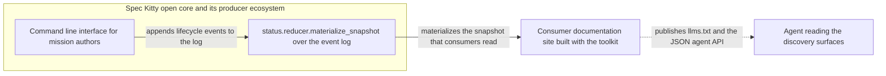
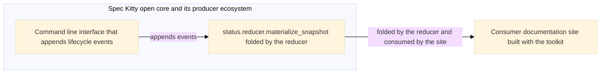
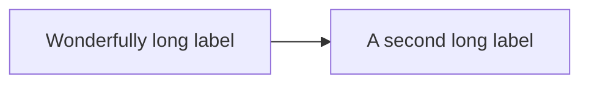
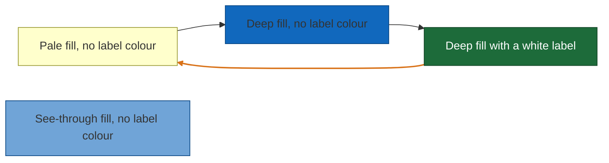
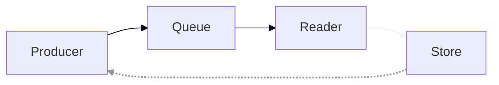

# Diagram contrast fixture

This page is a test fixture, kept as a draft so it is built for the browser
checks and never published. Its diagrams use the shapes that broke on a
consumer site: long labels, colours set by the author, and an ArchiMate view.
The checks measure each label and edge here in the light and the dark theme.

## Long labels

Every label below is long enough to wrap or to fill its box. A label must fit
inside its box: none may be cut off.



The next diagram sets its own font and size in an init directive, as many
hand-written diagrams do. Its labels must fit too.



The next diagram asks for a serif font. A serif font is narrower than the
toolkit's label font, so a box measured in it would be too small for the label.
It has a single edge, which an SVG optimizer could otherwise restyle.



## Author-set colours

The author sets each node's fill here. Two nodes set only a fill, so the
toolkit picks the label colour. One sets both a fill and a label colour, and
the author's choice stands. One fill is see-through, so the page shows through
it and its label follows the theme. The last edge carries an author-set colour.



## Author-set edge colours

This diagram sets its edge colour in an init directive, as one consumer diagram
does, and two edges set their own colour, one pale and one mid-grey. A dark edge
colour vanishes on the dark page, a pale one on the light page, and a mid-grey
one fades on whichever surface is closest to it in brightness. Each edge keeps the author's colour
where it is readable, and takes the theme's edge colour where it is not.



## ArchiMate view

ArchiMate colours each element by its layer: business elements are pale
yellow, application elements pale blue and technology elements pale green.
Those fills stay the same in both themes, so their labels must stay dark.

```plantuml
' title: Gate distribution (ArchiMate)
' description: An operator uses a built-in pack, which serves the gate definitions that run on the operator machine.
archimate #Business "Operator" as op <<business-actor>>
archimate #Application "built-in pack (trusted by position)" as pack <<application-component>>
archimate #Technology "Operator machine" as machine <<technology-node>>
archimate #Technology "Deterministic governed checks" as checks <<technology-system-software>>
op --> pack : uses
pack --> checks : serves
checks --> machine : runs on
```
