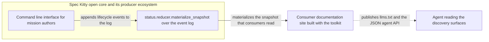
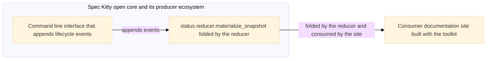
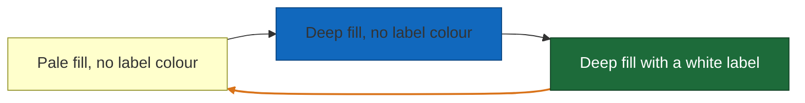

# Diagram contrast fixture

This page is a test fixture, kept as a draft so it is built for the browser
checks and never published. Its diagrams use the shapes that broke on a
consumer site: long labels, colours set by the author, and an ArchiMate view.
The checks measure each label and edge here in the light and the dark theme.

## Long labels

Every label below is long enough to wrap or to fill its box. A label must fit
inside its box: none may be cut off.



The next diagram sets its own font and size in an init directive, as many
hand-written diagrams do. Its labels must fit too.



## Author-set colours

The author sets each node's fill here. Two nodes set only a fill, so the
toolkit picks the label colour. One sets both a fill and a label colour, and
the author's choice stands. The last edge carries an author-set colour.



## ArchiMate view

ArchiMate colours each element by its layer: business elements are pale
yellow, application elements pale blue and technology elements pale green.
Those fills stay the same in both themes, so their labels must stay dark.

```plantuml
' title: Gate distribution (ArchiMate)
' description: An operator uses a built-in pack, which serves the gate definitions that run on the operator machine.
archimate #Business "Operator" as op <<business-actor>>
archimate #Application "built-in pack (trusted by position)" as pack <<application-component>>
archimate #Technology "Operator machine" as machine <<technology-node>>
archimate #Technology "Deterministic governed checks" as checks <<technology-system-software>>
op --> pack : uses
pack --> checks : serves
checks --> machine : runs on
```
