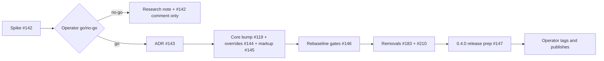

# Mission Specification: Astro 7 and Starlight 0.41 migration

**Mission Branch**: `claude/ecstatic-mccarthy-pm655w`
**Created**: 2026-10-18
**Status**: Draft
**Input**: Operator brief (session prompt, 2026-10-18), epic #149 and children #142, #143, #119, #144, #145, #146, #147, plus #183 and #210.

## Intent Summary (confirmed)

- **Primary actor:** the DocKitty maintainer (operator), on behalf of adopters
  who build a docs site with `@spec-kitty/doc-toolkit`.
- **Trigger:** the toolkit is pinned to Astro 5 and Starlight 0.32. That blocks
  OpenAPI support (#140) and keeps adopters two Astro majors and nine Starlight
  minors behind (#119).
- **Desired outcome:** a 0.4.0 release candidate on Astro 7 and Starlight 0.41+,
  with every DocKitty Markdown feature intact, ready for the operator to tag and
  publish.
- **Rule that always holds:** nothing after the spike starts until the operator
  says GO. The spike's evidence decides, not optimism.
- **Decisions already made (not re-opened):** remark and rehype stay on Astro's
  `unified()` processor. No Sätteri port in this mission; the ADR records its
  cost and the trigger to revisit. 0.4.0 is breaking and also carries #183 and
  #210.

Confirmed in Decision Moment `01M57Y2YYQR0K2FB1STTQQCK51`.

## User Scenarios & Testing *(mandatory)*

### User Story 1 - The operator decides from evidence (Priority: P1)

The operator wants to know, before committing to the migration, exactly what
breaks on Astro 7 / Starlight 0.41 and whether each breakage has a known fix.

**Why this priority**: every later step depends on this answer, and a no-go
must cost no more than the spike.

**Independent Test**: the spike branch builds (or fails) under the new
versions; a research note and a #142 comment list every breakage with file,
cause, category and owning ticket. The operator can decide from them alone.

**Acceptance Scenarios**:

1. **Given** the new versions are installed with `processor: unified()`, **When** the example site, the packed consumer fixture, the artifact gates, the unit tests and the accessibility suite run, **Then** each failure is recorded with what fails (not only what errors), grouped by category.
2. **Given** the Astro 6, Astro 7 and Starlight 0.33–0.41 changelogs, **When** they are read, **Then** every entry that touches DocKitty is listed with the affected file.
3. **Given** each remark/rehype plugin DocKitty registers, **When** the example builds under `unified()`, **Then** there is direct evidence the plugin ran (its output is present), and #143's question on appending plugins from an integration is answered.
4. **Given** the findings, **When** the spike ends, **Then** work stops and the operator receives a go/no-go report.

### User Story 2 - The decision is recorded (Priority: P2)

Maintainers and adopters want to know why DocKitty runs a second Markdown
processor, what that costs, and when the choice will be revisited.

**Independent Test**: an Accepted ADR states the choice, its costs and the
reopen trigger, and the core-bump work references it.

**Acceptance Scenarios**:

1. **Given** the spike evidence, **When** the ADR is written, **Then** it chooses `unified()`, records the deprecated options, the second processor and the Sätteri-rendered third-party Markdown gap, and names the trigger to reopen a Sätteri port.

### User Story 3 - Adopters get a working site on the new majors (Priority: P1)

An adopter upgrades to 0.4.0, follows the migration guide and gets the same
site: same pages, links, diagrams, glossary, decks, search and agent API.

**Independent Test**: the packed tarball installs into the clean consumer
fixture with only the documented steps and builds; CI's aggregate check is
green on the branch.

**Acceptance Scenarios**:

1. **Given** the core bump, override and markup fixes land together, **When** the example builds, **Then** the build is green and the artifact gates pass.
2. **Given** a gate's pinned output changed, **When** it is rebaselined, **Then** each changed baseline carries a stated reason; a determinism failure is fixed at the cause, never loosened.
3. **Given** a root page that carries its own canonical, **When** the site builds, **Then** the #188 canonical behaviour still holds under Starlight 0.41.

### User Story 4 - Deprecated surfaces retire in the breaking release (Priority: P2)

Clients of the scenarios API and authors of generated pages stop seeing the
unversioned `doc-kitty/gherkin` name.

**Independent Test**: `/api/scenarios.json` no longer carries `generated_from`
and reports a bumped version; a page carrying only a legacy stamp fails with a
message that says to regenerate.

**Acceptance Scenarios**:

1. **Given** a build, **When** `/api/scenarios.json` is read, **Then** `generated_from` is absent and `version` is incremented.
2. **Given** a generated page with a legacy stamp, **When** doc checks run, **Then** they fail with a regenerate instruction rather than silently treating the page as authored.

### User Story 5 - The release is ready to cut (Priority: P2)

The operator receives a release-ready branch: changelog, migration guide, peer
ranges and version, but no tag or publish.

**Acceptance Scenarios**:

1. **Given** the release prep, **When** the operator reviews, **Then** the changelog has `💥 Breaking` entries for every breaking change, `docs/migrations/` holds a 0.3.x → 0.4.0 guide, and no tag or publish was made.

### Edge Cases

- The spike finds a breakage with no known fix, a lost plugin, or a diagram stack that no longer renders: that is a no-go; the note and the #142 comment are the only deliverables and nothing else merges.
- A failure reproduces on `main` too (the three known local screenshot drifts): recorded as environment drift, not a migration breakage.
- A plugin "runs" but produces nothing on the example: treated as lost until output is shown.
- An adopter whose config appends remark/rehype plugins of their own: the migration guide says what they must change.
- A legacy-stamped page in an adopter tree after upgrade: clear failure with the fix, not a silent change.

## Requirements *(mandatory)*

### Functional Requirements

| ID | Title | User Story | Priority | Status | Delivery | No-op passable? |
|----|-------|------------|----------|--------|----------|-----------------|
| FR-001 | Spike on new versions | As the operator, I want astro, Starlight and `@astrojs/markdown-remark` bumped with `processor: unified()` in the toolkit and the example, so that real breakages surface. | High | Open | [build] | no — the build output under the new versions is the evidence |
| FR-002 | Run every gate in the spike | As the operator, I want the example build, the packed consumer fixture, the artifact gates, unit tests and the accessibility suite run, with failures (not only errors) recorded, so that nothing hides. | High | Open | [build] | no — each gate's pass/fail is listed per category |
| FR-003 | Categorised breakage list | As the operator, I want breakages grouped by Markdown pipeline, Starlight overrides/config, compiler strictness, content loader, build hooks, diagram stack, search and gates, each with file, cause and owning ticket. | High | Open | [build] | no — empty categories must be stated as checked-and-clean |
| FR-004 | Changelog audit | As the operator, I want every Astro 6, Astro 7 and Starlight 0.33–0.41 changelog entry that touches DocKitty listed. | High | Open | [build] | no |
| FR-005 | Plugin proof under unified() | As the operator, I want each registered remark/rehype plugin shown to run (deck split, relative-md-links, base-absolute-links, diagram meta, Mermaid/PlantUML, glossary, Markua incl. the #113 re-derive parity test, footnotes), and #143's integration-append question answered. | High | Open | [build] | no — per-plugin output must be present in built HTML |
| FR-006 | Research note and #142 comment | As the operator, I want a DocKitty research note in `docs/` and a #142 findings comment mapping each breakage to #119/#143/#144/#145/#146, with proposed resizes shown to me before any issue is edited. | High | Open | [build] | no |
| FR-007 | Go/no-go stop | As the operator, I want work to stop after the spike with a report, and continue only on my explicit GO. | High | Open | [build] | no |
| FR-008 | Processor ADR | As a maintainer, I want an Accepted ADR choosing `unified()`, recording its costs and the reopen trigger for Sätteri. | High | Open | [build] | no |
| FR-009 | Core bump green | As an adopter, I want the toolkit on Astro 7 / Starlight 0.41+ with overrides, config, CSS and markup fixed so the example and consumer builds are green, as separate reviewable commits on one line. | High | Open | [build] | no — red-first: the spike's failing build is the before state |
| FR-010 | #188 canonical re-check | As an adopter, I want the root-canonical behaviour from #188 to hold under Starlight 0.41, adapted or simplified if the head merge changed. | Medium | Open | [ratchet] | no — paired with the existing #188 test on the same fixture |
| FR-011 | Reasoned rebaseline | As a maintainer, I want every changed gate and visual baseline rebaselined with a stated reason, determinism failures fixed at the cause. | High | Open | [build] | no |
| FR-012 | Drop `generated_from` | As a scenarios-API client, I want `generated_from` removed and the API version bumped (#183). | Medium | Open | [build] | no — red-first test asserting absence and new version |
| FR-013 | Drop legacy stamps | As an author, I want legacy stamp support removed with a regenerate-instruction failure (#210). | Medium | Open | [build] | no — red-first test on a legacy-stamped fixture page |
| FR-014 | 0.4.0 release prep | As the operator, I want peer ranges, version, `💥 Breaking` changelog entries and a `docs/migrations/` guide, with no tag or publish. | High | Open | [build] | no |

### Non-Functional Requirements

| ID | Title | Requirement | Category | Priority | Status |
|----|-------|-------------|----------|----------|--------|
| NFR-001 | Determinism | Two consecutive example builds on the new versions produce byte-identical gated artifacts (same set the current determinism gates check). | Reliability | High | Open |
| NFR-002 | Accessibility | Zero new WCAG 2.2 AA violations versus the reviewed baselines. | Accessibility | High | Open |
| NFR-003 | Build time | Example build time rises by no more than 25% versus `main` on the same machine. | Performance | Medium | Open |
| NFR-004 | CI | The `ci-ok` aggregate is green on the PR before it leaves draft. | Reliability | High | Open |

### Constraints

| ID | Title | Constraint | Category | Priority | Status |
|----|-------|------------|----------|----------|--------|
| C-001 | Keep unified() | Remark/rehype stay on `processor: unified()`; no Sätteri port. | Technical | High | Open |
| C-002 | Gate after spike | No post-spike work package starts without the operator's GO. | Process | High | Open |
| C-003 | No release actions | No tag, no publish, no merge; those belong to the operator. | Process | High | Open |
| C-004 | No blind rebaseline | No gate is loosened or disabled to get green. | Quality | High | Open |
| C-005 | Issue edits need approval | Resizes or splits of epic tickets are shown to the operator before editing. | Process | Medium | Open |
| C-006 | Breaking-release scope | 0.4.0 carries exactly the migration, #183 and #210 on top of what is already `[Unreleased]`. | Business | Medium | Open |

### Key Entities

- **Breakage record**: category, symptom (what fails), file, cause, known fix, owning ticket.
- **Gate baseline**: a pinned output (accessibility, visual, determinism, example pin) and the reason it changed.
- **Generator stamp**: provenance on generated pages; legacy forms retire in 0.4.0.

## Success Criteria *(mandatory)*

### Measurable Outcomes

- **SC-001**: The operator can make the go/no-go call from the note and #142 comment alone, with 100% of observed failures mapped to a ticket or marked environment drift. — [build] · no-op passable: no
- **SC-002**: All nine named Markdown features render on the example under the new versions (0 lost). — [build] · no-op passable: no
- **SC-003**: An adopter upgrading from 0.3.x reaches a building site using only the migration guide's steps (proved by the clean consumer fixture). — [build] · no-op passable: no
- **SC-004**: 100% of rebaselined files carry a one-line reason in the PR. — [build] · no-op passable: no

## Assumptions

- Astro 7.0.2+ and Starlight 0.41+ are on the public registry and resolvable through the proxy.
- The three known local screenshot drifts on `main` stay environment drift and are judged against CI.
- The PlantUML demonstrator needs the PlantUML service; local runs may skip it, CI is its proof.
