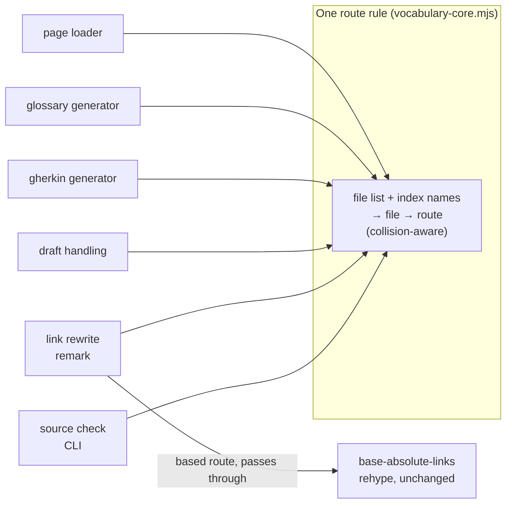

# Implementation Plan: Generated pages and relative links hold up for consumers

**Branch**: `fix/generated-page-and-link-integrity` | **Date**: 2026-10-13 | **Spec**: [spec.md](spec.md)
**Input**: Mission specification from `kitty-specs/generated-page-and-link-integrity-01M4VB0N/spec.md`

## Summary

Three adopter-facing defects (#122, #129, #131) are fixed in one mission. The
work starts by giving the toolkit one rule for turning a docs file into its
route, because two of the three fixes and both link gates depend on it. The
Gherkin guard and the glossary file-name fix follow, independent of each other.
The link rewrite and the source-check rework come last and can be cut (C-005).

Planning questions were settled before this plan: the owner's decisions are in
the spec's decisions table, and the grounding and post-spec reviews supplied the
seam map and confirmed the two framework assumptions by reading installed code.
No planning question is open.

## Technical Context

**Language/Version**: TypeScript 5.9 and plain ESM JavaScript (`.mjs`) on Node 22+
**Primary Dependencies**: Astro 5 (`^5.2.0`), Starlight 0.32, `@astrojs/mdx` (through Starlight), unified/remark/rehype, `@cucumber/gherkin`. No dependency is added, upgraded or removed.
**Storage**: files only: Markdown under a docs root, generated pages written into that tree
**Testing**: Vitest (`src/tests/*.test.ts`) run as `cd src && ./node_modules/.bin/vitest run tests/<file>`; the consumer proof (`tests/consumption/`) and example build gates run in CI
**Target Platform**: Node CLI scripts and an Astro integration; output is a static site
**Project Type**: single package (`@spec-kitty/doc-toolkit` in `src/`) with a demo site (`example/`) and a consumer fixture (`tests/consumption/consumer-fixture/`)
**Performance Goals**: example build no more than 10% slower than `main` (NFR-003, observed, not gated)
**Constraints**: example output byte-identical (NFR-001, NFR-002); deterministic output (NFR-004); ADR-0037 not edited (C-001); one route rule (C-002); no ownership stamp on glossary pages (C-003)
**Scale/Scope**: about 12 source files changed, 1 new plugin module, 1 new ADR, 4 docs pages, 1 fixture; 22 functional requirements

**Supply chain (DIRECTIVE_051)**: not applicable. The plan changes no dependency and no lockfile. The fixture change is expected to leave its lockfile untouched; a lockfile diff in the fixture is a finding, not an accepted side effect.

**Local environment limits**: `pnpm install` and `pnpm exec` are not to be run here (they alter `node_modules` and file modes). A full example build needs a PlantUML server, so build-level gates (artifact assertions, built-link gate, a11y, consumer proof) are verified by CI on the draft PR.

## Charter Check

| Charter rule | How the plan meets it | Result |
|---|---|---|
| Decisions are recorded as ADRs | ADR-0047 amends ADR-0037 and ADR-0048 amends ADR-0026 and ADR-0046; all are new files and no accepted ADR is edited | pass |
| `README.md` is the section index (ADR-0002) | The glossary fix makes generated pages honour the site's index names; the consumer proof moves to the default | pass |
| Doc-sanity: link integrity fails the build on a dangling reference | Unresolvable relative links are left as written so the built gate still fails; the source check now agrees | pass |
| Single `ci-ok` required check; path-scoped CI | No workflow change | pass |
| Living documentation: a behaviour change updates its docs in the same change | Guide, architecture pages, ADRs and changelog are in scope (FR-018, FR-019) | pass |
| Writing is audience-oriented | Applies to ADR-0047, the guide and the changelog | pass |

No violation; Complexity Tracking is empty. Re-checked after the design below: unchanged.

## Project Structure

### Documentation (this mission)

```
kitty-specs/generated-page-and-link-integrity-01M4VB0N/
├── plan.md
├── research.md
├── data-model.md
├── quickstart.md
├── contracts/public-surface.md
└── tasks.md            # written by /spec-kitty.tasks
```

### Source Code (repository root)

```
src/lib/
├── vocabulary-core.mjs            # home of the shared route rule (pure, fs-free)
├── metadata.ts                    # re-exports the rule; loses its private copy
├── draft-publication.mjs          # draftRoutesOf converges on the rule
├── config.ts                      # integration wiring: glossary, gherkin, link rewrite
├── schema.ts                      # loader: unchanged caller of the rule
├── remark/relative-md-links.ts    # NEW: the link rewrite
├── rehype/base-absolute-links.ts  # unchanged; still applies the base
├── glossary/generate.ts           # file-name rule + guarded prune
└── gherkin/{generate,options}.mjs # empty-source guard + allowEmpty
src/scripts/
├── check-links.mjs                # uses the rule; --strict, --index-basename
└── generate-feature-pages.mjs     # --allow-empty
src/tests/                         # changed and new tests, listed per concern
tests/consumption/consumer-fixture/  # default index name, both link forms
docs/adr/0047-*.md, 0048-*.md      # NEW
docs/{guides/consumer-setup,architecture/gherkin-pages,architecture/glossary}.md
CHANGELOG.md
```

**Structure Decision**: single package. The shared rule lives in a plain `.mjs`
because the CLI scripts run under Node without a TypeScript step and cannot
import `.ts`; `metadata.ts` already imports from `vocabulary-core.mjs`.

## Design



- **Route rule.** `readmeToIndexId` and `resolveIndexEntries` move verbatim from `metadata.ts` to `vocabulary-core.mjs`; `metadata.ts` keeps exporting them and their types, because `src/index.ts` re-exports that module as public surface. New pure functions beside them:
  - `routeOfSlug(slug)`: `''` → `/`, otherwise `/slug/`.
  - `generatedIndexBasename(indexBasename, { prefer })`: the name a generator writes its index pages under. Gherkin calls it with no preference (first name); the glossary calls it with `prefer: 'index'`. The two generators share one function and keep their different answers on purpose.
  - `buildRouteTable(paths, { indexBasename, unpublishedPaths })` → `{ routes, collisions }`. It takes draft **file paths**, not draft routes; `draftRoutesOf` is then derived from the table instead of feeding it.
  - `resolveRelativeDocLink(routes, sourcePath, href)` → route or `null`.
  - `detectIndexCollisions` becomes `resolveIndexEntries(...).collisions`. The private `normalizeIndexBasenames` twin in `metadata.ts` is removed.
- **One walk.** The loader, `draftRoutesOf`, `directoryMetaInputs` and `check-links` each walk the tree with different skip rules (`log.md`, `_meta/`, dot-folders). The loader's `walkMarkdownPaths` is hoisted to a shared `.mjs` and is the walk behind every route table. `check-links` keeps its own wider walk for the files it reads, and uses the shared walk for the table it resolves against.
- **Gherkin guard.** In `generateFeaturePages`, after the authored-file check and before any write: throw when the model has no files, owned pages exist, and `allowEmpty` is not true. Check mode does not call this function and is unchanged.
- **Glossary.** `glossaryIntegration` receives `indexBasename` and passes it to `generateGlossaryPages`. Target name: `index` if listed, else the first. Before writing, an authored file at a target path stops the run. After writing, a stale page is removed only under the FR-008 conditions; names are compared case-insensitively.
- **Link rewrite.** A remark plugin visits `link` and `definition` nodes. It takes the source path from `file.path`, resolves the href with the shared rule, and replaces it with the **base-prefixed** route plus the original query and fragment. It applies the base itself: the existing rehype pass skips any href that already starts with the base, so a section named like the base would otherwise be left unprefixed, and a based href passes through that pass untouched. It is registered last in the remark order, inside the existing `doc-kitty:base-absolute-links` integration, which gains `docsDir` and `indexBasename` parameters. No existing plugin emits a relative `.md` href, so running last is safe. The plugin does nothing when it has no options or the file has no path (the pipeline parity test calls it that way) and when the docs root is absent. The source key is derived by testing `file.path` against both the lexical and the real path of the docs root.
- **Freshness (FR-021).** Registration is `[plugin, { routes, base, docsRoot }]` with `routes` a plain object whose keys are sorted first. Astro's content store is cleared when the config digest changes; a probe showed the digest serialises plugin options, turns a function into `null` and a `Map` or `Set` into `{}`, and does not sort keys. The table is built in the integration's `astro:config:setup`, which runs after the glossary and Gherkin generators and after draft state is resolved. This holds for a build and for a dev-server start; a rename while the dev server runs is picked up on restart.
- **Source check.** `check-links.mjs` builds the same table from the tree it scans and accepts a relative Markdown link exactly when the rule resolves it. It gains reference-definition parsing, `--strict` (adds the bare-link rule to any root) and `--index-basename`. It keeps its file-system probing for `related:` entries and directory links. Its index names default to `README,index` when `--index-basename` is absent, which differs from the site default (`README`) and keeps existing invocations working. A relative link to an existing file outside the docs tree is accepted on a non-strict root and reported on a strict one: this repository's `docs/` has 18 such links to repository files and is not built as a site. Draft targets follow the same split: reported only on a strict root, because CI checks `docs` with drafts off alongside the example and 25 links there point from active pages to draft pages. The root index page is never a draft for this purpose, matching the build, and that exemption lives in `unpublishedDraftPaths`, not in its callers. This repository's own `docs/` links ADRs as `./NNNN-x.md`; those resolve and must stay accepted (`example-adopter.test.ts` pins exit 0 for `docs example/docs`).

## File ownership

`src/lib/config.ts` is touched by IC-01 (`directoryMetaInputs`), IC-02 (Gherkin types and pass-through), IC-03 (`glossaryIntegration`) and IC-04 (`baseAbsoluteLinksIntegration`), in separate regions. `src/lib/gherkin/generate.mjs` is touched by IC-01 (`hubBasename`) and IC-02 (the guard). `docs/guides/consumer-setup.md` and `CHANGELOG.md` are touched by every concern. Work packages that share one of these files run in sequence, or the docs and changelog edits are held for one closing package.

## Complexity Tracking

No charter violation to justify.

## Implementation Concern Map

### IC-01 — Shared route rule

- **Purpose**: one pure rule for file-to-route, so every consumer agrees (FR-010, C-002).
- **Relevant requirements**: FR-010, NFR-001, NFR-004
- **Affected surfaces**: `src/lib/vocabulary-core.mjs`, `src/lib/metadata.ts`, `src/lib/draft-publication.mjs`, `src/lib/config.ts` (`directoryMetaInputs`), `src/lib/gherkin/generate.mjs` (`hubBasename`); tests `index-basename.test.ts` and one agreement test
- **Sequencing/depends-on**: none
- **Risks**: the existing copies disagree for a folder with two index files and for a site that does not list `index`; converging changes output in those cases only. The example and fixture have neither. `section-type-parity.test.ts` compares the two copies as a two-arm guard; once they are one implementation that comparison is vacuous, so keep its literal cases and drop the two-arm claim. Route joiners elsewhere (`routes/rss.ts`, `routes/llms-txt.ts`, `layouts/Hub.astro`, `route-shaping.ts`) are left for later; this mission must not add another copy. Loader ids are verbatim paths, so a route can hold spaces or capitals: the resolver encodes each path segment when it writes the href and matches on the decoded form.

### IC-02 — Gherkin empty-source guard

- **Purpose**: stop the build instead of deleting generated behaviour pages (#122).
- **Relevant requirements**: FR-001, FR-002, FR-003, FR-004, FR-004a, FR-005
- **Affected surfaces**: `src/lib/gherkin/generate.mjs`, `src/lib/gherkin/options.mjs`, `src/lib/config.ts` (gherkin types and pass-through), `src/scripts/generate-feature-pages.mjs`; tests `gherkin-generate.test.ts` (the existing warn-and-delete test becomes the red-first repro), `gherkin-integration.test.ts`, `gherkin-check-cli.test.ts`, `gherkin-example.test.ts` (flag parity)
- **Sequencing/depends-on**: none (touches `hubBasename`'s file; coordinate with IC-01 on `generate.mjs`)
- **Risks**: an option registered in some places and not others is dropped silently. The existing parity test compares hand-listed fields and would stay green, so FR-004a needs a new assertion that derives both lists from the code. `gherkin-integration.test.ts` pins the validator's exact return: omit `allowEmpty` when false, or update that pin. No boolean option exists to copy; `--check` is the only boolean flag.

### IC-03 — Glossary file name and prune

- **Purpose**: glossary pages are section indexes on any index-name setting (#129).
- **Relevant requirements**: FR-006, FR-007, FR-008, FR-009, NFR-002
- **Affected surfaces**: `src/lib/glossary/generate.ts`, `src/lib/config.ts` (`glossaryIntegration` and its call site); tests `glossary-generate.test.ts`, `link-integrity.test.ts`, `glossary-codegen-guard.test.ts` (must stay green)
- **Sequencing/depends-on**: IC-01
- **Risks**: deleting an authored page. Bounded by the FR-008 conditions and the stop-on-collision rule; both get a test. The generator's new index-name parameter must not default to `README` for a caller that omits it: eleven test pins and three mocks call it with two arguments and expect `index.md`. Make the parameter required at the production call site and update the direct test callers. Generator-written fields, for the prune rule: hub `title`, `description`, `kind: Hub`, `doc_status`; context page adds `kind: Glossary` and `glossary_context`.

### IC-04 — Relative Markdown link rewrite

- **Purpose**: relative `.md`/`.mdx` links become routes at build (#131).
- **Relevant requirements**: FR-011, FR-012, FR-013, FR-014, FR-021, C-007
- **Affected surfaces**: new `src/lib/remark/relative-md-links.ts`, `src/lib/config.ts` (the `doc-kitty:base-absolute-links` integration and route-table construction); tests: one new plugin test file, `base-absolute-links.test.ts`, the remark-stack parity helper `src/tests/helpers/remark-stack.ts`
- **Sequencing/depends-on**: IC-01; after IC-03 (generated glossary pages must be in the route table)
- **Risks**: docs roots outside the project or behind a symlink (compare real paths); `.mdx` path is confirmed by reading only, so it needs one executed test; byte-neutrality of the example.

### IC-05 — Source link check agrees with the build

- **Purpose**: the fast gate and the built gate give the same answer (#131).
- **Relevant requirements**: FR-015, FR-016, FR-017
- **Affected surfaces**: `src/scripts/check-links.mjs`; tests `check-links-tightened.test.ts`
- **Sequencing/depends-on**: IC-01, IC-04 (same resolver semantics)
- **Risks**: newly reports links that passed before (classified Breaking in the changelog); the example's strict rejection of `.md`-relative links flips to accept resolvable ones, so its pinned classifications change.

### IC-06 — Consumer proof

- **Purpose**: prove the three fixes from the packaged toolkit (FR-020).
- **Relevant requirements**: FR-020, SC-002, SC-003, SC-004
- **Affected surfaces**: `tests/consumption/consumer-fixture/` (`astro.config.mjs`, `src/content.config.ts`, `docs/rhetoric/**` index files renamed to `README.md`, new relative links), `tests/consumption/scripts/*`
- **Sequencing/depends-on**: IC-03, IC-04, IC-05
- **Risks**: cannot be run locally; CI is the verifier. `url-baseline.txt` and the lockfile must not change. The proof's source-check calls pass no flags today, so they must gain `--strict --index-basename`. The fixture cannot hold a link to a draft or to a non-page: the built-link gate would fail, which is the intended behaviour and is covered by unit tests instead. Add the two link forms inside existing pages.

### IC-07 — Records and adopter documentation

- **Purpose**: ADR, guide, architecture pages and changelog match the behaviour (FR-018, FR-019).
- **Relevant requirements**: FR-018, FR-019, C-001, C-006
- **Affected surfaces**: `docs/adr/0047-*.md` and `docs/adr/0048-*.md` (new), `docs/architecture/gherkin-pages.md`, `docs/architecture/glossary.md`, `docs/guides/consumer-setup.md`, `CHANGELOG.md`
- **Sequencing/depends-on**: IC-02 to IC-05
- **Risks**: `docs/adr/README.md` is generated and gated (`validate:adr-index`); regenerate it once, last, with `node src/scripts/generate-adr-index.mjs`, and note that changing an ADR's `updated` date also changes that index. The guide may not name `src/scripts/` paths (`assert-guide-no-internal-paths`); use the `dockitty-*` command names. Root `docs/` is not built, so example page-count pins do not move. ADR-0047 follows the house format and the amending precedent of ADR-0038. The Gherkin and glossary changes are recorded in a second new ADR (0048) that amends ADR-0046 and ADR-0026. No accepted ADR is edited: the charter makes them immutable, and the `## Update` notes found on some older ADRs are not a practice to extend. PR #132 has merged, so the changelog needs both sets of entries at rebase.
