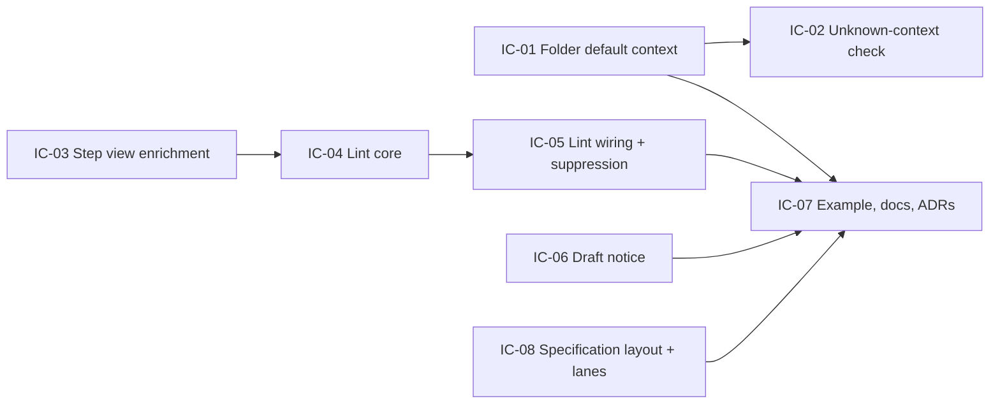

# Implementation Plan: Gherkin authoring aids and Specification layout

**Branch**: `feat/gherkin-authoring-aids` | **Date**: 2026-10-19 | **Spec**: [spec.md](./spec.md)
**Input**: Mission specification from `kitty-specs/gherkin-authoring-aids-01M59A5E/spec.md`

The planning questions are answered:

- The research decisions D1–D13 are recorded as specify Decision Moments.
- The Engineering Alignment A1–A8 was confirmed by the operator on 2026-10-19
  (Decision Moment `01M59AH8N44YBMKZ5KHXW8W4K8`).

## Summary

The mission delivers three slices in order, all inside the existing Gherkin pipeline
and theme layer.

1. **Folder default glossary context (#197).** A `gherkin.defaultGlossaryContext`
   page option resolves a feature's glossary context in the shared frontmatter
   builder. The precedence is: tag, then nearest folder key, then none.
   - A matching repeatable CLI flag keeps `validate:features` byte-reproducible.
   - During the site build, the generator checks the resolved context against
     the glossary's context names, from map values and tags alike.
2. **Imperative-step lint (#196).** A pure lint core,
   `src/lib/gherkin/imperative.mjs`, is called from the feature-page renderer and
   from the in-page fence stage, on the same pattern as `warnDuplicates`.
   - Steps gain a line number and a resolved keyword type.
   - A new `@dk:allow=imperative` tag silences a Feature, Rule or Scenario.
   - The option is a non-page option, so it changes no generated bytes.
3. **Specification layout and draft notice (#198).**
   - A `Specification` base-kind layout adds a header card with tags and the
     source link, and keeps the TOC as the scenario list. The ADR-0055 results
     summary stays in the body (operator decision, plan phase).
   - The shared page-title carrier shows a draft notice for every `doc_status:
     draft` page.
   - The geometry and axe lanes gain the feature pages.

Two ADRs record the contract changes: ADR-0061 covers the authoring aids, ADR-0062
the layout and draft notice.

## Technical Context

**Language/Version**: TypeScript 5.7 and ES modules (`.mjs`) on Node ≥22.22; Astro 7.4, Starlight 0.42.6
**Primary Dependencies**: `@cucumber/gherkin` 42 and `@cucumber/messages` 34 (already pinned); no new dependencies
**Storage**: Files. Generated feature pages are committed `.md` under the example site's `docs/behaviour/`
**Testing**: Vitest unit tests (`src/tests/*.test.ts`, `pnpm test`), the example build and drift gate (`pnpm validate:features`), and the Playwright a11y and geometry lanes (`tests/a11y/`, `pnpm test:a11y`). Tests are written red first.
**Target Platform**: Static docsites built with Astro on CI (GitHub Actions) and locally
**Project Type**: Single library package (`src/`, published as `@spec-kitty/doc-toolkit`) plus the runnable example site (`example/`)
**Performance Goals**: The lint adds under 5% to feature generation time on the example site (NFR-006)
**Constraints**:
- With both options unset, generated pages are byte-identical (NFR-001).
- New CSS uses `--dk-*` tokens only (NFR-005).
- One resolution point for the context (C-001) and one lint core (C-002).
- Strict option validation (C-003).
**Scale/Scope**: About 40 `.feature` files across the example site and fixtures. Roughly 8 source modules touched, 1 new layout, 1 new lint module, 2 ADRs, 3 docs pages.

### Supply chain

No dependency is added, upgraded or removed. The DIRECTIVE_051 controls therefore
have nothing to check. Recorded as N/A by construction, not skipped.

## Charter Check

*GATE: Must pass before Phase 0 research. Re-check after Phase 1 design.*

| Charter item | How the plan meets it | Status |
|---|---|---|
| Decisions recorded as ADRs; accepted ADRs immutable | ADR-0061 and ADR-0062 are new ADRs that *amend by reference* ADR-0046 (the `@dk:` contract and "no new render code") and ADR-0028 ("not inherited"). No accepted ADR is edited | Pass |
| Metadata contract (ADR-0009): `doc_status`, `kind` | The draft notice reads `doc_status`; the layout keys on `kind: Specification`. No new frontmatter field | Pass |
| Theme and chrome are swappable and layered (ADR-0008, 0011, 0015) | The layout is a base-kind manifest entry that themes override per key. The draft notice lives in the existing carrier | Pass |
| Path-scoped CI; `ci-ok` is the only required check | Code and docs both change, so both lanes run. No workflow changes beyond the a11y route lists | Pass |
| Vitest unit tests, example build, Playwright lanes | Every FR maps to red-first unit tests. The lanes are extended (FR-018) | Pass |
| WCAG 2.2 AA | The card is a labelled region, the draft notice is text, and status uses words. The axe lane covers both feature pages | Pass |
| Living documentation | The consumer setup guide, authoring guide, `gherkin-pages.md`, both ADRs and the CHANGELOG change in the same PR (FR-019) | Pass |
| Writing policy (sentence-case headings, no AI tells) | Applies to all docs and ADRs; markdownlint and Vale run in CI | Pass |

**Post-design re-check (after Phase 1)**: still pass. The contracts add no
frontmatter field, no new token, and no change to an accepted ADR.

## Project Structure

### Documentation (this mission)

```
kitty-specs/gherkin-authoring-aids-01M59A5E/
├── plan.md
├── research.md
├── data-model.md
├── quickstart.md
├── contracts/
│   ├── gherkin-options.md
│   ├── cli-flags.md
│   ├── warnings.md
│   └── specification-layout.md
└── tasks.md              # /spec-kitty.tasks output
```

### Source code (repository root)

```
src/lib/gherkin/
├── options.mjs           # + defaultGlossaryContext (page key), lint (option key), validation
├── feature-core.mjs      # + context precedence in buildFrontmatter; + `allow` metadata key (Feature/Rule/Scenario)
├── generate.mjs          # + folder-default resolution, unused-key and unknown-context warnings
├── view.mjs              # + StepView.line, StepView.keywordType (And/But/* resolved)
├── imperative.mjs        # NEW: pure lint core (rules, matcher, suppression, warning text)
└── render.mjs            # renderFeatureBody calls the lint core beside warnDuplicates
src/lib/remark/gherkin-fence.ts   # fence calls the lint core; `@dk:allow` exempt from "no effect"
src/lib/integrations/gherkin.ts   # passes defaultGlossaryContext, glossary context names, lint options
src/scripts/generate-feature-pages.mjs  # + --default-glossary-context dir=ctx (repeatable), glossary context names
src/lib/manifest.ts       # + Specification base kind
src/layouts/Specification.astro   # NEW: header card + content slot
src/components/PageTitle.astro    # + draft notice for doc_status: draft (all kinds)
src/components/slots/DraftNotice.astro  # NEW: the notice markup
src/styles/dk-components.css      # + .dk-spec-card, .dk-draft-notice (tokens only)
src/tests/                # new and extended Vitest suites
tests/a11y/routes.ts, tests/a11y/layout-geometry.spec.ts  # + feature and draft-feature routes
example/astro.config.mjs, package.json  # defaultGlossaryContext + lint demo; CLI flag in validate:features
example/features/shipping/*.feature     # drop the now-redundant @dk:context tags
example/docs/behaviour/**               # regenerated pages
docs/adr/0061-*.md, docs/adr/0062-*.md, docs/adr/README.md
docs/guides/consumer-setup.md, docs/guides/authoring.md, docs/architecture/gherkin-pages.md
CHANGELOG.md
```

**Structure decision**: the existing single library package plus the example
site. No new package and no new directory beyond the two new files under
`src/lib/gherkin/` and `src/layouts/`.

## Complexity Tracking

No charter violations, so none are tracked.

## Implementation Concern Map



### IC-01 — Folder default glossary context

- **Purpose**: Resolve a generated page's `glossary_context` from a folder map
  when no tag supplies it, at the one place frontmatter is built.
- **Relevant requirements**: FR-001, FR-002, FR-003, FR-004, FR-005, FR-007, NFR-001, C-001, C-003
- **Affected surfaces**:
  - `options.mjs` (`GHERKIN_PAGES_KEYS`, validation copied from `checkTitles`)
  - `feature-core.mjs` (`buildFrontmatter` precedence)
  - `generate.mjs` (longest-prefix lookup per `relPath`; unused-key warning like `titles`)
  - `generate-feature-pages.mjs` (the `FLAG` map and the repeatable parser)
  - `gherkin-example.test.ts` (parity)
- **Sequencing/depends-on**: none
- **Risks**:
  - The parity test fails until the CLI flag exists, which is intended.
  - The generator stamp hashes source bytes only, so a context change made only
    in config keeps `generated.at`. This gap already exists for
    `sourceUrlPrefix`; document it, do not fix it here.

### IC-02 — Unknown glossary context warning

- **Purpose**: Warn when a resolved context (from the map or a tag) is not a
  context in the site glossary.
- **Relevant requirements**: FR-006
- **Affected surfaces**:
  - `generate.mjs` (the check, given an optional `knownContexts` set; no set
    means no check)
  - `integrations/gherkin.ts` (passes the context names from `loadGlossary(root)`
    when the glossary is present)
- **Sequencing/depends-on**: IC-01
- **Risks**:
  - The CLI (`generate-feature-pages.mjs`) does not pass `knownContexts`. It
    cannot import the TypeScript loader, and a second definitions parser is ruled
    out, so `validate:features` stays a pure drift gate. This narrows alignment
    A1 to the build, which is the surface FR-006 names. See research R-02.

### IC-03 — Step view enrichment

- **Purpose**: Give each `StepView` a source `line` and a resolved `keywordType`
  (`context`, `action`, `outcome`), so `And`, `But` and `*` take the preceding
  step's type, Background included.
- **Relevant requirements**: FR-008 and FR-010 (prerequisite)
- **Affected surfaces**: `view.mjs`, view snapshot tests
- **Sequencing/depends-on**: none
- **Risks**: the view feeds rendering. The new fields must be additive, so
  rendered bytes stay unchanged (NFR-001); existing render goldens prove it.

### IC-04 — Imperative-step lint core

- **Purpose**: A pure function that takes a feature view, rules, a file, a
  `warn` callback and a line offset, and emits one warning per offending step.
- **Relevant requirements**: FR-008, FR-009, FR-010, FR-013, NFR-002, NFR-006, C-002
- **Affected surfaces**: `src/lib/gherkin/imperative.mjs` (new), `src/tests/gherkin-imperative.test.ts` (new)
- **Sequencing/depends-on**: IC-03
- **Risks**:
  - False positives. Use the narrow phrase list and match only `text` segments.
    Quoted arguments are scanned only for the selector signal.
  - Skip non-English features (`feature.language`).

### IC-05 — Lint wiring and suppression tag

- **Purpose**: Call the core from `renderFeatureBody` and the fence stage, add
  the `lint` option, and add `@dk:allow=imperative`.
- **Relevant requirements**: FR-011, FR-012, C-003
- **Affected surfaces**:
  - `render.mjs`, `gherkin-fence.ts`, `integrations/gherkin.ts` (option threading)
  - `options.mjs` (`GHERKIN_OPTION_KEYS`)
  - `feature-core.mjs` (`METADATA_KEYS` += `allow`; Rule and Scenario tags read for `allow` only)
- **Sequencing/depends-on**: IC-04
- **Risks**:
  - Today only Feature-level `@dk:` tags carry meaning. `allow` is the first key
    read at Rule or Scenario level, which is an ADR-0061 contract point.
  - Fence warnings disappear on content-layer cache hits. Document fence lint as
    best-effort in dev; generated pages are authoritative.

### IC-06 — Draft notice on every draft page

- **Purpose**: Show a text draft notice on every page whose `doc_status` is
  `draft`, rendered once in the shared page-title carrier.
- **Relevant requirements**: FR-016, NFR-003, NFR-005
- **Affected surfaces**: `PageTitle.astro`, `slots/DraftNotice.astro` (new), `dk-components.css`, carrier tests
- **Sequencing/depends-on**: none
- **Risks**:
  - Changes the HTML of every draft page (the operator accepted this, D10).
  - Must not use `role="alert"` or `role="banner"`.
  - Must not reuse Starlight's `draft` field or `banner`.

### IC-07 — Example site, docs and ADRs

- **Purpose**: Demonstrate and document the features, and record the decisions.
- **Relevant requirements**: FR-019, SC-001–SC-005, NFR-002
- **Affected surfaces**:
  - `example/astro.config.mjs`, root `package.json` (`validate:features` flag)
  - `example/features/shipping/*.feature`, regenerated `example/docs/behaviour/**`
  - ADR-0061, ADR-0062, `docs/adr/README.md` index
  - `consumer-setup.md`, `authoring.md`, `gherkin-pages.md` (including the stale
    "#113" pointer, a side finding)
  - `CHANGELOG.md`
- **Sequencing/depends-on**: IC-01, IC-05, IC-06, IC-08
- **Risks**:
  - Regenerated pages must pass `validate:features`.
  - The ADR index is generated, so run `validate:adr-index`.

### IC-08 — Specification layout and test lanes

- **Purpose**: Add the base-kind `Specification` layout with a header card, and
  cover feature pages in the geometry and axe lanes.
- **Relevant requirements**: FR-014, FR-015, FR-017, FR-018, NFR-003, NFR-004, NFR-005, C-004
- **Affected surfaces**:
  - `src/layouts/Specification.astro` (new), `manifest.ts` (`BASE_KIND_LAYOUTS`)
  - `dk-components.css`
  - `tests/a11y/routes.ts`, `layout-geometry.spec.ts`
  - a CSS token test
- **Sequencing/depends-on**: IC-06 (shares the notice styling)
- **Risks**:
  - The layout must wrap the content slot, not re-render the body, so the
    ADR-0055 overlay stays valid.
  - It must degrade without `sources` or `generated`.
  - Visual baselines may need updating.

## Branch contract (restated)

- Current branch: `feat/gherkin-authoring-aids`.
- Planning base: `feat/gherkin-authoring-aids`.
- Merge target for completed work packages: `feat/gherkin-authoring-aids`.
- That branch then goes to `main` as one PR. The maintainer merges.
