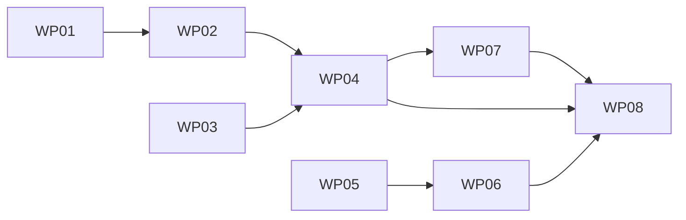

# Work Packages: Gherkin authoring aids and Specification layout

**Inputs**: Design documents from `kitty-specs/gherkin-authoring-aids-01M59A5E/`
**Prerequisites**: plan.md, spec.md, research.md, data-model.md, contracts/, quickstart.md

**Tests**: Required. The operator brief asks for red-first tests, so every work
package writes its failing tests before the implementation.

**Organization**: Fine-grained subtasks (`Txxx`) roll up into work packages
(`WPxx`). Every file has exactly one owner. Where a WP must touch another WP's
file, the prompt names the one-line out-of-map edit and its rationale.

**Prompt Files**: `kitty-specs/gherkin-authoring-aids-01M59A5E/tasks/WPxx-*.md`.

## Subtask Format: `[Txxx] [P?] Description`

- **[P]** means the subtask can proceed in parallel with others (different
  files).
- Subtasks are reference rows, not checkboxes. Record completion with
  `spec-kitty agent tasks mark-status <Txxx> --status done`.

## Path Conventions

- **Toolkit source**: `src/lib/`, `src/layouts/`, `src/components/`, `src/styles/`, `src/scripts/`
- **Unit tests**: `src/tests/*.test.ts` (Vitest, `pnpm test`)
- **Browser lanes**: `tests/a11y/` (Playwright, `pnpm test:a11y`)
- **Example site**: `example/`

---

## Work Package WP01: Gherkin option and metadata contract (Priority: P1)

**Goal**: Validate the two new options and teach the frontmatter builder the new
precedence and the `allow` key, with the CLI twin flag, so later packages
consume a settled contract.
**Independent Test**: The option and feature-core suites cover valid and invalid
shapes. The FR-004a parity test stays green, because
`--default-glossary-context` exists the moment the page key does.
**Prompt**: `tasks/WP01-gherkin-option-and-metadata-contract.md`
**Requirement Refs**: FR-001, FR-003, FR-005, FR-010, FR-012, C-003

### Included Subtasks

T001 Validate `gherkin.defaultGlossaryContext` as a page key in `src/lib/gherkin/options.mjs` (WP01)
T002 [P] Validate `gherkin.lint.imperativeSteps` as a non-page option key and normalise it (WP01)
T003 Add `--default-glossary-context <dir>=<ctx>` to `src/scripts/generate-feature-pages.mjs` (WP01)
T004 Context precedence in `buildFrontmatter` (tag, then folder default, then none; empty tag falls through) in `src/lib/gherkin/feature-core.mjs` (WP01)
T005 [P] `allow` as a known, repeatable Feature-level `@dk:` key, value-checked (WP01)

### Implementation Notes

- Write the red tests first in `gherkin-options.test.ts`, `gherkin-feature-core.test.ts` and `gherkin-check-cli.test.ts`.
- Copy the `titles` validation and the CLI parser shape. Use the `defineProperty` guard.

### Parallel Opportunities

- T002 and T005 touch independent code paths in their files.

### Dependencies

- None (starting package).

### Risks & Mitigations

- **Parity test.** It goes red if the page key lands without the flag. Do T001
  and T003 together.

---

## Work Package WP02: Folder default resolution and context warnings (Priority: P1)

**Goal**: Resolve each generated page's folder default by longest-prefix match,
warn on unused keys and unknown contexts, and thread the new options through
generation and the integration.
**Independent Test**: `generateFeaturePages` on fixtures:
- produces the documented `glossary_context` for nested, mapped, tagged,
  empty-tag and unmapped files;
- warns exactly on unused keys and unknown contexts;
- leaves unmapped pages byte-identical.
**Prompt**: `tasks/WP02-folder-default-resolution-and-context-warnings.md`
**Requirement Refs**: FR-001, FR-002, FR-004, FR-006, FR-007, C-001, NFR-001

### Included Subtasks

T006 Longest-prefix folder lookup per `relPath` and hand-off to `buildFrontmatter` in `src/lib/gherkin/generate.mjs` (WP02)
T007 Unused-key warning mirroring `titles` (WP02)
T008 Unknown-context warning from an optional `knownContexts` set, naming the origin (WP02)
T009 Integration threads `defaultGlossaryContext`, glossary context names and `lint` in `src/lib/integrations/gherkin.ts`; `generate.mjs` forwards `lint` to `renderFeatureBody` (WP02)
T010 Dormancy and production-path tests (WP02)

### Implementation Notes

- The resolution point stays in feature-core (C-001). `generate.mjs` only looks
  up and passes.
- The CLI does not pass `knownContexts` (research R-02).

### Parallel Opportunities

- T007 and T008 are independent once T006 lands.

### Dependencies

- Depends on WP01.

### Risks & Mitigations

- **Byte drift on unmapped pages.** Mitigation: a golden test compares the
  option-off output with the option-on output for an unmapped folder.

---

## Work Package WP03: Step view enrichment and imperative-step lint core (Priority: P2)

**Goal**: Give steps a line and a resolved keyword type, and build the pure lint
core: phrase list, matcher, selector signal, language skip, suppression and
warning text.
**Independent Test**: `gherkin-imperative.test.ts` drives `lintSteps` over
parsed fixtures. It covers flagged, clean, domain counter-examples, Dutch,
placeholders, suppression, `verbs`, `extend` and `keywords`. The render goldens
stay unchanged.
**Prompt**: `tasks/WP03-step-view-enrichment-and-lint-core.md`
**Requirement Refs**: FR-008, FR-009, FR-010, FR-012, FR-013, C-002, NFR-002, NFR-006

### Included Subtasks

T011 `StepView.line` and `StepView.keywordType` (And/But/* inherit; Background chain) in `src/lib/gherkin/view.mjs` (WP03)
T012 [P] `hasMetadataTag` ignores `@dk:allow` (WP03)
T013 Default phrase list and compiler (inflections, phrases, word boundaries) in new `src/lib/gherkin/imperative.mjs` (WP03)
T014 Matcher over text segments, selector signal, English-only skip (WP03)
T015 Suppression scopes, bad-value warning, warning text per `contracts/warnings.md` (WP03)
T016 Lint core test suite including counter-examples and a timing guard (WP03)

### Implementation Notes

- The lint core is pure, with no I/O. It takes `(view, { rules, file, warn,
  lineOffset, language })`.

### Parallel Opportunities

- WP03 runs in parallel with WP01 and WP02. It owns different files.

### Dependencies

- None.

### Risks & Mitigations

- **False positives.** Mitigation: the narrow list, and matching text segments
  only.
- **View changes alter render bytes.** Mitigation: the new fields are additive,
  and the render goldens prove it.

---

## Work Package WP04: Lint wiring into pages and fences (Priority: P2)

**Goal**: Call the lint core from the generated-page renderer and the in-page
fence stage, keeping includes and raw fences silent.
**Independent Test**: Through the production entry points (`generateFeaturePages`
and the remark processor with `gherkinFence`):
- one warning per imperative step, with `file:line`;
- identical page bytes with the lint on and off;
- silence for includes and raw fences.
**Prompt**: `tasks/WP04-lint-wiring-into-pages-and-fences.md`
**Requirement Refs**: FR-009, FR-011, C-002

### Included Subtasks

T017 `renderFeatureBody` calls `lintSteps` beside `warnDuplicates` when `opts.lint` is set in `src/lib/gherkin/render.mjs` (WP04)
T018 Fence stage: `GherkinFenceOptions.lint`, call beside `warnDuplicates` with the fence offset in `src/lib/remark/gherkin-fence.ts`; one-line `fenceOptions` edit in the integration (WP04)
T019 Production-path tests for pages, fences, includes and raw fences (WP04)

### Implementation Notes

- An include calls `renderFeatureBody` without `lint`, so it stays silent by
  construction. A test pins it.

### Parallel Opportunities

- T017 and T018 are independent files.

### Dependencies

- Depends on WP02 and WP03.

### Risks & Mitigations

- **Fence warnings lost on cache hits.** This is documented (WP08), not fixed.

---

## Work Package WP05: Draft notice on every draft page (Priority: P3)

**Goal**: Render a text draft notice for every `doc_status: draft` page from the
shared page-title carrier, styled with tokens, and assert it in the built
artifacts.
**Independent Test**:
- The built `track-consignment` page (an `@wip` draft) has exactly one
  `.dk-draft-notice`, and an active page has none.
- The token test rejects literals.
- The drafts-off build has no draft pages and no notices.
**Prompt**: `tasks/WP05-draft-notice-on-every-draft-page.md`
**Requirement Refs**: FR-016, NFR-005, SC-003

### Included Subtasks

T020 New `src/components/slots/DraftNotice.astro` per `contracts/specification-layout.md` (WP05)
T021 `src/components/PageTitle.astro` renders it for drafts of every kind, outside the overridable band slot (WP05)
T022 [P] Token-only `.dk-draft-notice` rules in `src/styles/dk-components.css` and a literal-guard test (WP05)
T023 Built-artifact assertions in `src/scripts/assert-chrome-artifacts.mjs`, tolerant of drafts-off builds (WP05)

### Implementation Notes

- No `role="alert"` or `role="banner"`. Do not use Starlight's `draft` field or
  `banner`.

### Parallel Opportunities

- WP05 runs in parallel with WP01–WP04.

### Dependencies

- None.

### Risks & Mitigations

- **Persona pages skip the shared header branch.** The notice must still render
  for a draft Persona page. Test it.

---

## Work Package WP06: Specification layout and test lanes (Priority: P3)

**Goal**: Register a base-kind `Specification` layout whose card shows tags and
source. Keep the TOC as the only scenario navigation and the results summary in
the body. Bring feature pages into the geometry and axe lanes.
**Independent Test**:
- `spec-card` unit tests cover link and plain source, empty tags and no card.
- The manifest test covers the default registration and the theme opt-out.
- The built-artifact module asserts the card on `book-consignment`, one TOC and
  one results summary.
- The geometry and axe lanes include the feature and draft-feature routes.
**Prompt**: `tasks/WP06-specification-layout-and-test-lanes.md`
**Requirement Refs**: FR-014, FR-015, FR-017, FR-018, NFR-003, NFR-004, NFR-005, C-004, SC-004

### Included Subtasks

T024 Pure card model `src/lib/spec-card.ts` (tags, source link vs text, emptiness) with tests (WP06)
T025 `src/layouts/Specification.astro` and token-only `src/styles/specification.css` (WP06)
T026 Register `Specification` in `BASE_KIND_LAYOUTS` (`src/lib/manifest.ts`); manifest test for default and opt-out (WP06)
T027 Built-artifact module `src/scripts/assert-specification-artifacts.mjs`, wired from `assert-build-artifacts.mjs` (WP06)
T028 [P] Add the feature and draft-feature routes to `tests/a11y/routes.ts` and the geometry `SCROLL_ROUTES` (WP06)
T029 [P] Literal-guard test for `specification.css` (WP06)

### Implementation Notes

- The layout wraps `<slot />`, and the body is not re-rendered.
- The card heading is visually hidden, and the card is not a `nav`.

### Parallel Opportunities

- T028 and T029 are independent of the layout files.

### Dependencies

- Depends on WP05 (the axe lane must see the draft notice on the draft feature
  route).

### Risks & Mitigations

- **Visual or geometry baselines may shift.** Mitigation: run the lanes and
  update any baseline in the same change, with a note.

---

## Work Package WP07: Example site demonstration (Priority: P2)

**Goal**: The example site uses the folder map and the lint, drops the redundant
shipping tags, and keeps `validate:features` green with the new flags.
**Independent Test**:
- `pnpm validate:features` exits 0.
- `gherkin-example.test.ts` proves:
  - the HR page carries `glossary_context: "hr"`;
  - the shipping pages carry `shipping` with no tag in their sources;
  - the lint finds 0 imperative steps in the example corpus.
**Prompt**: `tasks/WP07-example-site-demonstration.md`
**Requirement Refs**: SC-001, SC-002, SC-005, NFR-001, NFR-002

### Included Subtasks

T030 `example/astro.config.mjs`: `defaultGlossaryContext: { shipping: 'shipping', hr: 'hr' }` and `lint: { imperativeSteps: true }` (WP07)
T031 Drop `@dk:context=shipping` from the three shipping features and regenerate `example/docs/behaviour/**` (WP07)
T032 Root `package.json` `validate:features` gains the two `--default-glossary-context` flags (WP07)
T033 `src/tests/gherkin-example.test.ts` assertions for SC-001, SC-002 and NFR-002 (WP07)

### Implementation Notes

- Regenerate with the toolkit's own generator; never hand-edit generated pages.

### Parallel Opportunities

- None. The steps are sequential.

### Dependencies

- Depends on WP02 and WP04.

### Risks & Mitigations

- **A shipping page's bytes change only in a stamp or ordering.** Mitigation:
  check the diff. Only the removed tag's absence should matter, and
  `glossary_context` must stay "shipping".

---

## Work Package WP08: Decisions, documentation and changelog (Priority: P3)

**Goal**: Record ADR-0061 and ADR-0062, update the guides and the Gherkin
architecture page (including the stale "#113" pointer and the known limits),
and add the CHANGELOG entry.
**Independent Test**: `pnpm validate:docs`, `validate:links`,
`validate:adr-index` and markdownlint all pass, and every new option, flag, tag
and warning is documented.
**Prompt**: `tasks/WP08-decisions-documentation-and-changelog.md`
**Requirement Refs**: FR-019, C-005, C-006

### Included Subtasks

T034 ADR-0061 "Gherkin authoring aids" (WP08)
T035 ADR-0062 "Specification layout and draft notice" (WP08)
T036 Regenerate the ADR index (`docs/adr/README.md`) (WP08)
T037 [P] `docs/guides/consumer-setup.md` and `docs/guides/authoring.md` (WP08)
T038 [P] `docs/architecture/gherkin-pages.md` and `docs/architecture/theming.md` (WP08)
T039 `CHANGELOG.md` `[Unreleased]` entry (WP08)

### Implementation Notes

- ADRs follow `docs/adr/template.md`. Accepted ADRs are never edited; the new
  ADRs amend by reference.

### Parallel Opportunities

- T037 and T038 are independent pages.

### Dependencies

- Depends on WP04, WP06 and WP07 (it documents shipped behaviour).

### Risks & Mitigations

- **Vale and markdownlint findings.** Mitigation: run both locally before
  hand-off.

---

## Dependency & Execution Summary

- **Sequence**: WP01 → WP02. WP03 runs in parallel. Then WP04 → WP07.
  WP05 → WP06 run in parallel with the Gherkin track. WP08 comes last.
- **Parallelization**: three independent starts: WP01, WP03 and WP05.
- **MVP Scope**: WP01, WP02 and WP07 (#197) fix the live "policy" collision on
  their own.

---

## Requirements Coverage Summary

| Requirement ID | Covered By Work Package(s) |
|----------------|----------------------------|
| FR-001 | WP01, WP02 |
| FR-002 | WP02 |
| FR-003 | WP01 |
| FR-004 | WP02 |
| FR-005 | WP01 |
| FR-006 | WP02 |
| FR-007 | WP02 |
| FR-008 | WP03 |
| FR-009 | WP03, WP04 |
| FR-010 | WP01, WP03 |
| FR-011 | WP04 |
| FR-012 | WP01, WP03 |
| FR-013 | WP03 |
| FR-014 | WP06 |
| FR-015 | WP06 |
| FR-016 | WP05 |
| FR-017 | WP06 |
| FR-018 | WP06 |
| FR-019 | WP08 |
| NFR-001 | WP02, WP07 |
| NFR-002 | WP03, WP07 |
| NFR-003 | WP06 |
| NFR-004 | WP06 |
| NFR-005 | WP05, WP06 |
| NFR-006 | WP03 |
| C-001 | WP02 |
| C-002 | WP03, WP04 |
| C-003 | WP01 |
| C-004 | WP06 |
| C-005 | WP08 |
| C-006 | WP08 |

---

## Subtask Index (Reference)

| Subtask ID | Summary | Work Package | Priority | Parallel? |
|------------|---------|--------------|----------|-----------|
| T001 | Validate defaultGlossaryContext | WP01 | P1 | No |
| T002 | Validate lint.imperativeSteps | WP01 | P1 | Yes |
| T003 | CLI --default-glossary-context | WP01 | P1 | No |
| T004 | Context precedence in buildFrontmatter | WP01 | P1 | No |
| T005 | `allow` metadata key | WP01 | P1 | Yes |
| T006 | Longest-prefix folder lookup | WP02 | P1 | No |
| T007 | Unused-key warning | WP02 | P1 | Yes |
| T008 | Unknown-context warning | WP02 | P1 | Yes |
| T009 | Integration and option threading | WP02 | P1 | No |
| T010 | Dormancy and production-path tests | WP02 | P1 | No |
| T011 | StepView line and keywordType | WP03 | P2 | No |
| T012 | hasMetadataTag ignores @dk:allow | WP03 | P2 | Yes |
| T013 | Phrase list and compiler | WP03 | P2 | No |
| T014 | Matcher, selector, language skip | WP03 | P2 | No |
| T015 | Suppression and warning text | WP03 | P2 | No |
| T016 | Lint core tests | WP03 | P2 | No |
| T017 | renderFeatureBody calls lint | WP04 | P2 | Yes |
| T018 | Fence stage calls lint | WP04 | P2 | Yes |
| T019 | Production-path wiring tests | WP04 | P2 | No |
| T020 | DraftNotice component | WP05 | P3 | No |
| T021 | PageTitle renders notice | WP05 | P3 | No |
| T022 | Draft notice CSS and guard | WP05 | P3 | Yes |
| T023 | Draft notice build assertions | WP05 | P3 | No |
| T024 | spec-card model | WP06 | P3 | No |
| T025 | Specification layout and CSS | WP06 | P3 | No |
| T026 | Manifest registration | WP06 | P3 | No |
| T027 | Specification build assertions | WP06 | P3 | No |
| T028 | a11y and geometry routes | WP06 | P3 | Yes |
| T029 | specification.css literal guard | WP06 | P3 | Yes |
| T030 | Example config | WP07 | P2 | No |
| T031 | Drop tags and regenerate | WP07 | P2 | No |
| T032 | validate:features flags | WP07 | P2 | No |
| T033 | Example assertions | WP07 | P2 | No |
| T034 | ADR-0061 | WP08 | P3 | No |
| T035 | ADR-0062 | WP08 | P3 | No |
| T036 | ADR index | WP08 | P3 | No |
| T037 | Guides | WP08 | P3 | Yes |
| T038 | Architecture pages | WP08 | P3 | Yes |
| T039 | CHANGELOG | WP08 | P3 | No |
