# Implementation Plan: Large hubs: paged hub listing

**Branch**: `kitty/mission-large-hubs-paged-hub-listing-01M84WYV` → lands on `feat/342-paged-hub-listing` (based on `main` at 5001dff; PR #426 merged) | **Date**: 2026-11-24 | **Spec**: [spec.md](./spec.md)
**Input**: Mission specification from `kitty-specs/large-hubs-paged-hub-listing-01M84WYV/spec.md`

## Summary

A hub over its sidebar child cap renders its first `pageSize` children and a
`Pagination` navigation. The toolkit injects one prerendered route,
`/[...hub]/page/[page]/`, which renders pages 2 onwards through Starlight's
`StarlightPage`, inside the frame. The route-shaping integration already
composes a capped hub's cap, count and order. It now does that for every
published `kind: Hub` hub in every sidebar mode (#429), adds the page size, and
fails the build on a `page` child. The hub page, the paged route, the sidebar,
the agent API and `llms.txt` all read that one data set. The sitemap and
Pagefind pick up the paged pages from the built HTML, as the spike showed. No
client JavaScript is added.

```mermaid
flowchart LR
  docs[(docs tree)] --> RS[route-shaping integration<br/>hub data: every Hub hub<br/>cap · pageSize · count · children · capped]
  RS -->|virtual:doc-kitty/route-shaping| MW[route middleware<br/>sidebar cap, capped only]
  RS --> HUB[Hub.astro<br/>page 1 + HubPagination]
  RS --> PR[injected /&#91;...hub&#93;/page/&#91;page&#93;/<br/>StarlightPage + HubPagination]
  RS --> API[agent API index + per-page JSON]
  RS --> LLMS[llms.txt]
  HUB & PR -->|built HTML| SM[sitemap] & PF[Pagefind]
```



## Technical Context

**Language/Version**: TypeScript 5.9 and ESM JavaScript on Node 22; Astro 7.4.0 with Starlight 0.42.6
**Primary Dependencies**: Astro, `@astrojs/starlight` (`StarlightPage`), `@astrojs/sitemap`, Pagefind (via Starlight); no new dependency
**Storage**: N/A (static build output; build-time data in the `virtual:doc-kitty/route-shaping` module)
**Testing**: Vitest fast tier (pure functions, integration source generation), Vitest build tier (fixture sites built with Astro, assertions on `dist/`), `assert-build-artifacts.mjs` and `assert-no-broken-links.mjs` on the example, Playwright + axe on the example (light and dark), `pnpm test` (both tiers plus mcp) before every hand-off
**Target Platform**: Static sites (GitHub Pages); any Starlight host
**Project Type**: Single project: the toolkit package `src/` (`@spec-kitty/doc-toolkit`) and the worked example `example/`
**Performance Goals**: The hub page HTML on a 1,000-child fixture is at most 25% of the unpaged hub page (NFR-001). The median build is at most 10% slower than unpaged, over three interleaved runs (NFR-002).
**Constraints**: Sites with no hub over its cap build byte-identical pages (NFR-005). Output is deterministic (NFR-003). There is no client JavaScript (NFR-006). There is no new sidebar carrier (C-002), and there is one composition for count and order (C-001).
**Scale/Scope**: Hubs from 51 to several thousand children. The test fixtures have 200 children (proof) and 1,000 children (measurements).

**Supply chain (DIRECTIVE_051)**: no dependency is added, upgraded or removed. The `pnpm install --frozen-lockfile` lockfile is unchanged. No adversarial supply-chain pass is needed.

## Charter Check

| Charter point | Check | Result |
| --- | --- | --- |
| Agent interoperability: a site agents can discover and browse | Paged pages are in the agent API (with their child slugs), `llms.txt` and the sitemap; every child stays listed (FR-012, FR-013) | Pass |
| Three separated axes (content / IA / presentation) | The page size is IA configuration (`sections.yaml`, site option) or hub frontmatter. The listing markup is a theme-layer component styled by `hub.css` tokens | Pass |
| Accessibility target WCAG 2.2 AA | A labelled landmark, `aria-current`, 24 px targets, focus visible, axe in both themes (FR-008, NFR-004) | Pass |
| Starlight frame, not splash (ADR-0013 Hub layout) | `StarlightPage` keeps the frame (C-005); the spike confirmed it | Pass |
| ADR-0063 carrier set locked | No carrier is added; route shaping is unchanged in shape (C-002) | Pass |
| Living documentation | Configuration guide, ADR, slice-1 guide cross-reference, plan measurements and changelog fragment ship with the code (FR-020) | Pass |
| Changelog by fragment; ADR file without index row (AGENTS.md) | `docs/changelog/unreleased/342-paged-hub-listing.md`; a new ADR file only (C-006) | Pass |
| Tests: Vitest plus a built-output example assertion | Both tiers plus Playwright (SC-006) | Pass |

No violations, so Complexity Tracking is empty.

## Project Structure

### Documentation (this mission)

```
kitty-specs/large-hubs-paged-hub-listing-01M84WYV/
├── spec.md
├── plan.md              # this file
├── research.md          # decisions R1–R10 (spike, duplicates, settings names, ...)
├── data-model.md        # HubData entry, page-size levels, listing page, agent record
├── quickstart.md        # how to see it working
├── contracts/
│   ├── paging-api.md    # @spec-kitty/doc-toolkit/child-cap additions
│   └── surfaces.md      # routes, agent API record, llms.txt line, settings
└── tasks.md             # /spec-kitty.tasks
```

### Source Code (repository root)

```
src/lib/
├── child-cap.ts                     # + page size + paging arithmetic (pure, exported)
├── integrations/route-shaping.ts    # hub data for every hub, every sidebar mode; page size; `page` collision
├── route-shaping-module.d.ts        # module type: hubs entries gain capped/pageSize
├── route-middleware.ts              # shapes the sidebar from capped entries only
├── sections.ts                      # section `hub.pageSize` parsing/validation
├── config.ts                        # site `hub.pageSize` option; registers the paged-hubs integration
├── schema.ts                        # frontmatter `hub_page_size`
├── i18n-plugin.ts                   # dockitty.hub.pagination.* UI strings (en)
├── integrations/paged-hubs.ts       # NEW: injects /[...hub]/page/[page]/ (prerender)
├── routes/paged-hub.astro           # NEW: getStaticPaths from hub data; StarlightPage
├── routes/agent-index.ts            # + listing records appended (OpenAPI precedent); buildId fold
├── routes/agent-page.ts             # + per-listing-page JSON
├── routes/llms-txt.ts               # + one line per paged page after its hub
└── routes/shared.ts                 # buildId input includes listing pages
src/components/hub/
├── HubCardList.astro                # NEW: the card list extracted from Hub.astro (byte-identical)
└── HubPagination.astro              # NEW: the labelled pagination landmark
src/layouts/Hub.astro                # uses HubCardList; page 1 + HubPagination when paged
src/styles/hub.css                   # pagination styles (tokens, 24px targets, focus)
src/package.json                     # export ./routes/paged-hub
src/tests/                           # unit + build-tier suites, large-hub fixture reuse
example/docs/guides/paged-hub/       # NEW example hub over its cap, small page size
tests/a11y/                          # pagination axe + keyboard + search ranking spec
docs/guides/paged-hub-listing.md     # NEW configuration page
docs/adr/0089-paged-hub-listing.md   # NEW ADR (0089, allocated by the dispatcher across parallel missions)
docs/changelog/unreleased/342-paged-hub-listing.md
docs/plans/features/large-hubs.md    # slice 2 measurements + the Q3 change
```

**Structure Decision**: a single project. The toolkit owns the injected route, as content-graph does, so every consumer gets paging with no page file. The example adds content only.

## Complexity Tracking

None.

## Implementation Concern Map

### IC-01 — Hub data for every hub, and the page size

- **Purpose**: one resolved data set per published `kind: Hub` hub (cap, page size, count, children, `capped`) in every sidebar mode (#429), and the page-size setting at three levels with validation.
- **Relevant requirements**: FR-001, FR-002, FR-003, FR-004, FR-005, FR-016, FR-017, FR-018, FR-019; NFR-003, NFR-005; C-001, C-002
- **Affected surfaces**:
  - `src/lib/child-cap.ts`, `src/lib/integrations/route-shaping.ts`, `src/lib/route-shaping-module.d.ts`, `src/lib/route-middleware.ts`;
  - `src/lib/sections.ts`, `src/lib/config.ts`, `src/lib/schema.ts`;
  - the OpenAPI follow-up middleware's `dkHubOrder` (capped only).
- **Sequencing/depends-on**: none
- **Risks**:
  - Today the pages are read only when `shapeSidebar` is on. Reading them always must not change the shaped output: the middleware filters the entries to `capped` and must not pass uncapped hubs to `shapeSidebar` or `hubOrderPagination`.
  - The `page` collision check must run only for paged hubs.

### IC-02 — The listing markup: hub page and pagination

- **Purpose**: one card-list component and one pagination component, so the hub page and the paged pages render identical cards and navigation. An unpaged hub stays byte-identical.
- **Relevant requirements**: FR-005, FR-006, FR-008, FR-009; NFR-004, NFR-005, NFR-006
- **Affected surfaces**: `src/layouts/Hub.astro`, new `src/components/hub/HubCardList.astro` and `HubPagination.astro`, `src/styles/hub.css`, `src/lib/i18n-plugin.ts`
- **Sequencing/depends-on**: IC-01
- **Risks**:
  - The extraction must keep the existing goldens byte-identical, including scoped class hashes. The new components use the global `hub.css` classes, not scoped styles.
  - The card details (description, kind, ADR status and date) come from the collection, looked up by the slugs in the hub data.

### IC-03 — The paged route

- **Purpose**: prerendered `/<hub>/page/N/` pages in the Starlight frame.
- **Relevant requirements**: FR-007, FR-010, FR-011, FR-016, FR-017, FR-018; C-005
- **Affected surfaces**: new `src/lib/integrations/paged-hubs.ts` and `src/lib/routes/paged-hub.astro`, `src/package.json` exports, `src/lib/config.ts` registration, `src/lib/page-formats-route.ts` (no format or source links for these pages, already true)
- **Sequencing/depends-on**: IC-01, IC-02
- **Risks**:
  - `StarlightPage` validates frontmatter against the toolkit schema, so the route must pass `description`, `doc_status`, `updated` and `kind` (the spike hit this).
  - With `prev: false`/`next: false`, prev/next stay off even though the capped entry is current (route-shaping.ts:399).
  - `getStaticPaths` must produce no paths for a site without paged hubs, so such sites are byte-identical.

### IC-04 — Machine surfaces: agent API, llms.txt, search

- **Purpose**: include every paged page exactly once in the agent API (index record plus per-page JSON with child slugs), `llms.txt` (one line after its hub) and Pagefind, without listing children twice.
- **Relevant requirements**: FR-012, FR-013, FR-014, FR-015; SC-003, SC-004
- **Affected surfaces**: `src/lib/routes/agent-index.ts`, `agent-page.ts`, `llms-txt.ts`, `shared.ts` (buildId), and the agent-API contract docs under `docs/api/`
- **Sequencing/depends-on**: IC-01 (paged URLs come from the hub data, not the route)
- **Risks**:
  - The buildId fold must keep the index and per-page stamps consistent.
  - Sitemap entries are sorted lexically (`page/10/` before `page/2/`), which is acceptable.
  - The feeds gate (`feedsSurface`) applies to paged pages through their hub's section.

### IC-05 — Proof, measurements and documentation

- **Purpose**: show the acceptance on built output and document the feature.
- **Relevant requirements**: FR-015, FR-020; NFR-001, NFR-002, NFR-004; SC-001 to SC-006
- **Affected surfaces**:
  - build fixtures: a 200-child build test reusing `src/tests/fixtures/large-hub/` and `measure.mjs`, a consumer-sidebar variant, a locale variant, a `page`-collision variant;
  - the example: `example/docs/guides/paged-hub/`, the pins in `assert-build-artifacts.mjs` (index and sitemap counts), Playwright specs and `AXE_PAGES`;
  - docs: the configuration guide, ADR-0089, the changelog fragment, `docs/plans/features/large-hubs.md` (measurements and the Q3 change), and cross-links from `docs/guides/sidebar-child-cap.md`.
- **Sequencing/depends-on**: IC-02, IC-03, IC-04
- **Risks**:
  - The pinned counts move: each paged example page adds one sitemap URL and one agent-index record.
  - The local Chromium differs from CI's (as noted in #426), so CI is authoritative for screenshots.
