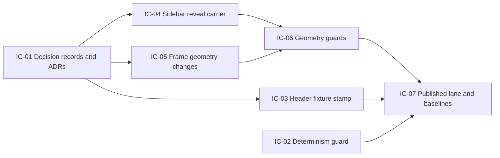

# Implementation Plan: Layout guards and decisions

**Branch**: `feat/layout-guards-decisions` | **Date**: 2026-10-19 | **Spec**: [spec.md](./spec.md)
**Input**: Mission specification from `kitty-specs/layout-guards-decisions-01M59CGE/spec.md`

## Summary

Ship the owner's layout decisions for issues #199 to #207, #216 and #217, and give
each one a guard that a do-nothing change fails. The work has three parts:

1. **Two ADRs and the decision records.** Changing the carrier lock and the frame
   default needs new ADRs, because accepted ADRs are immutable.
2. **The reader-visible changes.** These are a sixth carrier (`Sidebar`) that
   reveals the current entry before first paint, a header search that tracks the
   reading column, toggle clearance, a 120rem default frame cap, and a band-width
   persona card.
3. **The guards.** Machine-surface determinism, a stamped and carrier-free header
   fixture, explicit target sizes, the no-sidebar recentre, and a published-sidebar
   lane.

No new dependency is added. Screenshot baselines are regenerated once, at the end,
by the CI baseline workflow.

## Technical Context

**Language/Version**: TypeScript 5.9 and Astro components on Node 22 (pnpm 11); Astro 7.4.0, Starlight 0.42.6
**Primary Dependencies**: `@spec-kitty/doc-toolkit` (`src/`), Starlight component overrides, CSS custom properties; no new packages
**Storage**: N/A (build-time static output in `example/dist` and `example/dist-nodrafts`)
**Testing**: Vitest (`src/tests`, fast and build projects); Playwright 1.62.1 with `@axe-core/playwright` 4.13.0 (`tests/a11y`, light and dark projects); docs validators (`validate:docs`, `validate:links`, markdownlint, Vale)
**Target Platform**: Static sites on GitHub Pages; evergreen browsers; CI in `mcr.microsoft.com/playwright:v1.62.1-noble`
**Project Type**: single (toolkit package plus example site)
**Performance Goals**: published lane at most +120 s in the a11y job (NFR-001); determinism check +0 builds, at most 1 s (NFR-002); stamp test at most 1 s with no build (NFR-003)
**Constraints**: header markup byte-identical to stock (sidebar-frame-header-carrier-01M4T3CB#NFR-007); exactly six carriers (C-002); no fixture pages in the example (C-003); baselines only from CI, once per set (C-001)
**Scale/Scope**: about 15 source files, about 8 test files, 2 new ADRs, and about 6 docs pages; 68 framed example pages measured at 5 widths

**Supply chain (DIRECTIVE_051)**: this plan adds, upgrades and removes no dependency in any ecosystem, so no install-safety control applies. The one tool fetched during research (Vale 3.18.0, as pinned in `ci.yml`) went to a scratch directory and is not part of the change.

## Charter Check

*GATE: Must pass before Phase 0 research. Re-check after Phase 1 design.*

| Charter rule | How the plan meets it | Result |
| --- | --- | --- |
| Build on Astro + Starlight (ADR-0001); theme and chrome are a layered, swappable concern (ADR-0008) | The reveal stays inside a carrier that composes around Starlight's own `Sidebar`; all layout changes are tokens and CSS, overridable by a site | Pass |
| ADRs are immutable; a change is a new or superseding ADR | ADR-0063 amends the carrier lock (ADR-0013, ADR-0015 and ADR-0044); ADR-0064 supersedes ADR-0045 decision 1 | Pass |
| Path-scoped CI with one `ci-ok` aggregate (ADR-0007) | The published lane joins the existing a11y job, so the `needs` graph and `ci-ok` are unchanged | Pass |
| WCAG 2.2 AA | Target size becomes an explicit check; axe stays at 0 new violations (NFR-004) | Pass |
| Living documentation: a behaviour change updates its docs in the same change | Each concern below names the docs it updates; the changelog carries the breaking default | Pass |
| Writing style (plain language, sentence-case headings, no AI tells) | All new docs go through Vale and markdownlint as in CI | Pass |

Post-design re-check: the design adds one test-only switch to shipping code (IC-03).
It is undocumented for consumers, off by default and unit-tested. It needs no
charter exception, but it is listed under Complexity Tracking.

## Project Structure

### Documentation (this mission)

```
kitty-specs/layout-guards-decisions-01M59CGE/
├── plan.md              # This file
├── research.md          # Phase 0 output
├── data-model.md        # Phase 1 output
├── quickstart.md        # Phase 1 output
├── contracts/           # Phase 1 output
└── tasks.md             # Created by /spec-kitty.tasks, not here
```

### Source Code (repository root)

```
src/
├── components/          # carriers: Head, PageTitle, MarkdownContent, Footer, Header, + Sidebar (new)
├── layouts/Persona.astro
├── lib/
│   ├── config.ts        # carriers map, head scripts, test-only stock-header switch
│   ├── route-shaping.ts # REVEAL_CURRENT_SCRIPT
│   └── theme.ts         # width tokens
├── styles/              # theme.css, dk-components.css, toc-rail.css
├── scripts/             # capture-stock-header.mjs (new)
└── tests/               # vitest: config-invariants, header-carrier, draft-publication-build, route-shaping, stock-header-stamp (new)
    └── fixtures/header-theme/   # stock-header.html, stock-header.meta.json (new), README.txt
tests/a11y/              # playwright: layout-geometry, reading-width, toc-rail, visual, axe, serve-dist.mjs, routes.ts
.github/workflows/       # ci.yml (a11y job, build-example uploads), update-a11y-baselines.yml
docs/adr/                # 0063-sidebar-carrier.md, 0064-default-frame-cap.md (new)
docs/architecture/       # collapsible-toc-rail.md, theming.md, starlight-integration.md
docs/guides/             # consumer-setup.md, adopting.md
example/                 # no new pages (C-003)
```

**Structure Decision**: Single project. The toolkit lives in `src/` and the example
site in `example/`. Every change lands in existing directories. The new files are
one component, one script, one sidecar, one unit test and two ADRs.

## Complexity Tracking

| Violation | Why Needed | Simpler Alternative Rejected Because |
| --- | --- | --- |
| A test-only switch in `createConfig` that drops the `Header` carrier (IC-03) | The owner decided (decision `01M59CR08D2F8D3P8T3D0GN9VD`) that the stock-header fixture must come from the real example built without the carrier | A separate plain-Starlight fixture site would have to mirror by hand whatever `createConfig` passes to Starlight, and drift would silently change what "stock" means |
| A sixth carrier (`Sidebar`) against the five-carrier lock | The owner chose to inline the reveal right after the sidebar markup (#203), which only a `Sidebar` override can place | A head-script observer was offered and declined; ADR-0063 records the choice |

## Implementation Concern Map

> Implementation concerns are not work packages. `/spec-kitty.tasks` turns them into
> work packages.



### IC-01 — Decision records and ADRs

- **Purpose**: Record every owner decision where the next maintainer looks, before the
  code that depends on it lands.
- **Relevant requirements**: FR-009, FR-015 (partly), SC-005; C-002
- **Affected surfaces**:
  - `docs/adr/0063-sidebar-carrier.md`: the sixth carrier; amends the carrier lock.
  - `docs/adr/0064-default-frame-cap.md`: the 120rem default; supersedes ADR-0045
    decision 1.
  - `docs/adr/README.md` (regenerated with `validate:adr-index`).
  - `docs/architecture/collapsible-toc-rail.md`: the accepted rail/no-rail shift
    with measured values, the carrier list, and a re-stamped tripwire.
  - `docs/architecture/theming.md`: the persona alignment; centring rejected.
  - `kitty-specs/sidebar-frame-header-carrier-01M4T3CB/acceptance-matrix.json` and
    `spec.md`: FR-010 moves from "code review" to the simulation test, and the NFR-005
    reveal half points to this mission.
- **Sequencing/depends-on**: none
- **Risks**:
  - The ADR numbers 0063 and 0064 assume nothing else lands first; re-check before
    writing.
  - The ADR index generator must pass `--check`.

### IC-02 — Machine-surface determinism guard (#201)

- **Purpose**: Prove that two same-input drafts-off builds produce byte-identical
  machine surfaces, reusing the `offRepeat` build that already exists.
- **Relevant requirements**: FR-001, NFR-002
- **Affected surfaces**: `src/tests/draft-publication-build.test.ts` (one exported
  surface manifest of globs, the drafts-off vs repeat comparison, an empty-glob
  failure, and `rss.xml`, `okf/**`, `pagefind/**` and `api/pages/*` added to the
  drafts-on vs drafts-off list with the draft pages as named expected diffs).
- **Sequencing/depends-on**: none
- **Risks**:
  - Both builds share a warm `.astro` cache and one checkout path. Cold-cache and
    path independence are an accepted gap, already shown in the research.
  - The positive control mutates a copy of one output file inside the test, never
    the dist.

### IC-03 — Header fixture stamp and carrier-free capture (#207)

- **Purpose**: Make the stock-header fixture real Starlight output again, and make an
  upgrade fail fast with a fix-it message.
- **Relevant requirements**: FR-002, FR-003, FR-015 (provenance comments), NFR-003
- **Affected surfaces**:
  - `src/lib/config.ts`: a test-only environment switch omits only `Header` from the
    carriers map.
  - `src/tests/config-invariants.test.ts`: the switch is off by default, and the
    carrier count is exact with and without it.
  - `src/scripts/capture-stock-header.mjs` (new): builds with the switch, extracts and
    normalises the header, and writes the fixture and the stamp.
  - `src/tests/fixtures/header-theme/stock-header.meta.json` (new).
  - A new fast test compares the stamp with the installed versions.
  - `src/tests/header-carrier.test.ts` and `README.txt`: provenance.
  - `package.json`: a `fixture:stock-header` script.
- **Sequencing/depends-on**: IC-01 (the carrier count moves to six there, so this
  concern's invariant test is written against six)
- **Risks**:
  - The regenerated fixture may differ from today's if the carrier was not perfectly
    neutral. That would be a finding, not noise: diff it and report it.
  - Resolving the installed versions must use the example's own resolution, as
    `createRequire` does from `example/package.json`.

### IC-04 — Sidebar reveal carrier (#203)

- **Purpose**: Reveal the current sidebar entry before first paint, by an inline script
  emitted right after Starlight's sidebar tree (so after Starlight's restore script).
- **Relevant requirements**: FR-004, NFR-005, C-002
- **Affected surfaces**:
  - `src/components/Sidebar.astro` (new): composes Starlight's `Sidebar`, then emits
    the inline script.
  - `src/lib/config.ts`: adds `Sidebar` to the carriers and removes the
    `REVEAL_CURRENT_SCRIPT` head entry.
  - `src/lib/route-shaping.ts`: the script runs immediately when inline, and keeps
    the popover `toggle` re-reveal.
  - `src/tests/route-shaping.test.ts` and `config-invariants.test.ts`.
  - `tests/a11y/sidebar-reveal.spec.ts` (new): a fail-first test reads the pane's
    `scrollTop` at first paint and at `DOMContentLoaded`, with the rest of the HTML
    delayed by a slow-server helper in `tests/a11y/helpers/`.
  - `docs/architecture/collapsible-toc-rail.md` and `starlight-integration.md`.
- **Sequencing/depends-on**: IC-01
- **Risks**:
  - Composing `Sidebar` must not change its markup apart from the appended script.
    A unit or build check compares the sidebar block with and without the carrier.
  - The script must still run after Starlight's restore. Placement guarantees it,
    and the in-session test proves it.
  - The script must stay a no-op on the closed mobile popover.

### IC-05 — Frame geometry changes (#205, #206, #216, #217)

- **Purpose**: Apply the four reader-visible geometry decisions through tokens and
  CSS that a site can override.
- **Relevant requirements**: FR-005, FR-006, FR-007, FR-008, FR-016, NFR-004,
  NFR-006
- **Affected surfaces**:
  - `src/styles/theme.css`: `--dk-width-frame` defaults to 120rem.
  - `src/lib/theme.ts`: token registry and docs.
  - `src/styles/dk-components.css`: the column start becomes one toolkit-owned length
    that the header's first grid track also uses, so the search tracks the column on
    rail, no-rail and collapsed pages and under a cap.
  - `src/styles/toc-rail.css`: the collapsed pane's end padding is at least the toggle
    plus 4 px below 84rem, the duplicate rail-link minimum goes, and stale comments
    are fixed.
  - `src/layouts/Persona.astro`: `max-width: var(--dk-width-band)`, keeping
    `--dk-width-passport` as the hook.
  - `docs/guides/consumer-setup.md` and `adopting.md`, `README.md`: explain the cap,
    the default and the opt-out, and fix the 720 px figures.
  - `CHANGELOG.md`: the breaking default and the migration line.
  - Tests:
    - `tests/a11y/frame-alignment.spec.ts` (new): search vs column, toggle
      clearance, the cap, and narrow layouts unchanged.
    - `tests/a11y/persona-card.spec.ts` (new).
    - `tests/a11y/layout-geometry.spec.ts` and `reading-width.spec.ts`: only where
      the 120rem default moves an existing expectation.
- **Sequencing/depends-on**: IC-01
- **Risks**:
  - The header must stay byte-identical (NFR-007 of the earlier mission), so the
    search fix is CSS on the stock header only. It is unlayered and wins over
    `@layer starlight.core` by layer order, not by specificity.
  - It must not depend on Starlight's private `--__*` properties beyond what the
    track formula already reads; the plan prefers setting `grid-template-columns`
    from toolkit lengths.
  - The cap must leave every layout at 1920 px and below unchanged (NFR-006); assert
    it before regenerating baselines.

### IC-06 — Geometry guards (#199, #202, plus #216 and #217 assertions)

- **Purpose**: Add the assertions that pin FR-010, NFR-004 and the new geometry, each
  proven to fail first.
- **Relevant requirements**: FR-005, FR-006, FR-008, FR-010, FR-011, SC-001, SC-003
- **Affected surfaces**: new spec files (research D-05), each light-project only:
  - `tests/a11y/no-sidebar-recentre.spec.ts`: the DOM-derived no-sidebar simulation
    at 5 widths × 2 states.
  - `tests/a11y/target-size.spec.ts`: the per-region target-size check with the
    spacing exception.
  - `tests/a11y/helpers/` for the shared measuring code.

  The search, toggle and cap assertions go in `tests/a11y/frame-alignment.spec.ts`
  with the CSS change (IC-05). The persona assertion goes in
  `tests/a11y/persona-card.spec.ts`, and the 2560 expectations in
  `reading-width.spec.ts`, both with IC-05.
- **Sequencing/depends-on**: IC-04, IC-05
- **Risks**:
  - Each assertion needs a recorded fail-first proof: a mutation and the red output,
    in the work package's review notes.
  - Geometry must measure boxes, not glyphs, so it is font-independent (#217).

### IC-07 — Published lane and baseline regeneration (#200)

- **Purpose**: Measure the sidebar that readers see, and regenerate every screenshot
  baseline once.
- **Relevant requirements**: FR-012, FR-013, FR-014, NFR-001, C-001
- **Affected surfaces**:
  - `.github/workflows/ci.yml`: the build-example job uploads `dist-nodrafts`, and the
    a11y job downloads both dists.
  - `playwright.config.ts`: a `webServer` array, plus `published-light` and
    `published-dark` projects limited to the sidebar specs.
  - `tests/a11y/serve-dist.mjs`: `DK_A11Y_DIST`, and `DK_A11Y_EXPECT_DRAFTS=on|off`
    that is fatal both ways.
  - A sidebar membership test.
  - `.github/workflows/update-a11y-baselines.yml`: builds both dists and updates all
    projects.
  - `tests/a11y/__screenshots__/**`: regenerated by that workflow only.
- **Sequencing/depends-on**: IC-02, IC-03, IC-06 (land last so baselines move once)
- **Risks**:
  - Baselines can only come from the workflow in the pinned container. The local
    Chromium build 1194 and its fonts must never write them.
  - The workflow is run once, on the mission branch, after every layout change has
    landed.

## Phase 0 and Phase 1 outputs

- [research.md](./research.md): the decisions taken in planning, with alternatives.
  The owner's product decisions are in the research note.
- [data-model.md](./data-model.md): the stamp, the surface manifest and the a11y
  server's environment contract.
- [contracts/](./contracts/): the stamp schema and the a11y server's environment
  contract.
- [quickstart.md](./quickstart.md): how to run each guard locally and see it fail
  first.
