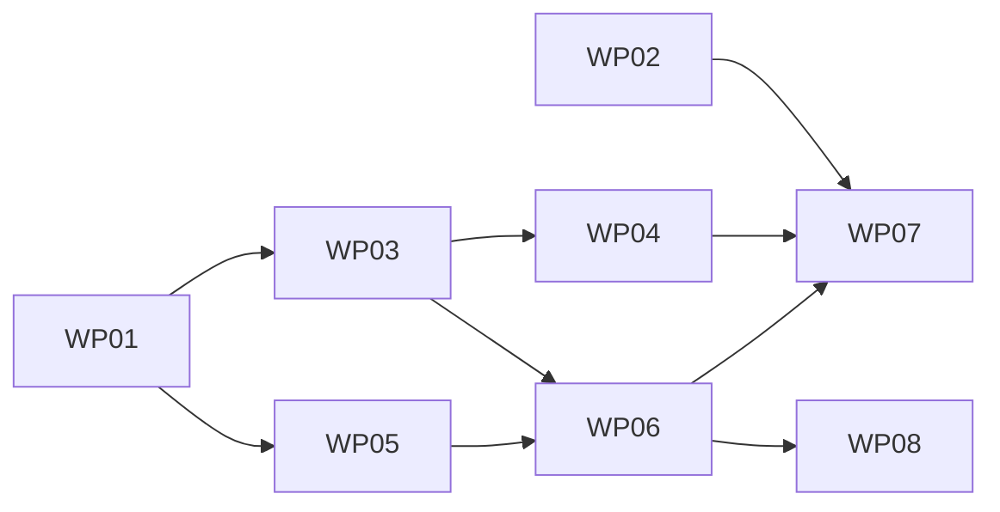

# Tasks: Layout guards and decisions

**Mission**: `layout-guards-decisions-01M59CGE`
**Spec**: [spec.md](./spec.md) · **Plan**: [plan.md](./plan.md) · **Research**: [research.md](./research.md)
**Owner decisions**: [`docs/architecture/research/layout-guards-and-decisions.md`](../../docs/architecture/research/layout-guards-and-decisions.md) ("Decisions taken")
**Planning base / merge target**: `feat/layout-guards-decisions`

Subtask rows below are references, not checkboxes. Completion is recorded with
`spec-kitty agent tasks mark-status Txxx --status done`.

## Subtask Index

| ID | Description | WP | Parallel |
| --- | --- | --- | --- |
| T001 | Write ADR-0063: `Sidebar` is the sixth carrier | WP01 | [P] |
| T002 | Write ADR-0064: the frame is capped at 120rem by default | WP01 | [P] |
| T003 | Regenerate and check the ADR index; cross-link related ADRs | WP01 | |
| T004 | Update the rail architecture page (#204 accepted shift, six carriers, tripwire) | WP01 | [P] |
| T005 | Update the theming and Starlight integration pages | WP01 | [P] |
| T006 | Amend the earlier mission's acceptance matrix and spec (FR-010, NFR-005) | WP01 | [P] |
| T007 | Declare one machine-surface manifest with a glob walker | WP02 | |
| T008 | Compare drafts-off and its repeat build byte for byte over the manifest | WP02 | |
| T009 | Extend the drafts-on vs drafts-off comparison to the manifest | WP02 | |
| T010 | Prove the determinism check fails first (positive control) | WP02 | |
| T011 | Red first: slow-server helper and `sidebar-reveal.spec.ts` | WP03 | |
| T012 | Add the `Sidebar` carrier that composes Starlight's sidebar | WP03 | |
| T013 | Make the reveal script run inline, keep the popover re-reveal | WP03 | |
| T014 | Register `Sidebar` and drop the head reveal entry in `config.ts` | WP03 | |
| T015 | Update the carrier invariants to six | WP03 | |
| T016 | Add the test-only stock-header switch | WP03 | |
| T017 | Assert the reveal script ships once per sidebar page | WP03 | |
| T018 | Write the stock-header capture script | WP04 | |
| T019 | Capture the fixture and its stamp without the carrier | WP04 | |
| T020 | Add the fast stamp test with the regeneration hint | WP04 | |
| T021 | Correct the fixture provenance and add the package script | WP04 | |
| T022 | Red first: header search tracks the reading column | WP05 | |
| T023 | Red first: collapsed column clears the toggle | WP05 | |
| T024 | Red first: 120rem default, opt-out, narrow layouts unchanged | WP05 | |
| T025 | Red first: persona card start-aligned at band width | WP05 | |
| T026 | Change the frame and passport token defaults | WP05 | |
| T027 | Share one column-start length with the header's first track | WP05 | |
| T028 | Pad the collapsed pane past the toggle; tidy the rail sheet | WP05 | |
| T029 | Move existing expectations the default cap changes | WP05 | |
| T030 | Write the no-sidebar simulation helper | WP06 | |
| T031 | Write `no-sidebar-recentre.spec.ts` (FR-010 guard) | WP06 | |
| T032 | Write the target collector | WP06 | [P] |
| T033 | Write the WCAG 2.5.8 spacing-exception check | WP06 | [P] |
| T034 | Write `target-size.spec.ts` over the route and width matrix | WP06 | |
| T035 | Record the fail-first proofs for both guards | WP06 | |
| T036 | Rewrite the consumer setup cap section; fix the 720px figures | WP07 | |
| T037 | Surface the cap in the adopting guide and the README | WP07 | [P] |
| T038 | Write the CHANGELOG `[Unreleased]` entry | WP07 | |
| T039 | Run the docs validators | WP07 | |
| T040 | Give the a11y server a dist and an expected draft mode | WP08 | |
| T041 | Add the published Playwright projects and a second web server | WP08 | |
| T042 | Write `sidebar-membership.spec.ts` | WP08 | |
| T043 | Upload `dist-nodrafts` and feed it to the a11y job | WP08 | |
| T044 | Build both dists in the baseline workflow | WP08 | |
| T045 | Update the lane comments in `routes.ts` and the config | WP08 | |

## Phase 1: Foundation

### WP01: Decision records and ADRs

- **Prompt**: [tasks/WP01-decision-records-and-adrs.md](./tasks/WP01-decision-records-and-adrs.md)
- **Goal**: record every owner decision where the next maintainer looks, before the
  code that depends on it.
- **Priority**: P1 (unblocks WP03, WP05)
- **Independent test**: `pnpm validate:docs`, `pnpm validate:adr-index`,
  `pnpm validate:links` and Vale pass, and every row of "Decisions taken" is cited.
- **Subtasks**:
  - T001 Write ADR-0063: `Sidebar` is the sixth carrier (WP01)
  - T002 Write ADR-0064: the frame is capped at 120rem by default (WP01)
  - T003 Regenerate and check the ADR index; cross-link related ADRs (WP01)
  - T004 Update the rail architecture page (#204 accepted shift, six carriers, tripwire) (WP01)
  - T005 Update the theming and Starlight integration pages (WP01)
  - T006 Amend the earlier mission's acceptance matrix and spec (FR-010, NFR-005) (WP01)
- **Dependencies**: none
- **Risks**: the ADR numbers must still be free when written; ADRs are immutable, so
  ADR-0045 is not edited.

### WP02: Machine-surface determinism guard

- **Prompt**: [tasks/WP02-machine-surface-determinism-guard.md](./tasks/WP02-machine-surface-determinism-guard.md)
- **Goal**: prove NFR-006 for every machine surface, reusing the existing repeat
  build.
- **Priority**: P2
- **Independent test**: `pnpm --filter @spec-kitty/doc-toolkit exec vitest run --project build tests/draft-publication-build.test.ts`
- **Subtasks**:
  - T007 Declare one machine-surface manifest with a glob walker (WP02)
  - T008 Compare drafts-off and its repeat build byte for byte over the manifest (WP02)
  - T009 Extend the drafts-on vs drafts-off comparison to the manifest (WP02)
  - T010 Prove the determinism check fails first (positive control) (WP02)
- **Dependencies**: none (parallel with everything)
- **Risks**: the build suite is slow (four builds); never add a fifth.

## Phase 2: Reader-visible changes

### WP03: Sidebar reveal carrier

- **Prompt**: [tasks/WP03-sidebar-reveal-carrier.md](./tasks/WP03-sidebar-reveal-carrier.md)
- **Goal**: reveal the current sidebar entry before first paint through a sixth
  carrier, and add the test-only stock-header switch to the same carrier map.
- **Priority**: P1
- **Independent test**: `tests/a11y/sidebar-reveal.spec.ts` is red on `main` and
  green here; the config invariants list six carriers.
- **Subtasks**:
  - T011 Red first: slow-server helper and `sidebar-reveal.spec.ts` (WP03)
  - T012 Add the `Sidebar` carrier that composes Starlight's sidebar (WP03)
  - T013 Make the reveal script run inline, keep the popover re-reveal (WP03)
  - T014 Register `Sidebar` and drop the head reveal entry in `config.ts` (WP03)
  - T015 Update the carrier invariants to six (WP03)
  - T016 Add the test-only stock-header switch (WP03)
  - T017 Assert the reveal script ships once per sidebar page (WP03)
- **Dependencies**: WP01
- **Risks**: the composed sidebar must not change Starlight's markup; the script must
  still follow Starlight's restore script.

### WP04: Header fixture stamp and carrier-free capture

- **Prompt**: [tasks/WP04-header-fixture-stamp-and-capture.md](./tasks/WP04-header-fixture-stamp-and-capture.md)
- **Goal**: make the stock-header fixture real Starlight output and make an upgrade
  fail fast with a fix-it message.
- **Priority**: P2
- **Independent test**: change `starlight` in the stamp and the fast test fails,
  naming `pnpm fixture:stock-header`.
- **Subtasks**:
  - T018 Write the stock-header capture script (WP04)
  - T019 Capture the fixture and its stamp without the carrier (WP04)
  - T020 Add the fast stamp test with the regeneration hint (WP04)
  - T021 Correct the fixture provenance and add the package script (WP04)
- **Dependencies**: WP03 (the switch)
- **Risks**: a recapture that differs from today's fixture is a finding about carrier
  neutrality; report it, do not hide it.

### WP05: Frame geometry: cap, search alignment, toggle clearance, persona

- **Prompt**: [tasks/WP05-frame-geometry.md](./tasks/WP05-frame-geometry.md)
- **Goal**: apply #205, #216, #217 and #206 through tokens and CSS, each behind a
  test written first.
- **Priority**: P1
- **Independent test**: `tests/a11y/frame-alignment.spec.ts` and
  `tests/a11y/persona-card.spec.ts` are red on `main` and green here; NFR-006 holds.
- **Subtasks**:
  - T022 Red first: header search tracks the reading column (WP05)
  - T023 Red first: collapsed column clears the toggle (WP05)
  - T024 Red first: 120rem default, opt-out, narrow layouts unchanged (WP05)
  - T025 Red first: persona card start-aligned at band width (WP05)
  - T026 Change the frame and passport token defaults (WP05)
  - T027 Share one column-start length with the header's first track (WP05)
  - T028 Pad the collapsed pane past the toggle; tidy the rail sheet (WP05)
  - T029 Move existing expectations the default cap changes (WP05)
- **Dependencies**: WP01
- **Risks**: header markup stays byte-identical (CSS only); the default cap must not
  move any layout at 1920px or narrower.

## Phase 3: Guards

### WP06: Geometry guards: no-sidebar recentre and target size

- **Prompt**: [tasks/WP06-geometry-guards.md](./tasks/WP06-geometry-guards.md)
- **Goal**: pin FR-010 and NFR-004 of the earlier mission with tests that fail
  first.
- **Priority**: P2
- **Independent test**: each guard turns red on its documented mutation.
- **Subtasks**:
  - T030 Write the no-sidebar simulation helper (WP06)
  - T031 Write `no-sidebar-recentre.spec.ts` (FR-010 guard) (WP06)
  - T032 Write the target collector (WP06)
  - T033 Write the WCAG 2.5.8 spacing-exception check (WP06)
  - T034 Write `target-size.spec.ts` over the route and width matrix (WP06)
  - T035 Record the fail-first proofs for both guards (WP06)
- **Dependencies**: WP03, WP05 (final geometry)
- **Risks**: measure boxes, not glyphs, so the checks do not depend on the font.

### WP07: Consumer docs and changelog

- **Prompt**: [tasks/WP07-consumer-docs-and-changelog.md](./tasks/WP07-consumer-docs-and-changelog.md)
- **Goal**: tell consumers about the 120rem default and its opt-out, and record the
  mission in the changelog.
- **Priority**: P2
- **Independent test**: the docs validators and Vale pass; the changelog names the
  opt-out line.
- **Subtasks**:
  - T036 Rewrite the consumer setup cap section; fix the 720px figures (WP07)
  - T037 Surface the cap in the adopting guide and the README (WP07)
  - T038 Write the CHANGELOG `[Unreleased]` entry (WP07)
  - T039 Run the docs validators (WP07)
- **Dependencies**: WP02, WP03, WP04, WP05, WP06
- **Risks**: the changelog must describe what shipped, so it comes after the code.

### WP08: Published-sidebar lane

- **Prompt**: [tasks/WP08-published-sidebar-lane.md](./tasks/WP08-published-sidebar-lane.md)
- **Goal**: measure the sidebar readers see, in the same CI job, with a server that
  can never serve the wrong dist.
- **Priority**: P1
- **Independent test**: `published-light` runs the sidebar specs against the
  drafts-off dist; the server refuses a mismatched dist.
- **Subtasks**:
  - T040 Give the a11y server a dist and an expected draft mode (WP08)
  - T041 Add the published Playwright projects and a second web server (WP08)
  - T042 Write `sidebar-membership.spec.ts` (WP08)
  - T043 Upload `dist-nodrafts` and feed it to the a11y job (WP08)
  - T044 Build both dists in the baseline workflow (WP08)
  - T045 Update the lane comments in `routes.ts` and the config (WP08)
- **Dependencies**: WP06 (and so WP03, WP05)
- **Risks**: the published projects must not run every spec (NFR-001: at most 120s).

## After all lanes merge (orchestrator, not a work package)

1. Push `feat/layout-guards-decisions`.
2. Dispatch the "Update a11y baselines" workflow from that branch with
   `target_branch=feat/layout-guards-decisions`. It writes both baseline sets in
   the pinned container (C-001).
3. Review the image diffs and merge its `ci/a11y-baselines-*` branch into the
   feature branch.
4. Confirm the full a11y lane is green, and read the job's added time from the logs
   (NFR-001).

## Dependency graph

**Parallel opportunities**: WP01 and WP02 start at once. WP03 and WP05 run in
parallel after WP01. WP04 runs alongside WP05 and WP06. WP07 and WP08 run in
parallel at the end.

**MVP**: WP01 + WP03 + WP05. Those carry every reader-visible decision; the rest
are guards.
