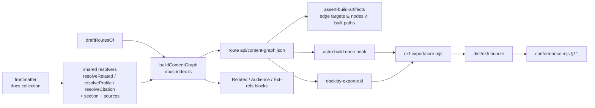

# Implementation Plan: OKF alignment and content graph

**Branch**: `feat/okf-alignment-content-graph` | **Date**: 2026-10-18 | **Spec**: [spec.md](./spec.md)
**Input**: Mission specification from `kitty-specs/okf-alignment-content-graph-01M56PNW/spec.md`. Binding design: [ADR-0059](../../docs/adr/0059-content-graph-and-okf-alignment.md).

## Summary

Three issues, delivered in order #177 → #176 → #178:

1. **Metadata alignment (#177).** Pure rules for instants (`updated`, `stale_after`, `generated.at`, `verified[].at`), actors and `doc_status`→`status` land in `vocabulary-core.mjs`, so both validator twins share them and parity holds by construction. One generator-stamp module gives every generator a versioned actor (`<producer>/<toolkit version>`), a stable `generated.at` and a `generated.content_hash`. A one-off script migrates `docs/` and `example/`.
2. **Content graph (#176).** A pure `buildContentGraph()` sits next to `buildDocsIndex()` in `docs-index.ts`. It reuses `resolveRelated`, `resolveProfile` and `resolveCitation`, excludes drafts with `draftRoutesOf`, and sorts with `compareCodeUnit`. A new static route serialises it to `api/content-graph.json`. `api/index.json` links the file in `_links`, and the artifact gate walks it.
3. **OKF export (#178).** A pure export core reads a built `content-graph.json` and the source tree and writes a plain OKF v0.2 bundle. Two callers use it: the `dockitty-export-okf` bin and an `astro:build:done` hook that writes `dist/okf/`. An in-repo checker asserts the §11 rules.

No new runtime or dev dependencies.

## Technical Context

**Language/Version**: TypeScript 5.7+ (toolkit; root 5.9) and pure ESM `.mjs` on Node ≥ 22; Astro ^5.2 with `@astrojs/starlight` ^0.32.6 (peer range `>=0.32.0 <0.33.0`); toolkit package `@spec-kitty/doc-toolkit` 0.3.0 (`src/package.json`).
**Primary Dependencies**: Astro content collections + Zod (via `astro:content`), `@astrojs/sitemap`, `yaml`/gray-matter parsing already used by `validate-frontmatter.mjs`, `node:crypto` (sha256). Nothing new.
**Storage**: Files. Source Markdown under `docs/` and `example/docs/`; build output under `dist/` (`dist/api/content-graph.json`, `dist/okf/`).
**Testing**: Vitest (`src/`, `fileParallelism: false`), the example build plus `assert-build-artifacts.mjs`, pinned example baselines, the agent-API `_links` tests and the packed-tarball consumption test (`tests/consumption/consumption-gap.test.ts`). Playwright is not touched.
**Target Platform**: Static site build (GitHub Pages) and Node CLI bins for adopters.
**Project Type**: Single project. A toolkit package (`src/`), a worked example (`example/`) and the repo's own docs (`docs/`).
**Performance Goals**: Graph plus always-on export add ≤ 10% to the example build wall time (NFR-006, measured once).
**Constraints**: Byte determinism across builds and regenerations (NFR-001); 100% validator parity (NFR-002); zero new warnings on our trees (NFR-003); an old-form tree still exits 0 (NFR-004); C-001..C-011. In particular: single owners (C-009), the export reads the built graph (C-010), edge ids derived from content (C-011), tests strengthened before any new one is added (C-005, DIRECTIVE_041).
**Scale/Scope**: About 200 example pages and about 120 repo-doc pages. 5 edge kinds. One new route, one new bin, one build hook.

## Charter Check

| Charter rule | Status | How this plan meets it |
|---|---|---|
| Three separated axes (content / IA / presentation) | Pass | The graph reads content and the section registry and adds no presentation. The export is a separate output. |
| Metadata contract via ADR (ADR-0009, ADR-0059) | Pass | All shape changes follow ADR-0059. The glossary stamp change is recorded in the ADR-0059 touch (see IC-02 risk). |
| ADRs immutable once accepted | Pass | No ADR text is rewritten. Clarifications go into a dated "Implementation notes" addendum, or a new ADR if a decision changes. |
| Doc-sanity: frontmatter, links, `related` integrity fail closed | Pass | The new warnings are advisory (NFR-004). The graph edge-target check fails closed (FR-014). |
| Living documentation | Pass | The metadata model, the export guide and the changelog change in the same mission (IC-08). |
| Agent-API is discovery, not retrieval | Pass | The graph holds structure and metadata only, no bodies. |
| Tree conforms to OKF v0.2 | Pass, strengthened | A raw tree still carries per-index `okf_version` (ADR-0059 §3). The export is strictly conformant. |
| Writing policy (descriptions 50–180 chars, changelog ≤ 1,200) | Pass | Gated by C-006 on new pages. |
| Node 22+, pnpm | Pass | No toolchain change. |

No violations, so Complexity Tracking stays empty.

## Decisions on "Plan must decide"

Full rationale and alternatives are in [research.md](./research.md).

1. **Export bundle location and form.** A **directory, `dist/okf/`**, written in `astro:build:done` from `dist/api/content-graph.json` plus the source tree. No archive: an archive is not byte-deterministic without extra care, it hides the bundle from the site's static hosting, and an adopter can zip `dist/okf/` in one line. `dist/okf/` is served as-is. The sitemap does not list it, because the hook runs after the sitemap is written. The CLI writes the same layout to `--out` (default `./okf-export`).
2. **Catalog and persona targets.** Personas are pages (`context/audience/<profile>`) and are linked as bundle paths. A catalog citation (`cites`) links to the catalog entry's `url` when it has one, as an absolute external link (OKF §6.2 allows external URLs). An entry with no URL is omitted from the body and kept as a `sources` entry. Catalog entries are never invented as bundle files. SC-003 compares page-to-page edges only.
3. **Preserved index metadata.** A **sidecar per index**, `_index.meta.yaml`, next to each exported `index.md` (excluding the root). The YAML holds the original index frontmatter verbatim, with sorted keys. It is not `.md`, so OKF §11 does not apply to it, and readers ignore unknown files (§12). A concept page was rejected because it would create a fake concept and graph node.
4. **Source of `in-section` and `derived-from`.**
   - **`in-section`**: page → its section index. The source is the parent directory's index, resolved with the existing route table (`readmeToIndexId`/`resolveIndexEntries`) and `sectionOf()` in `metadata.ts:217`. The section registry (`sections.yaml`) supplies labels only. One edge per non-index page, to the nearest ancestor index that exists and is published.
   - **`derived-from`**: page → resource. The source is `sources[].resource`. When the resource is a bundle page, the target is that page id. Otherwise the target is a `resource:<url-or-path>` node id, and the edge is emitted only if that resource node is in the graph (one is created for each distinct `sources` resource, kind `resource`). The Gherkin generator's `sources` entry (`feature-core.mjs:657`) is the main producer. There is no `generated.source` field today, so none is introduced.
5. **What counts as an index file (FR-003).** A file whose basename (without `.md`) is in `normalizeIndexBasenames(indexBasename)` (`vocabulary-core.mjs:792`; default `README`, plus `index` when configured). The same function that drives routing decides this, so the two cannot drift. The bundle-root index is the one at the docs root.
6. **`log.md`.** None exists in `docs/` or `example/docs/` (verified with find). The export reserves the name. A source `log.md` is copied as-is, without frontmatter rewriting (OKF §3 reserved file), and is not given a `type`. The checker exempts reserved names (`index.md`, `log.md`). No `log.md` is generated.

## Project Structure

### Documentation (this mission)

```
kitty-specs/okf-alignment-content-graph-01M56PNW/
├── plan.md
├── research.md
├── data-model.md
├── quickstart.md
├── contracts/
│   ├── content-graph.schema.json
│   └── okf-export.md
└── tasks.md             # /spec-kitty.tasks output
```

### Source Code (repository root)

```
src/
├── lib/
│   ├── vocabulary-core.mjs        # + parseActor/isActor, normaliseInstant, okfStatusOf (C-009 owner)
│   ├── generator-stamp.mjs        # NEW: toolkitVersion(), makeStamp(prev, hash, producer), isGeneratedStamp()
│   ├── schema.ts                  # updated/stale_after/generated/verified/okf_version twins (:150-233)
│   ├── docs-index.ts              # + buildContentGraph() next to buildDocsIndex (:58)
│   ├── metadata.ts                # updatedMillis (:285), toAgentRecord (:327), rankForFeed (:489); resolvers reused
│   ├── draft-publication.mjs      # draftRoutesOf (:392), the shared draft predicate
│   ├── routes/agent-index.ts      # version '2'→'3', _links.contentGraph
│   ├── routes/content-graph.ts    # NEW static route
│   ├── routes/rss.ts              # full-timestamp pubDate
│   ├── okf-export/core.mjs        # NEW pure export: graph + tree → file map
│   ├── okf-export/conformance.mjs # NEW §11 checker
│   ├── okf-export/integration.ts  # NEW astro:build:done → dist/okf/
│   ├── gherkin/{feature-core,generate,include-scan}.mjs
│   └── glossary/generate.ts
├── scripts/
│   ├── validate-frontmatter.mjs   # twin (:105-401), GENERATED_BY_STAMPS (:113-143)
│   ├── scaffold.mjs               # :114-166
│   ├── generate-adr-index.mjs     # :76-114 (date display kept)
│   ├── assert-build-artifacts.mjs # graph walk (:349-384, :2391)
│   ├── export-okf.mjs             # NEW bin dockitty-export-okf
│   └── (one-off) migrate-okf-metadata.mjs   # under scripts/oneoff/, run once, not a bin
├── components/PageTitle.astro, layouts/Persona.astro
└── package.json                   # bin + version source (C-004)
tests/ (src/tests, tests/consumption)
docs/, example/docs/               # migrated trees
```

**Structure Decision**: Single project. New code goes into the existing `src/lib` owner modules plus one `okf-export/` folder. No new package.

## Graph → export flow



## Complexity Tracking

None.

## Implementation Concern Map

Ordered #177 → #176 → #178. Each concern names its seams, the existing test it strengthens (DIRECTIVE_041: at most one new focused test per change), and its ripple.

### IC-01 — Shared metadata rules in the vocabulary core (#177)

- **Purpose**: One owner for the actor grammar, instant normalisation (value plus a `dateOnly` flag), the `okf_version` check and the `doc_status`→`status` mapping, imported by both twins.
- **Relevant requirements**: FR-001, FR-002, FR-003 (rule), FR-004, FR-008 (function), FR-021, FR-022, FR-023; NFR-002, NFR-004.
- **Affected surfaces**:
  - `src/lib/vocabulary-core.mjs`: new exports next to `STATUSES` (:159).
  - `src/lib/schema.ts:150-233`: `updated`, `stale_after` and `verified` (list or bare mapping), `generated.content_hash`, `authors`.
  - `src/scripts/validate-frontmatter.mjs:105-401`: warnings for date-only, email author, missing or non-`"0.2"` `okf_version`.
- **Tests strengthened**: `schema-validator-parity.test.ts` gets fixtures for every form (UTC, date-only, email, `human:`, tool/version, `process:`, numeric and string `okf_version`, bare `verified`). One focused test, `okf-status-mapping`, enumerates `STATUSES` and asserts totality (the settled rule).
- **Sequencing/depends-on**: none.
- **Risks**: `z.coerce.date()` must not become a parser of its own. Both twins must call `normaliseInstant` so they cannot diverge. A charter-added status maps to `stable` unless the charter declares a mapping. Keep it total.

### IC-02 — Generator stamp module and generators (#177)

- **Purpose**: Versioned, stable stamps, with generated-page detection by prefix.
- **Relevant requirements**: FR-005, FR-006; SC-004; NFR-001.
- **Affected surfaces**:
  - New `src/lib/generator-stamp.mjs`. `toolkitVersion()` reads `src/package.json` relative to the module (C-004), never the root manifest. `makeStamp({producer, hash, previous, now})` reuses `previous.at` when `previous.content_hash === hash`. `isGeneratedStamp(by, producer)` matches by prefix.
  - Gherkin: `feature-core.mjs:29` (`GENERATED_BY` becomes the producer id `doc-kitty-gherkin`), :121, :209 (`shortHash` moves to `content_hash`), :658, :712; `generate.mjs:16,430,480` (detection); `include-scan.mjs:140`.
  - `validate-frontmatter.mjs:113-143`: `GENERATED_BY_STAMPS` becomes prefix detection.
  - `glossary/generate.ts:153`: the key sets gain `generated`.
  - `scaffold.mjs:114-166`: UTC `updated`, `okf_version` on every index, `human:` placeholder author.
- **Tests strengthened**: `gherkin-feature-core.test.ts` (stamp shape, idempotent rerun, content change moves `at`/`content_hash`, version bump changes only `by`); the generated-page exemption case in the validator suite (FR-006 positive control); the existing glossary generator test (key-set recognition with the stamp).
- **Sequencing/depends-on**: IC-01 (actor and instant rules).
- **Risks**: the glossary previously ruled out a `generated:` stamp (its own C-003). FR-005 overrides that, so record it in the ADR-0059 implementation notes (IC-08). The pinned Gherkin example pages change bytes once. "Now" must be injectable so tests stay deterministic.

### IC-03 — `updated` consumers and agent-index version (#177)

- **Purpose**: Full timestamps render and sort the same as their date-only twins.
- **Relevant requirements**: FR-009, FR-024.
- **Affected surfaces**:
  - `metadata.ts`: :285 `updatedMillis`, :329 `toAgentRecord` (serialise ISO `…Z`), :475-493 `rankForFeed` (slug tie-break stays last).
  - `routes/rss.ts:48`.
  - `PageTitle.astro:61,105` and `Persona.astro:65,108`: display stays date-only, in UTC.
  - `generate-adr-index.mjs:76-114`: keeps `YYYY-MM-DD`.
  - `routes/agent-index.ts:110-119`: version `'2'`→`'3'`.
- **Tests strengthened**: `collect-doc-entries-order.test.ts` (a date-only twin and a timestamp on the same day sort the same); `agent-api.test.ts` (version and record `updated` format). The FR-009 positive control goes in the existing order test.
- **Sequencing/depends-on**: IC-01.
- **Risks**: a timezone leak in display (use UTC getters). The RSS bytes change, so update the pinned baselines in the same change (C-007).

### IC-04 — Tree migration and metadata-model doc (#177)

- **Purpose**: Our trees pass with zero new warnings.
- **Relevant requirements**: FR-007, FR-008 (doc), FR-003 (tree); NFR-003.
- **Affected surfaces**: one-off `src/scripts/oneoff/migrate-okf-metadata.mjs` (run once, committed for audit, not a bin). It rewrites `updated: YYYY-MM-DD` to `…T00:00:00Z`, email to `human:<local-part>`, and adds `okf_version: "0.2"` to every index. It edits text in place (regex on the frontmatter block) so key order and comments are kept. Also `docs/architecture/metadata-model.md` (mapping table).
- **Tests strengthened**: none new. The doc-sanity gate on both trees is the oracle. Pinned example baselines are refreshed in the same change.
- **Sequencing/depends-on**: IC-01, IC-02, IC-03 (the generators must emit the new form first, or regeneration reverts the change).
- **Risks**: this is a bulk edit. Use plain edits through the script (the bulk-edit guardrail hazard). Large diff, so keep it in its own commit.

### IC-05 — Content graph builder, route and gate (#176)

- **Purpose**: One request returns the whole site structure.
- **Relevant requirements**: FR-010..FR-014; SC-001, SC-005; NFR-001.
- **Affected surfaces**:
  - `docs-index.ts`: new `buildContentGraph(entries, {drafts, catalog, sections})`.
  - New `routes/content-graph.ts`, mounted where the agent routes are mounted (always on).
  - `agent-index.ts:24-35`: `_links.contentGraph` (always declared).
  - `draft-publication.mjs:392`: `draftRoutesOf` (all drafts, whatever the publication setting).
  - `assert-build-artifacts.mjs:349-384,:2391`: follow `_links.contentGraph` and check edge targets against node ids and built paths.
- **Tests strengthened**: `agent-api.test.ts` (`_links` gains contentGraph); `type-registry-authority.test.ts` if section typing feeds `in-section`; the artifact-gate suite gets a dangling-edge fixture (fails, names the edge) and a draft-target fixture (not reported). One focused test, `content-graph.test.ts`, covers builder determinism, the edge id, sorting, and graph edges equal to the rendered block resolvers for a sample page (SC-001).
- **Sequencing/depends-on**: IC-01, IC-03 (node `updated`/`status` fields). It does not need IC-04, but the baselines are cleaner after it.
- **Risks**: pinned example baselines and the remark/integration enumerator change (the determinism-hardening lesson). The consumption test sees a new file. The rendered blocks must call the same functions; do not copy logic into the builder.

### IC-06 — OKF export core, conformance checker and CLI (#178)

- **Purpose**: Turn the graph plus the tree into a plain OKF bundle.
- **Relevant requirements**: FR-015, FR-016, FR-017, FR-019, FR-025, FR-026; SC-002, SC-003.
- **Affected surfaces**:
  - New `okf-export/core.mjs`: a pure `(graph, sourceFiles) → Map<path, bytes>`.
  - New `okf-export/conformance.mjs`.
  - New `scripts/export-okf.mjs`.
  - `src/package.json:44-53`: bin `dockitty-export-okf`, plus a `dockitty-check-okf` bin, or a `--check` flag on the export bin (recommended: the flag, to keep one bin).
- **Tests strengthened**: one focused test, `okf-export.test.ts`, covers the mapping, the relations section, an empty-relations page with no heading, sidecars, the conformance positive control (a fixture missing `type` fails), and SC-003 equality.
- **Sequencing/depends-on**: IC-05 (graph schema), IC-01 (mapping).
- **Risks**: the export must not re-resolve relations (C-010). It reads edges only. Link form is `/`-prefixed. Drafts are already absent from the graph, but source files must also be filtered by graph node membership.

### IC-07 — Export build hook and consumption proof (#178)

- **Purpose**: Every build ships `dist/okf/`, proven in a clean-room adopter build.
- **Relevant requirements**: FR-018; NFR-005, NFR-006.
- **Affected surfaces**:
  - New `okf-export/integration.ts`, registered in `config.ts` next to the sitemap-order `build:done` step, and ordered after it.
  - `assert-build-artifacts.mjs`: run the conformance check on `dist/okf/`.
  - `tests/consumption/consumption-gap.test.ts`.
- **Tests strengthened**: `consumption-gap.test.ts` (graph plus bundle present); the artifact gate (bundle conforms; two-build byte diff in the existing determinism oracle).
- **Sequencing/depends-on**: IC-06.
- **Risks**: the vitest build project can clobber `dist/` (a known race), so keep the gate to post-build checks. Measure NFR-006 once.

### IC-08 — Docs, ADR touch, changelog, upstream report (#176-#178)

- **Purpose**: Living documentation and the FR-020 evidence.
- **Relevant requirements**: FR-008 (doc), FR-020, FR-024 (changelog); C-006.
- **Affected surfaces**:
  - An export how-to guide under `docs/guides/` (CLI, layout, viewer gap and upstream issue URL).
  - `docs/architecture/metadata-model.md`.
  - An ADR-0059 "Implementation notes" addendum (the glossary stamp, the decisions above).
  - Root `CHANGELOG.md` (canonical).
- **Tests strengthened**: none. Doc-sanity, links and Vale apply.
- **Sequencing/depends-on**: IC-04..IC-07.
- **Risks**: the upstream issue is filed by the operator (manual evidence). Keep the changelog ≤ 1,200 characters.

Suggested WP mapping: IC-01, IC-02, IC-03, IC-04, IC-05 (possibly split into builder+route and gate+baselines), IC-06, IC-07, IC-08, for 8–9 WPs. IC-02 and IC-03 can run in parallel after IC-01.
