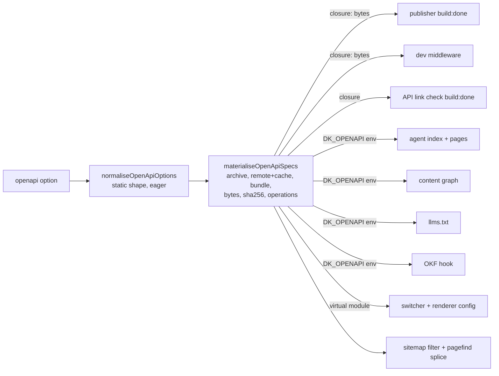

# Implementation Plan: OpenAPI pages, second slice

**Branch**: `feat/openapi-second-slice` (merge target, per meta.json; planned from `kitty/mission-openapi-second-slice-01M6WXJ4`) | **Date**: 2026-11-08 | **Spec**: [spec.md](./spec.md)
**Input**: Mission specification from `kitty-specs/openapi-second-slice-01M6WXJ4/spec.md`, the #285 research debrief and the post-spec rulings R1-R21.

## Summary

Make each OpenAPI spec version one machine-visible entry, finish the #258/#259 polish, widen inputs (#260) and fix the debrief bugs, without changing a site that sets no `openapi`. The design rests on one new seam:

- **Materialisation at config time.** `normaliseOpenApiOptions` keeps the eager static-shape check. A new `materialiseOpenApiSpecs()` step, called from `defineDocKittyIntegrations` right after it, resolves archive globs, fetches pinned remotes (with cache), bundles multi-file definitions, computes the final bytes and sha256 once, extracts the sorted operation list and returns one ordered `MaterialisedSpec[]`. Every surface reads that list (FR-006, FR-007). Nothing re-reads a source file later.
- **Two handoffs, as today.** The bytes stay in the integration closure (publisher, dev middleware, link check). The metadata (label, released, ext, sha256, title, raw route, operations) goes through the existing `DK_OPENAPI` internal env as an extended `OpenApiPublication`. Routes (agent API, content graph, `llms.txt`) and the OKF hook read only that.
- **One summary function.** `openApiSummaryMarkdown(version, publication)` builds the generated Markdown used by the agent page `markdown` field and by the OKF file, so they cannot drift (FR-002, FR-004).
- **Unreleased pages unindexed** by extending the existing `getPageProps` splice with `pagefind: false` for unreleased versions, and by extending the sitemap filter with the unreleased prefixes (FR-015).
- **Switcher** reshapes `OpenApiVersionNav.astro` into a `<details>` of plain links upgraded by `src/lib/disclosure/` (no inline script, no CSP hash).

## Technical Context

**Language/Version**: TypeScript 5.9 and JSDoc-typed ESM (`.mjs`), Astro components, Node >= 22.22 (uses `fs.globSync`, `fetch`)
**Primary Dependencies**: Astro 7.4, `@astrojs/starlight` 0.42.6, `starlight-openapi` 0.27.0 (peer, pinned). New direct dependency: `@readme/openapi-parser` 4.1.2 (pinned; already in the lockfile through the renderer) for bundling (C-006)
**Storage**: Build output only, plus an on-disk fetch cache at `node_modules/.cache/doc-kitty/openapi/<sha256>.<ext>`
**Testing**: Vitest unit and build-output tests (`src/tests/`, `tests/consumption/openapi-optin.test.ts`), `assert-openapi-artifacts.mjs` build gate, `assert-no-broken-links.mjs`, Playwright + axe (`tests/a11y/openapi.spec.ts`), MCP corpus tests (`mcp/`)
**Target Platform**: Static sites, root and `base` deployments; `astro build`, `astro dev`, `astro sync`, `astro check`
**Project Type**: Single toolkit package (`src/`) with the worked example (`example/`) and the MCP server (`mcp/`)
**Performance Goals**: Agent index grows by exactly one entry per spec version (NFR-004); bytes hashed once per build
**Constraints**: Byte-stable output (NFR-001), default-off byte identity (NFR-002), every rejection starts `[dk-openapi]` (NFR-003), offline mode makes 0 requests (NFR-008), WCAG 2.2 AA (NFR-005), no browser fetch of the spec (C-005)
**Scale/Scope**: 4 sub-issues, 28 FRs, 8 NFRs, 12 work packages

## Charter Check

| Gate | Result |
|---|---|
| Three separated axes | Pass. New keys are options; content stays in `docs/`; switcher styling stays in `dk-openapi.css` |
| Accessibility WCAG 2.2 AA | Pass by design (native disclosure, text marks for current and unreleased); enforced by NFR-005 |
| ADR for structural change | Required: one new ADR superseding ADR-0049's surface matrix and addendum (FR-024, C-002). WP11 takes the next free number at write time (checks `main` and open PRs); no number is fixed here. ADR-0049 and the index table untouched |
| Living documentation | FR-025, FR-026; changelog fragments per FR-027 (C-003) |
| Determinism | Deterministic bundler serialisation, sorted archive and operations (FR-023), two-build byte compare (NFR-001) |
| DIRECTIVE_051 supply chain | See below |

### Supply-chain check: `@readme/openapi-parser`

| Control | Result |
|---|---|
| Registry authenticity | npm official registry, `@readme` scope, the renderer's own parser |
| Freshness | 4.1.2, the version `starlight-openapi` 0.27.0 already resolves; older than two weeks |
| Lifecycle scripts | None (`install`/`postinstall` absent). No allowlist entry needed |
| Lockfile | Pinned exact in `src/package.json`; resolves to the existing lockfile entry, so no new transitive packages |
| Transitive deps | `@apidevtools/json-schema-ref-parser`, `ajv`, `ajv-draft-04`, `@readme/*` (all already installed) |
| Licence | MIT |

Low security impact: it adds no package to the install graph and runs at build time on site-owned input. The remote-fetch path (FR-021) is the security-relevant surface: https only, sha256 required, ≤5 redirects, cache keyed by digest. An adversarial-squad challenge is deferred to the post-tasks squad; dispositions go in `research.md` (R14).

## Design

### Data flow



### Materialisation (FR-006, FR-007, FR-018 to FR-023)

- `src/lib/openapi/materialise.mjs` (new). Input: the normalised option and `{ siteRoot, offline, cacheDir }`. Output: `MaterialisedSpec[]` in FR-023 order (explicit specs in config order, then archive matches sorted by POSIX relative path, code-point order).
- Per input kind: **local file** read once; **multi-file** (any external `$ref`) bundled with `@readme/openapi-parser` `bundle()` after a pre-walk that rejects folder escape, non-file schemes and external cycles (with the chain); serialised deterministically (R4). **Swagger 2.0** accepted; original bytes kept. **Remote** via `src/lib/openapi/remote.mjs` (R5).
- The renderer is pointed at a materialised file: the original path for a self-contained or Swagger file, the cache file for bundled or remote bytes. So the rendered pages and the published bytes come from the same input.
- `options.mjs` keeps static validation only (types, labels, section, `archive` shape, `https`, sha256 format, `llmsOperations`). File reads move to materialisation; the current `findExternalRef` rejection is replaced by the bundling gate.

### Machine surfaces (FR-001 to FR-005, FR-008, FR-010 to FR-012)

- **Agent API**: `agent-index.ts` appends one record per version after the docs records; `agent-page.ts` adds `getStaticPaths` entries `<section>/<label>` and a GET branch. Record shape: [contracts/synthetic-entry.md](./contracts/synthetic-entry.md). Footer page formats stay empty for these (not in the docs collection).
- **Content graph**: `content-graph.ts` adds one node `{ kind: 'resource' }` per version; no schema bump.
- **OKF**: the OKF integration reads `DK_OPENAPI` and writes `<section>/<label>.md` using `openApiSummaryMarkdown`; conformance accepts it as a generated page.
- **MCP**: no code. A corpus test runs the shape assertions over a fixture with synthetic entries.
- **Served surfaces**: `ServedSurfaces` gains `openapi: boolean`, set in `config.ts`; nothing renders from it when false, so default-off output is unchanged.
- **Exclusions** (autolinker, feeds, frontmatter gate) hold by construction; ratchet tests pin them and the ADR records them.

### llms.txt (FR-014)

`openApiLlmsLines` gains the opt-in operation lines, read from the publication. Off: byte-identical. Contract: [contracts/llms-operations.md](./contracts/llms-operations.md).

### Search and sitemap (FR-013, FR-015)

Unreleased labels are known at config time. `patchPageProps` adds `pagefind: <released>` to the spliced frontmatter via a runtime lookup by label (R2). `sitemapDraftFilter` composes with an OpenAPI predicate that drops URLs under `/<section>/<unreleased label>/`.

### Dev raw documents (FR-016)

`astro:server:setup` registers a Connect middleware that answers `/<base><section>/<label>/openapi.<ext>` and `.sha256` from the materialised bytes (R3).

### Link check (FR-009)

`astro:build:done` in the OpenAPI integration scans HTML under `<outDir>/<section>/`, classifies `href`s (relative `.md`, root-relative, fragment, external skipped), resolves against the built output and throws `[dk-openapi] <route>: broken link <target>` (R6).

### Switcher (FR-017)

`OpenApiVersionNav.astro` renders a `<details>` with a `<summary>` naming the current version and a list of links, each to the same operation in the target version when its slug exists there, else the overview. The slug map is computed at materialisation with the renderer's 0.27.0 slug rules (R7). `upgrade-details.ts` enhances it. One version: no switcher, as today.

### Config surface

See [contracts/config-options.md](./contracts/config-options.md).

## Implementation Concern Map

| ID | Concern | Requirements | Depends on |
|---|---|---|---|
| IC-00 | Red-first test seam: fixtures, two-version example, default-off baseline compare, rejected-input matrix skeleton | NFR-001, NFR-002, NFR-003 | None; first |
| IC-01 | Materialised spec list, bytes and sha256 once, publisher writes them, served-surfaces flag, ordering | FR-006, FR-007, FR-008, FR-023 | IC-00 |
| IC-02a | Agent index, pages, MCP | FR-001, FR-002, FR-005, NFR-004 | IC-01 |
| IC-02b | Content graph, OKF, exclusion ratchets | FR-003, FR-004, FR-010-FR-012 | IC-01 |
| IC-10 | Input safety limits and output escaping (trust model C-008) | FR-028 | IC-01; spread over WP02, WP04, WP06-WP10 |
| IC-03 | llms.txt operation summary, dev raw documents | FR-014, FR-016 | IC-01 |
| IC-04 | Unreleased out of sitemap and search; per-operation search ratchet | FR-013, FR-015 | IC-01 |
| IC-05 | API page link check | FR-009 | IC-01 |
| IC-06 | Version switcher | FR-017, NFR-005 | IC-01 |
| IC-07 | Archive glob | FR-018 | IC-01 |
| IC-08 | Inputs: bundling, Swagger 2, remote with cache, input gate | FR-019-FR-022, NFR-008 | IC-01 |
| IC-09 | ADR, guide, architecture page, migration note, assert gate, changelog fragments | FR-024-FR-027 | All |

## Security model

Owner-trusted (C-008, research R14): no renderer-HTML sanitisation, intranet hosts allowed, integrity from the sha256 pin. FR-028 limits are enforced in a WP02 `limits.mjs` (sizes, alias count, ref bounds, timeout) and applied by WP08-WP10; output escaping (`flattenText`, `escapeMdLink`) lives in WP02 `summary.mjs` and is used by WP03, WP04, WP07, WP12.

## Extension points and parallel-edit registry

WP02 ships these seams so WP03-WP12 run in parallel lanes and each adds at most one line to a WP02-owned file:

| Seam (WP02) | File | Consumer adds |
|---|---|---|
| `specSources` registry (`archive`, `remote`, `bundle`, `swagger2`) | `src/lib/openapi/materialise.mjs` | WP08, WP09, WP10: one `register…()` import line each |
| `buildDoneHooks` list run inside `openApiPlugin`'s inner integration **after** `openApiPublishHooks` | `src/lib/openapi/adapters.ts` | WP06: one push (link check runs after the publisher) |
| `devHandlers` hook in `astro:server:setup` | `src/lib/openapi/adapters.ts` | WP04: one push |
| `pagePropsHooks` merged into the `getPageProps` splice | `src/lib/openapi/adapters.ts` | WP05: one push (`pagefind`) |
| `sitemapPredicates` composed with `sitemapDraftFilter` | `src/lib/config.ts` | WP05: one push |
| `openApiLlmsLines` re-export | `src/lib/integrations/openapi-publish.ts` | WP04: re-export line already present; replaces body via `src/lib/openapi/llms.ts` |
| `OpenApiNav.current.operationSlug` from `resolveOpenApiNav` | `src/lib/openapi/adapters.ts` | WP07 reads it, no edit |
| `writeCacheAtomic()` shared writer | `src/lib/openapi/cache.mjs` | WP09, WP10 call it |
| `openapi` flag via `servedSurfacesIntegration()` | `src/lib/integrations/served-surfaces.ts` | none |
| `summary.mjs` (`openApiSummaryMarkdown`, `flattenText`, `escapeMdLink`) | `src/lib/openapi/summary.mjs` | WP03, WP04, WP07, WP12 import |
| `EXAMPLE_OPENAPI` mirror | `src/scripts/assert-openapi-artifacts.mjs` | Sequential shared file, owned by WP01: WP08 keeps the mirror in step; WP11 (depends on all) extends assertions last |

## Risks

| Risk | Mitigation |
|---|---|
| Renderer bump changes slug rules or `getPageProps` | Patch throws on shape change (existing); slug-mapping tests (C-007) |
| Bundler output not byte-stable | Sorted-key-free stable serialisation of the parser's output plus a two-build compare in the test seam |
| Env payload grows with 200 operations | Operations carry only method, path, summary, operationId, slug; measured in the 200-op fixture |
| Remote fetch flakes in CI | Tests use a local https stub and the offline path; no real network |
| Default-off drift | IC-00 baseline compare runs on every WP |

## Project Structure

```text
kitty-specs/openapi-second-slice-01M6WXJ4/
├── plan.md  research.md  data-model.md  quickstart.md
└── contracts/  config-options.md  synthetic-entry.md  llms-operations.md  rejected-inputs.md

src/lib/openapi/materialise.mjs, operations.mjs, summary.mjs, cache.mjs, limits.mjs (new, WP02)
src/lib/openapi/archive.mjs, bundle.mjs, remote.mjs, llms.ts, indexing.ts, switcher.ts (new, WP08/WP09/WP10/WP04/WP05/WP07)
src/lib/integrations/served-surfaces.ts (changed, WP02)
src/lib/openapi/options.mjs, adapters.ts (changed)
src/lib/integrations/openapi-publish.ts (changed: bytes from list, dev middleware, link check)
src/lib/integrations/openapi-link-check.ts (new)
src/lib/routes/{agent-index,agent-page,content-graph,llms-txt}.ts (changed)
src/lib/okf-export/{integration.ts,core.mjs} (changed)
src/lib/served-surfaces.ts, config.ts, internal-env.mjs (changed)
src/components/OpenApiVersionNav.astro, src/styles/dk-openapi.css (changed)
src/scripts/assert-openapi-artifacts.mjs (changed)
src/tests/fixtures/openapi/ (new fixtures), tests/consumption/openapi-optin.test.ts, tests/a11y/openapi.spec.ts
docs/adr/<next-free>-openapi-surface-matrix.md, docs/architecture/openapi-pages.md (new)
docs/guides/openapi*.md, docs/migrations/0.6-to-0.7.md, docs/changelog/unreleased/*.md
```
