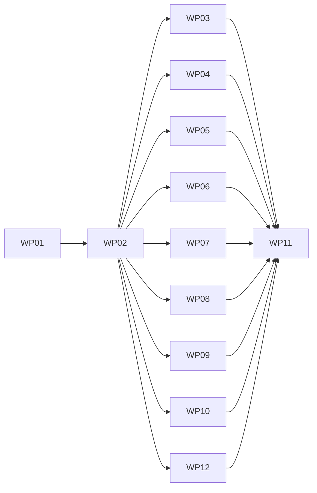

# Work Packages: OpenAPI pages, second slice

**Mission**: `openapi-second-slice-01M6WXJ4` · **Merge target**: `feat/openapi-second-slice`
**Inputs**: [spec.md](./spec.md), [plan.md](./plan.md), [research.md](./research.md), [data-model.md](./data-model.md), [contracts/](./contracts/)

Remediated per the post-tasks squad rulings P1-P10, S1, X1-X10. WP12 was split out of WP03.

## Dependency graph



WP03-WP10 and WP12 depend only on WP02 and run in parallel lanes. WP11 closes.

## Subtask Index

| ID | Description | WP | Parallel |
|---|---|---|---|
| T001 | Fixture tree | WP01 |  |
| T002 | Build helper | WP01 |  |
| T003 | Seam test with flip inventory | WP01 |  |
| T004 | Static output test (C-005) | WP01 |  |
| T005 | Example (P5) | WP01 |  |
| T006 | Consumption arms (P8) | WP01 |  |
| T007 | Red first | WP02 |  |
| T008 | Static option schema | WP02 |  |
| T009 | materialise.mjs and specSources | WP02 |  |
| T010 | operations.mjs, summary.mjs, cache.mjs, limits.mjs | WP02 |  |
| T011 | Publication and publisher | WP02 |  |
| T012 | Hooks and flags | WP02 |  |
| T013 | Red first | WP03 | [P] |
| T014 | Agent index | WP03 | [P] |
| T015 | Agent pages | WP03 | [P] |
| T016 | MCP corpus | WP03 | [P] |
| T017 | Growth and checksum | WP03 | [P] |
| T018 | Red first | WP12 | [P] |
| T019 | Graph node | WP12 | [P] |
| T020 | OKF file | WP12 | [P] |
| T021 | Exclusion ratchets | WP12 | [P] |
| T022 | Cross-surface | WP12 | [P] |
| T023 | Red first | WP04 | [P] |
| T024 | llms.ts | WP04 | [P] |
| T025 | Dev handler | WP04 | [P] |
| T026 | Tests | WP04 | [P] |
| T027 | Red first | WP05 | [P] |
| T028 | indexing.ts | WP05 | [P] |
| T029 | Tests | WP05 | [P] |
| T030 | Red first | WP06 | [P] |
| T031 | Classifier and resolver | WP06 | [P] |
| T032 | Hook | WP06 | [P] |
| T033 | Tests | WP06 | [P] |
| T034 | Red first | WP07 | [P] |
| T035 | switcher.ts | WP07 | [P] |
| T036 | Component and styles | WP07 | [P] |
| T037 | Tests | WP07 | [P] |
| T038 | Red first | WP08 | [P] |
| T039 | archive.mjs | WP08 | [P] |
| T040 | Fail-closed | WP08 | [P] |
| T041 | Red first | WP09 | [P] |
| T042 | Dependency | WP09 | [P] |
| T043 | Ref gate | WP09 | [P] |
| T044 | Bundle and Swagger 2 | WP09 | [P] |
| T045 | Tests | WP09 | [P] |
| T046 | Red first | WP10 | [P] |
| T047 | remote.mjs | WP10 | [P] |
| T048 | Offline | WP10 | [P] |
| T049 | Tests | WP10 | [P] |
| T050 | ADR | WP11 |  |
| T051 | Guide and architecture | WP11 |  |
| T052 | Migration note | WP11 |  |
| T053 | Assert gate (recorded edit to WP01-owned file) | WP11 |  |
| T054 | Changelog fragments | WP11 |  |

## WP01: Red-first test seam: fixtures, example, flip inventory

**Prompt**: [tasks/WP01-red-first-test-seam.md](./tasks/WP01-red-first-test-seam.md)  
**Depends on**: none  
**Requirements**: NFR-001, NFR-002, NFR-003, SC-004, C-004, C-005  
**Goal**: Land fixtures and cross-cutting assertions first. Cases for later behaviour are `it.fails('[WPnn] ...')`; each later WP flips its own. The flip inventory (case title to WP) is a table in `src/tests/fixtures/openapi/README.md`.

Subtasks:

T001 Fixture tree (WP01)
T002 Build helper (WP01)
T003 Seam test with flip inventory (WP01)
T004 Static output test (C-005) (WP01)
T005 Example (P5) (WP01)
T006 Consumption arms (P8) (WP01)

Acceptance commands:

```bash
pnpm --filter @spec-kitty/doc-toolkit exec vitest run tests/openapi-seam.test.ts tests/openapi-static-output.test.ts  # green; it.fails listed by WP id
( cd src && ./node_modules/.bin/vitest run --root ../tests/consumption openapi-optin.test.ts )  # arm A green, arm B it.fails only
pnpm --filter example build && pnpm assert:openapi  # green
```

## WP02: Materialised spec list, extension points and shared helpers

**Prompt**: [tasks/WP02-materialised-spec-list.md](./tasks/WP02-materialised-spec-list.md)  
**Depends on**: WP01  
**Requirements**: FR-006, FR-007, FR-008, FR-023, FR-028, C-007  
**Goal**: Introduce `materialiseOpenApiSpecs()`, the extended publication and every extension point in the plan's parallel-edit registry, so WP03-WP12 each add at most one line to a WP02 file.

Subtasks:

T007 Red first (WP02)
T008 Static option schema (WP02)
T009 materialise.mjs and specSources (WP02)
T010 operations.mjs, summary.mjs, cache.mjs, limits.mjs (WP02)
T011 Publication and publisher (WP02)
T012 Hooks and flags (WP02)

Acceptance commands:

```bash
pnpm --filter @spec-kitty/doc-toolkit exec vitest run tests/openapi-materialise.test.ts tests/openapi-summary.test.ts tests/openapi-options.test.ts tests/openapi-raw-document.test.ts tests/openapi-integration.test.ts tests/served-surfaces.test.ts
pnpm --filter @spec-kitty/doc-toolkit exec vitest run tests/openapi-seam.test.ts  # WP02 rows green, two-build identical
( cd src && ./node_modules/.bin/vitest run --root ../tests/consumption openapi-optin.test.ts )
```

## WP03: Synthetic entries on the agent index, agent pages and MCP corpus

**Prompt**: [tasks/WP03-agent-index-pages.md](./tasks/WP03-agent-index-pages.md)  
**Depends on**: WP02  
**Requirements**: FR-001, FR-002, FR-005, SC-001, NFR-004, NFR-007, C-001  
**Goal**: One synthetic record per version on `/api/index.json` and `/api/pages/<section>/<label>.json`, per contracts/synthetic-entry.md, including `related: []` and `audience: []`.

Subtasks:

T013 Red first (WP03)
T014 Agent index (WP03)
T015 Agent pages (WP03)
T016 MCP corpus (WP03)
T017 Growth and checksum (WP03)

Acceptance commands:

```bash
pnpm --filter @spec-kitty/doc-toolkit exec vitest run tests/openapi-agent-entries.test.ts tests/openapi-seam.test.ts
pnpm --filter @spec-kitty/mcp exec vitest run tests/corpus/openapi-entries.test.ts
( cd src && ./node_modules/.bin/vitest run --root ../tests/consumption openapi-optin.test.ts )
```

## WP12: Content graph node, OKF file and exclusion ratchets

**Prompt**: [tasks/WP12-graph-okf-exclusions.md](./tasks/WP12-graph-okf-exclusions.md)  
**Depends on**: WP02  
**Requirements**: FR-003, FR-004, FR-010, FR-011, FR-012, SC-002  
**Goal**: One `resource` graph node and one OKF file per version, and pinned exclusions from autolinker, feeds and frontmatter gate.

Subtasks:

T018 Red first (WP12)
T019 Graph node (WP12)
T020 OKF file (WP12)
T021 Exclusion ratchets (WP12)
T022 Cross-surface (WP12)

Acceptance commands:

```bash
pnpm --filter @spec-kitty/doc-toolkit exec vitest run tests/openapi-graph-okf.test.ts tests/openapi-exclusions.test.ts tests/openapi-seam.test.ts
( cd src && ./node_modules/.bin/vitest run --root ../tests/consumption openapi-optin.test.ts )
```

## WP04: llms.txt operation summary and raw documents in astro dev

**Prompt**: [tasks/WP04-llms-operations-dev-raw-docs.md](./tasks/WP04-llms-operations-dev-raw-docs.md)  
**Depends on**: WP02  
**Requirements**: FR-014, FR-016  
**Goal**: Opt-in operation lines (contracts/llms-operations.md) and dev serving of raw documents with an exact route allowlist.

Subtasks:

T023 Red first (WP04)
T024 llms.ts (WP04)
T025 Dev handler (WP04)
T026 Tests (WP04)

Acceptance commands:

```bash
pnpm --filter @spec-kitty/doc-toolkit exec vitest run tests/openapi-llms.test.ts tests/openapi-dev.test.ts tests/openapi-seam.test.ts
( cd src && ./node_modules/.bin/vitest run --root ../tests/consumption openapi-optin.test.ts )
```

## WP05: Unreleased versions out of the sitemap and search

**Prompt**: [tasks/WP05-unreleased-unindexed.md](./tasks/WP05-unreleased-unindexed.md)  
**Depends on**: WP02  
**Requirements**: FR-013, FR-015  
**Goal**: Drop unreleased versions from sitemap and Pagefind; keep released operations searchable (R2).

Subtasks:

T027 Red first (WP05)
T028 indexing.ts (WP05)
T029 Tests (WP05)

Acceptance commands:

```bash
pnpm --filter @spec-kitty/doc-toolkit exec vitest run tests/openapi-indexing.test.ts tests/openapi-seam.test.ts
pnpm --filter example build && pnpm assert:openapi
```

## WP06: Build-time link check over API page HTML

**Prompt**: [tasks/WP06-api-link-check.md](./tasks/WP06-api-link-check.md)  
**Depends on**: WP02  
**Requirements**: FR-009, NFR-006  
**Goal**: Fail the build on broken or dangerous links in rendered API pages, after publication (R6).

Subtasks:

T030 Red first (WP06)
T031 Classifier and resolver (WP06)
T032 Hook (WP06)
T033 Tests (WP06)

Acceptance commands:

```bash
pnpm --filter @spec-kitty/doc-toolkit exec vitest run tests/openapi-link-check.test.ts
pnpm --filter example build && node src/scripts/assert-no-broken-links.mjs example/dist
```

## WP07: Version switcher with same-operation mapping

**Prompt**: [tasks/WP07-version-switcher.md](./tasks/WP07-version-switcher.md)  
**Depends on**: WP02  
**Requirements**: FR-017, NFR-005, SC-003  
**Goal**: Native disclosure of plain links upgraded by `src/lib/disclosure/`, landing on the same operation when it exists (reads `current.operationSlug`).

Subtasks:

T034 Red first (WP07)
T035 switcher.ts (WP07)
T036 Component and styles (WP07)
T037 Tests (WP07)

Acceptance commands:

```bash
pnpm --filter @spec-kitty/doc-toolkit exec vitest run tests/openapi-switcher.test.ts
pnpm test:a11y -- openapi.spec.ts
```

## WP08: Tagged-release archive input

**Prompt**: [tasks/WP08-archive-glob.md](./tasks/WP08-archive-glob.md)  
**Depends on**: WP02  
**Requirements**: FR-018, FR-023  
**Goal**: Expand `openapi.archive` into spec versions, contained and capped (R8, FR-028).

Subtasks:

T038 Red first (WP08)
T039 archive.mjs (WP08)
T040 Fail-closed (WP08)

Acceptance commands:

```bash
pnpm --filter @spec-kitty/doc-toolkit exec vitest run tests/openapi-archive.test.ts tests/openapi-seam.test.ts
pnpm --filter example build && pnpm assert:openapi
```

## WP09: Multi-file bundling, Swagger 2 and the $ref gate

**Prompt**: [tasks/WP09-bundling-swagger2.md](./tasks/WP09-bundling-swagger2.md)  
**Depends on**: WP02  
**Requirements**: FR-019, FR-020, FR-022, C-006  
**Goal**: Bundle multi-file definitions under strict containment, accept Swagger 2 with original bytes (R4, R9, X4).

Subtasks:

T041 Red first (WP09)
T042 Dependency (WP09)
T043 Ref gate (WP09)
T044 Bundle and Swagger 2 (WP09)
T045 Tests (WP09)

Acceptance commands:

```bash
pnpm --filter @spec-kitty/doc-toolkit exec vitest run tests/openapi-bundle.test.ts tests/openapi-seam.test.ts
pnpm install --frozen-lockfile
```

## WP10: Pinned remote URL with cache and offline mode

**Prompt**: [tasks/WP10-remote-with-cache.md](./tasks/WP10-remote-with-cache.md)  
**Depends on**: WP02  
**Requirements**: FR-021, NFR-008  
**Goal**: Fetch https definitions pinned by sha256, cache by digest, offline from cache (R5, X6-X8).

Subtasks:

T046 Red first (WP10)
T047 remote.mjs (WP10)
T048 Offline (WP10)
T049 Tests (WP10)

Acceptance commands:

```bash
pnpm --filter @spec-kitty/doc-toolkit exec vitest run tests/openapi-remote.test.ts tests/openapi-seam.test.ts
```

## WP11: ADR, guide, architecture page, migration note, assert gate and changelog

**Prompt**: [tasks/WP11-adr-docs-changelog.md](./tasks/WP11-adr-docs-changelog.md)  
**Depends on**: WP03, WP04, WP05, WP06, WP07, WP08, WP09, WP10, WP12  
**Requirements**: FR-024, FR-025, FR-026, FR-027, C-002, C-003, C-008  
**Goal**: Record decisions (incl. the owner-trusted model) and tell consumers what changed.

Subtasks:

T050 ADR (WP11)
T051 Guide and architecture (WP11)
T052 Migration note (WP11)
T053 Assert gate (recorded edit to WP01-owned file) (WP11)
T054 Changelog fragments (WP11)

Acceptance commands:

```bash
pnpm validate:docs
pnpm validate:changelog && pnpm validate:adr-ids && pnpm validate:links
pnpm --filter example build && pnpm assert:openapi
```
