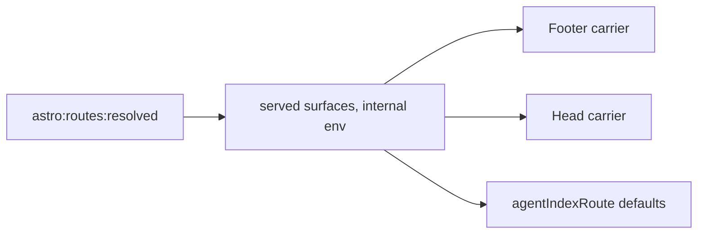

# Implementation Plan: Page chrome

**Branch**: `feat/page-chrome` | **Date**: 2026-11-05 | **Spec**: [spec.md](./spec.md)
**Input**: Mission specification from `kitty-specs/page-chrome-01M6PBR7/spec.md`

## Summary

Deliver the page chrome changes from #290, #292 and #293 with as little new contract as possible. Nearly all of it lives in the existing carriers and in `shapeSidebar`. The design choices that matter:

- **Hub order** rebinds which blocks sit inside or outside the layout, in the carrier. Layouts gain no slot contract.
- **Disclosure** is extracted from the TOC rail's toggle and enhances a native `<details>` baseline.
- **Served surfaces** come from Astro's resolved routes, so sites write no declaration.
- **The custom sidebar sublist** renders only when a site uses title-as-index or icons. Otherwise Starlight's own sidebar renders.
- **Title-as-index only changes rendering.** The index link stays in the route data, so pagination keeps working.

## Technical Context

**Language/Version**: TypeScript 5.9, Astro components, Node 22+
**Primary Dependencies**: Astro 7.4, `@astrojs/starlight` 0.42.6. New: `@iconify-json/fa6-solid` 1.2.4 (pinned) and, for tests only, `sax` 1.6.1 (pinned)
**Storage**: N/A. Build output only, and metadata blocks store nothing
**Testing**: Vitest (unit and build-HTML tests), `assert-*` build gates, Playwright with axe (`pnpm test:a11y`)
**Target Platform**: Static sites on any host, with and without a `base`
**Project Type**: Single toolkit package (`src/`) with a worked example (`example/`)
**Performance Goals**: No font files or external requests from icons. No new client script on pages unless a disclosure is rendered
**Constraints**: Deterministic builds (NFR-001), WCAG 2.2 AA, no-script baseline, carrier count stays at six
**Scale/Scope**: 3 tickets, 29 functional requirements, 11 work packages

## Charter Check

| Gate | Result |
|---|---|
| Three separated axes | Pass. Options configure behaviour, content stays in `docs/`, and pill styling stays in the theme |
| Accessibility WCAG 2.2 AA | Pass by design, enforced by NFR-002 and NFR-003 |
| ADR for structural change | Required: ADR-0075 (sidebar carrier), ADR-0076 (carrier block placement) and ADR-0077 (disclosure control). ADRs stay immutable |
| Living documentation | FR-029 and a changelog fragment per work package |
| Determinism, path-scoped CI | Pass. Existing same-input comparison extends to Atom |
| DIRECTIVE_051 supply chain | See below. Data-only package |

### Supply-chain check: `@iconify-json/fa6-solid`

| Control | Result |
|---|---|
| Registry authenticity | npm official registry, `@iconify-json` scope |
| Freshness | 1.2.4, last modified 2025-07-23, over a year old |
| Lifecycle scripts | None declared. No allowlist entry needed |
| Lockfile | Pinned exact in `src/package.json`, installed from the lockfile |
| Transitive deps | `@iconify/types` only (types) |
| Licence | CC BY 4.0, handled by C-008 |

The dependency decision has low security impact because the package is data, read at build time, and only used icon bodies reach the output. The post-tasks squad will still challenge it, and its findings go in `research.md`.

## Design

### Served surfaces (FR-001 to FR-004, FR-021)



An always-on integration reads `routes` in `astro:routes:resolved` and matches standard patterns against a table of known surfaces. It writes the result with `setInternalEnv`, the existing handoff pattern, because route code can't import a virtual module under Vitest. The OKF bundle is always served, since its integration is always added. The sitemap is served only when `site` is set, as `@astrojs/sitemap` otherwise skips writing it.

- The footer and head read it through one helper in `src/lib/served-surfaces.ts`.
- `discoveryHead` (`config.ts:349-369`) moves into the `Head` carrier, because Starlight's `head` config is fixed before the routes resolve.
- `agentIndexRoute` uses it for defaults when `links` is unset. An explicit `links` value still wins, so a call with no integration behaves as it does today.

### Sidebar (FR-005 to FR-011, FR-026 to FR-028)

- **Collapse**: `shapeSidebar` sets `collapsed: true` on every generated group unless `sidebar.collapsed: false`. Starlight already opens the current branch. A consumer-written array never reaches `shapeSidebar`, so FR-010 holds by construction.
- **Conditional renderer**: the `Sidebar` carrier renders Starlight's `Sidebar` unless title-as-index is on or an icon is authored. In that case it renders `SidebarPersister` (exported by Starlight) around a DocKitty sublist, and repeats `MobileMenuFooter`. The custom body comes through the manifest's virtual module, so its CSS doesn't reach sites that don't opt in. A parity test builds a fixture both ways, with no extras active, and compares the sidebars, which catches drift on a Starlight upgrade.
- **Title-as-index**: `shapeSidebar` marks the group's index link with a data attribute and keeps it in `entries`. The sublist renders that link as the group label and skips it in the list. Pagination reads route data, so it is untouched (FR-011). Without an index link, the label stays a toggle.
- **Icons**: names are `fa-<name>` for Font Awesome solid and bare for Starlight's built-ins, matching the Markua `{icon: fa-name}` convention. Page icons use `sidebar.icon`, and groups use `icon` in `sections.yaml` or their index page's `sidebar.icon`, with `sections.yaml` winning. Starlight has no public export for its built-ins, so a generated list with a drift test holds them. Names resolve at build time, and only used SVG bodies reach a virtual module. An unknown name fails config evaluation and `validate-frontmatter`.

### Hub order (FR-012, FR-013)

`MarkdownContent` already rebinds after-content positions to `EmptyFragment` for the glossary swap, to keep whitespace byte-identical. This reuses that pattern: inside and outside positions, with the outside ones active only for `kind: Hub`. On a hub, blocks render after `</Layout>`, and so after the cards.

The outside positions sit adjacent to `</Layout>`, because a compile check showed whitespace between them changes every page's bytes. Named `dk:*` slots stay inside the layout, as they are empty in practice.

This replaces #290's named-slot approach. No layout, including a theme's, can drop the blocks, since none has a new slot to place. Non-hub output stays byte-identical. ADR-0076 records it.

### Disclosure and metadata blocks (FR-014 to FR-018)

The maintainer chose extracting the rail's script over a native-only control.

- `src/lib/disclosure/` holds the toggle extracted from `toc-rail.client.ts`: button markup, chevron, `reflectState`, and an optional state adapter. The rail passes its existing persisted adapter and keeps `dk-toc-collapsed` and its pre-paint script. Its existing tests stay green unchanged.
- `MetadataBlock.astro` renders `<details class="dk-panel ...">` with a `<summary>` holding the eyebrow and count. It is `open` only under the opt-out. With scripts off, this baseline is complete.
- A small client module upgrades each `<details>` in place: it inserts the shared button directly before `details`, with `aria-expanded` and `aria-controls`, and hides the summary. `details.open` is the state, so nothing is stored for blocks. The button takes the summary's exact box, from a global `disclosure.css`, because scoped CSS doesn't reach a script-created element (NFR-006). Its accessible name contains the visible label and count (WCAG 2.5.3). Focus moves to the button if the summary had it.
- The title-as-index chevron uses the same upgrade on a chevron-only `<summary>`. Starlight's persister only records clicks inside a `summary`, so this adapter toggles through `summary.click()`. `details.open` stays the state, so the persister continues to work.
- `Audience`, `Related`, `ExternalReferences` and the three `OnThisPage` panels use `MetadataBlock`. `.dk-panel--*` classes stay on the outer element, and landmarks move to an inner wrapper. A print rule shows collapsed content.

### Page formats and source link (FR-019, FR-020, FR-022 to FR-025)

| Link | Href | Type | Shown when |
|---|---|---|---|
| JSON | `/api/pages/<slug>.json` | `application/json` | Route served, page published |
| OKF | `/okf/<bundlePathOf(id)>` | `text/markdown` | Page published |
| Atom | `/api/pages/<slug>.atom.xml` | `application/atom+xml;type=entry` | Atom on, page published and dated |
| source | Host view URL | None | Repository set, page authored |

- `PageFormats.astro` renders in the `Footer` carrier, and the `Head` carrier emits matching `<link rel="alternate">` tags, both from one pure helper, `pageFormatLinks()`.
- A page only counts if it is in the docs collection, which excludes 404 and OpenAPI pages.
- `dk-pill dk-pill--neutral` is on the links, and only the theme's CSS styles it. Size and focus rules go in each component's scoped style, so they hold for both.
- **Atom**: follows the content-graph injection pattern. A top-level `<entry>` document needs `title`, `id`, `updated`, `author` (the site title, since RFC 4287 requires one outside a feed), `link`, `summary` and HTML `content` with `xml:base`. See [contracts/page-atom.md](./contracts/page-atom.md).
- **Source URL**: `repository` provider rules build `blob`, `-/blob` or `src` view URLs from `entry.filePath`. `isGeneratedStamp` excludes generated pages.

### Config surface

See [contracts/config-options.md](./contracts/config-options.md). All options validate eagerly in `defineDocKittyIntegrations`, and `titleIsIndex` with `indexLabel` throws.

## Implementation Concern Map

| ID | Concern | Requirements | Depends on |
|---|---|---|---|
| IC-01 | Hub block placement, ADR-0076 | FR-012, FR-013, C-002 | None |
| IC-02 | Disclosure extraction, rail migration | FR-017 | None |
| IC-03 | Metadata blocks | FR-014, FR-015, FR-016, FR-018 | IC-01, IC-02 |
| IC-04 | Sidebar collapse default | FR-005, FR-006, FR-008, FR-010, FR-011 | None |
| IC-05 | Sublist renderer, title-as-index, ADR-0075 | FR-007, FR-009, C-001 | IC-02, IC-04 |
| IC-06 | Icons | FR-026, FR-027, FR-028, C-003, C-008 | IC-05 |
| IC-07 | Served surfaces, footer group, head links | FR-001 to FR-004, FR-021 | None |
| IC-08 | Atom route, page formats, source link | FR-019, FR-020, FR-022 to FR-025 | IC-07 |
| IC-09 | Docs, upgrade note, verification | FR-029, C-007 | All |
| IC-10 | Test harness, baselines, dependencies (added after the squad) | NFR-001, NFR-002 | None; first |

## Risks

| Risk | Mitigation |
|---|---|
| Starlight upgrade changes its sublist | The DOM parity test fails on upgrade, and the custom renderer only runs when opted in |
| Changing defaults breaks existing tests and gates | Expected. Tests get updated in the same work package as the change |
| A scripted upgrade shifts layout | Equal-box rule, with a Playwright geometry check |
| A golden is captured after a behaviour change | WP11 runs first, with a stamp test |
| Visual baselines go stale | Dispatch `update-a11y-baselines.yml` once, after lanes merge |
| Atom doubles output size | Off switch. Size is checked in the same-input comparison lane |
| A non-standard route path is unlinked | Documented limit, and it fails safe: no link rather than a dead link |

## Project Structure

```text
kitty-specs/page-chrome-01M6PBR7/
├── plan.md  research.md  data-model.md  quickstart.md
└── contracts/  config-options.md  page-atom.md  page-formats.md

src/lib/served-surfaces.ts              (new)
src/lib/integrations/served-surfaces.ts (new)
src/lib/disclosure/                     (new, extracted from toc-rail)
src/lib/page-formats.ts                 (new)
src/lib/routes/page-atom.ts, page-atom-injected.ts (new)
src/components/slots/MetadataBlock.astro, PageFormats.astro, MachineEntryPoints.astro (new)
src/components/sidebar/SidebarSublist.astro (new)
src/components/{Sidebar,Footer,Head,MarkdownContent}.astro (changed)
src/lib/{config,route-shaping,sections,schema,manifest}.ts, internal-env.mjs (changed)
src/styles/disclosure.css (new)
src/tests/fixtures/chrome/ (new)
docs/adr/0075-*.md, 0076-*.md, 0077-*.md (new)
```
