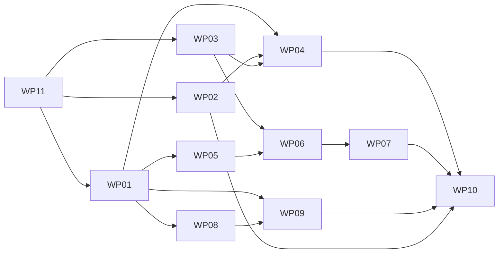

# Work Packages: Page chrome

**Mission**: `page-chrome-01M6PBR7` · **Branch**: `feat/page-chrome` (planning base and merge target; reaches `main` through a PR)
**Inputs**: [spec.md](./spec.md), [plan.md](./plan.md) (Implementation Concern Map IC-01..IC-09), [contracts/](./contracts/)

Tests are required by this spec: every FR row carries a non-vacuity mark, and many name a same-fixture control.

## Concern to work package

| Concern | Work package | Note |
|---|---|---|
| IC-01 Hub placement | WP02 | |
| IC-02 Disclosure extraction | WP03 | |
| IC-03 Metadata blocks | WP04 | |
| IC-04 Sidebar collapse | WP05 | |
| IC-05 Renderer, title-as-index | WP06 | |
| IC-06 Icons | WP07 | |
| IC-07 Served surfaces, footer, head | WP01 + WP09 | Detection is first because others read it; `config.ts` has one owner |
| IC-08 Atom, formats, source | WP08 + WP09 | Atom is split from links, as they have different owners |
| IC-09 Docs and verification | WP10 | |
| Test harness (added after the post-tasks squad) | WP11 | Runs first; every WP depends on it directly or through WP01 |

## Dependency graph

## Subtask index

| ID | Description | WP | Parallel |
|---|---|---|---|
| T001 | Add and validate the new options | WP01 |  |
| T002 | Publish resolved options through one reader | WP01 |  |
| T003 | Pure detection table | WP01 |  |
| T004 | The detection integration | WP01 |  |
| T005 | Agent index reads the same result | WP01 |  |
| T006 | Rebind after-content positions | WP02 |  |
| T007 | Prove the order, both ways | WP02 |  |
| T008 | ADR-0076 | WP02 |  |
| T009 | Extract the generic toggle | WP03 |  |
| T010 | Migrate the rail | WP03 |  |
| T011 | Upgrade a native details element | WP03 |  |
| T049 | ADR-0077 | WP03 |  |
| T012 | Client entry and tests | WP03 |  |
| T013 | MetadataBlock component | WP04 |  |
| T014 | Convert the three standalone blocks | WP04 |  |
| T015 | Convert OnThisPage | WP04 |  |
| T016 | Tests for behaviour and reach | WP04 |  |
| T017 | Collapse in shapeSidebar | WP05 |  |
| T018 | Markers for the custom renderer | WP05 |  |
| T019 | Tests | WP05 |  |
| T020 | DocKitty sublist with parity | WP06 |  |
| T021 | Carrier chooses the renderer | WP06 |  |
| T022 | Title-as-index rendering | WP06 |  |
| T023 | Tests | WP06 |  |
| T024 | ADR-0075 | WP06 |  |
| T025 | Reuse-or-reject the Markua map | WP07 |  |
| T026 | Resolver | WP07 |  |
| T027 | Authoring surface | WP07 |  |
| T028 | Integration and decoration | WP07 |  |
| T029 | Licence comment | WP07 |  |
| T030 | Tests | WP07 |  |
| T031 | Pure entry builder | WP08 |  |
| T032 | Route and injection | WP08 |  |
| T033 | Tests on the built site | WP08 |  |
| T034 | Machine entry points group | WP09 |  |
| T035 | Page format helper | WP09 |  |
| T036 | Source link | WP09 |  |
| T037 | Components and head | WP09 |  |
| T038 | Tests and gates | WP09 |  |
| T039 | Consumer guide | WP10 |  |
| T040 | Upgrade note | WP10 |  |
| T041 | Architecture page | WP10 |  |
| T042 | Whole-mission verification | WP10 |  |
| T043 | Fixture config with varied options | WP11 | [P] |
| T044 | Frozen fixture site | WP11 |  |
| T045 | Pre-mission goldens | WP11 |  |
| T046 | Register suites and dependencies | WP11 |  |
| T047 | Playwright projects and CI | WP11 |  |

## WP01: Config options and served-surface detection

**Prompt**: [tasks/WP01-config-and-served-surfaces.md](./tasks/WP01-config-and-served-surfaces.md)
**Goal**: Add every consumer option this mission needs, in one place, and detect which surfaces a site serves from its resolved routes. Later work packages read these values and don't touch `config.ts` except where they say so.
**Requirements**: FR-002, FR-009, C-007
Dependencies: WP11

Included subtasks:

T001 Add and validate the new options (WP01)
T002 Publish resolved options through one reader (WP01)
T003 Pure detection table (WP01)
T004 The detection integration (WP01)
T005 Agent index reads the same result (WP01)

## WP02: Hub child cards before metadata blocks

**Prompt**: [tasks/WP02-hub-block-placement.md](./tasks/WP02-hub-block-placement.md)
**Goal**: On a hub, render audience, body, child cards, then metadata blocks. Every other layout keeps its exact output.
**Requirements**: FR-012, FR-013, C-002, SC-002
Dependencies: WP11

Included subtasks:

T006 Rebind after-content positions (WP02)
T007 Prove the order, both ways (WP02)
T008 ADR-0076 (WP02)

## WP03: Extract the disclosure toggle from the TOC rail

**Prompt**: [tasks/WP03-disclosure-extraction.md](./tasks/WP03-disclosure-extraction.md)
**Goal**: Make the TOC rail's toggle reusable, with the rail's behaviour unchanged, and add the upgrade that turns a native `
` into that same control. The maintainer chose this over a native-only control (decision 01M6PDCSJA3PEZRH4NCZYVN9BB).
**Requirements**: FR-017, NFR-006
Dependencies: WP11

Included subtasks:

T009 Extract the generic toggle (WP03)
T010 Migrate the rail (WP03)
T011 Upgrade a native details element (WP03)
T049 ADR-0077 (WP03)
T012 Client entry and tests (WP03)

## WP04: Collapsible metadata blocks

**Prompt**: [tasks/WP04-metadata-blocks.md](./tasks/WP04-metadata-blocks.md)
**Goal**: Audience, Related, External references and Glossary links start collapsed, show a label and count, work by keyboard and mouse, and stay reachable and searchable.
**Requirements**: FR-014, FR-015, FR-016, FR-018, NFR-002, NFR-003, NFR-004, NFR-005, SC-003
Dependencies: WP01, WP02, WP03

Included subtasks:

T013 MetadataBlock component (WP04)
T014 Convert the three standalone blocks (WP04)
T015 Convert OnThisPage (WP04)
T016 Tests for behaviour and reach (WP04)

## WP05: Sidebar collapse default and shaping markers

**Prompt**: [tasks/WP05-sidebar-shaping.md](./tasks/WP05-sidebar-shaping.md)
**Goal**: Generated sidebar groups start closed, except the current branch. An opt-out restores today's exact sidebar. Add the data markers the custom renderer needs, emitted only when a site uses it.
**Requirements**: FR-005, FR-006, FR-008, FR-010, FR-011, NFR-004, SC-001, SC-005
Dependencies: WP01

Included subtasks:

T017 Collapse in shapeSidebar (WP05)
T018 Markers for the custom renderer (WP05)
T019 Tests (WP05)

## WP06: Opt-in sidebar renderer and title-as-index

**Prompt**: [tasks/WP06-sidebar-renderer-title-as-index.md](./tasks/WP06-sidebar-renderer-title-as-index.md)
**Goal**: When a site opts in, the sidebar carrier renders a DocKitty sublist. Title-as-index works on it. With nothing opted in, Starlight's own `Sidebar` renders, as it does today.
**Requirements**: FR-007, FR-008, FR-011, C-001, NFR-002, NFR-003, NFR-004
Dependencies: WP03, WP05

Included subtasks:

T020 DocKitty sublist with parity (WP06)
T021 Carrier chooses the renderer (WP06)
T022 Title-as-index rendering (WP06)
T023 Tests (WP06)
T024 ADR-0075 (WP06)

## WP07: Sidebar icons

**Prompt**: [tasks/WP07-sidebar-icons.md](./tasks/WP07-sidebar-icons.md)
**Goal**: Authors can set an icon on a page or section. Only used icons reach the output, as inline SVG, and an unknown name fails loudly.
**Requirements**: FR-026, FR-027, FR-028, C-003, C-008, NFR-007
Dependencies: WP06

Included subtasks:

T025 Reuse-or-reject the Markua map (WP07)
T026 Resolver (WP07)
T027 Authoring surface (WP07)
T028 Integration and decoration (WP07)
T029 Licence comment (WP07)
T030 Tests (WP07)

## WP08: Per-page Atom entries

**Prompt**: [tasks/WP08-page-atom-route.md](./tasks/WP08-page-atom-route.md)
**Goal**: Every published, dated page gets a valid, deterministic Atom entry with no wiring, and a site can turn it off. See [contracts/page-atom.md](./contracts/page-atom.md).
**Requirements**: FR-020, NFR-001, NFR-008
Dependencies: WP01

Included subtasks:

T031 Pure entry builder (WP08)
T032 Route and injection (WP08)
T033 Tests on the built site (WP08)

## WP09: Footer group, page formats, source link and head links

**Prompt**: [tasks/WP09-footer-head-page-formats.md](./tasks/WP09-footer-head-page-formats.md)
**Goal**: From any page, a reader or agent reaches the site's machine entry points and that page's formats. Nothing links a surface the site doesn't serve. See [contracts/page-formats.md](./contracts/page-formats.md).
**Requirements**: FR-001, FR-003, FR-004, FR-019, FR-021, FR-022, FR-023, FR-024, FR-025, NFR-003, NFR-009, SC-004
Dependencies: WP01, WP08

Included subtasks:

T034 Machine entry points group (WP09)
T035 Page format helper (WP09)
T036 Source link (WP09)
T037 Components and head (WP09)
T038 Tests and gates (WP09)

## WP10: Consumer docs, upgrade note and final verification

**Prompt**: [tasks/WP10-docs-and-upgrade-note.md](./tasks/WP10-docs-and-upgrade-note.md)
**Goal**: A site owner can upgrade without surprises, and the docs describe what shipped. Run the whole gate suite once against the merged lanes.
**Requirements**: FR-029, SC-006, C-005, C-006, NFR-001
Dependencies: WP02, WP04, WP05, WP06, WP07, WP09

Included subtasks:

T039 Consumer guide (WP10)
T040 Upgrade note (WP10)
T041 Architecture page (WP10)
T042 Whole-mission verification (WP10)

## WP11: Test harness, baselines and dependencies

**Prompt**: [tasks/WP11-test-harness-and-baselines.md](./tasks/WP11-test-harness-and-baselines.md)
**Goal**: Give every later work package a way to vary options, a frozen pre-mission baseline to compare with, and the dependencies it needs. **This WP must land before any behaviour changes**, because its goldens record today's output.
**Requirements**: NFR-001, NFR-002, C-003
Dependencies: none

Included subtasks:

T043 Fixture config with varied options (WP11)
T044 Frozen fixture site (WP11)
T045 Pre-mission goldens (WP11)
T046 Register suites and dependencies (WP11)
T047 Playwright projects and CI (WP11)

