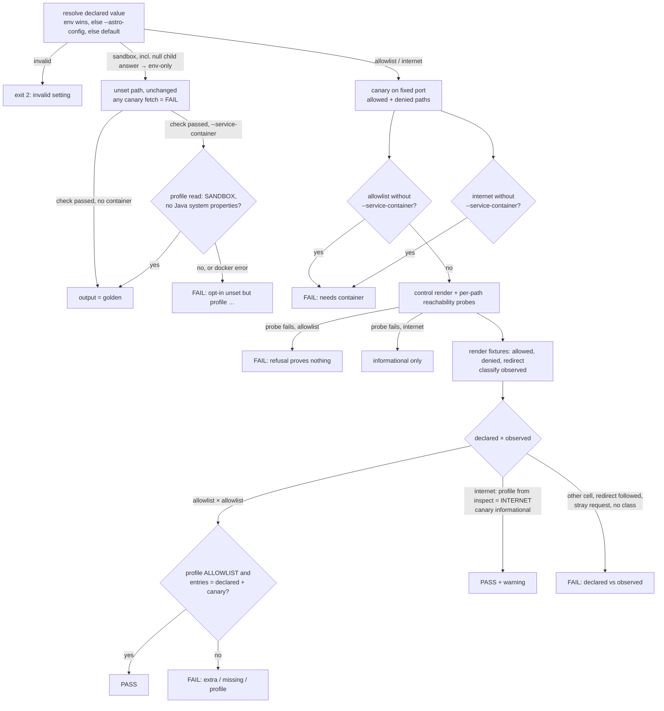

# Implementation Plan: PlantUML external-connection opt-in

**Branch**: `feat/268-plantuml-external-opt-in` | **Date**: 2026-11-02 | **Spec**: [spec.md](./spec.md)
**Input**: Mission specification from `kitty-specs/plantuml-external-opt-in-01M6F052/spec.md`

Revised after the post-plan squad; dispositions in [squad/post-plan.md](./squad/post-plan.md). Revised after the CI spike (research.md addendum; F1–F5; decisions `01M6F4BRKQ4E9H9Z41BYZH37MC`, `01M6F4BVDASAREW2NVH23727CW`): internet mode is verified by the container's profile, empty service-allowlist items fail, redirects are judged from the request log, entries with `@` are rejected. Decision `01M6F4XFDPJ6XFBYM5HM65G1AM` (analyze A2): in unset mode with `--service-container` the check also requires the profile `SANDBOX`; pass output unchanged. Planning questions are answered in [research.md](./research.md) (R1–R13, each Decision / Rationale / Alternatives, with file:line evidence). The model is in [data-model.md](./data-model.md), the interfaces in [contracts/](./contracts/), and the operator flow in [quickstart.md](./quickstart.md).

## Summary

Add one opt-in setting, `plantumlAllowExternal` in site configuration with the `DK_PLANTUML_ALLOW_EXTERNAL` environment override (environment wins), accepting exactly unset (sandbox), a non-empty allowlist of URL prefixes ending in `/`, or `internet`. One dependency-free module, `src/lib/plantuml-external.mjs`, validates and resolves it for both the build and the include check. The build validates at config time and prints a "declared" notice. The include check keeps today's unset path byte-identical (golden-pinned) and gains a declared-mode path: a canary on a fixed port with an allowed and a denied path, per-path reachability probes, a request log, a redirect probe, and a `docker inspect` read of the service's profile (allowlist and internet modes; unset mode too when the container is named, which must then be `SANDBOX`) and, in allowlist mode, its entries compared as a set with the declared entries plus the canary entry. A new, unconditional CI lane runs the digest-pinned image in allowlist mode against the canary. A new inventory test holds every PlantUML service in every workflow to SANDBOX except that lane. Docs: a guide subsection, ADR-0074, a pointer in `docs/architecture/diagrams.md`, and a changelog fragment.

One spec point was infeasible as first written: NFR-003 (9 of 9, including "site configuration only") and C-006 (check runs before install) could not both hold, because a site configuration can only be evaluated with the site's `astro` installed. The plan reads site configuration only with `--astro-config`. The amendment is **accepted** and in spec.md (decision `01M6F1VS8XWTR7A7KAC42ZWAE0`); decision `01M6F21BY4VJVWE4VY889F80CP` keeps unset mode silent and makes the build notice print the full verify command with `--astro-config`; decision `01M6F21EKGBG5HF8XA2YFC517K` keeps `docker inspect` mandatory for allowlist mode and records the limit.

## Technical Context

**Language/Version**: JavaScript (ESM, JSDoc-typed `.mjs`) and TypeScript ^5.9 on Node >=22.22.0 (`package.json` engines); pnpm 11.22.0
**Primary Dependencies**: Astro ^7.4 + Starlight (build side, `src/lib/config.ts`); the include check and the resolver use Node built-ins only (`node:http`, `node:child_process`, `node:zlib`, `node:fs`); PlantUML server image `plantuml/plantuml-server:jetty-v1.2026.9@sha256:065c66ad…3618`; Docker CLI (on the operator's machine and GitHub runners)
**Storage**: N/A (files only: committed golden outputs and test fixtures)
**Testing**: Vitest ^2.1 (`src/tests/*.test.ts`), including command-level tests that spawn the CLI with fake PlantUML servers and a fake `docker` on `PATH`; `node --test` for `.github/scripts/ci-ok-decision.test.mjs`; one real-service CI lane
**Target Platform**: Node CLI and Astro build on Linux/macOS; GitHub Actions `ubuntu-latest` for the real-service lane
**Project Type**: single (pnpm workspace: toolkit package `src/`, example site `example/`)
**Performance Goals**: new CI lane at most 5 minutes wall time, in parallel with existing lanes (NFR-002); expected about 1 minute (no `pnpm install`)
**Constraints**: unset-mode check output byte-identical to a golden (FR-007); check runs before install on the env/unset path (C-006); no real outbound request in CI (NFR-001); toolkit never sets the service profile (C-003); digest-pinned image (C-005); no `plantuml.com` (C-004)
**Scale/Scope**: about 6 source files changed or added, 6 test files, 1 workflow job, 5 docs files; 9 matrix cells plus 10 edge cases

## Charter Check

*GATE: passed before Phase 0; re-checked after Phase 1 design.*

| Charter rule | Status |
|---|---|
| Path-scoped CI with one `ci-ok` aggregate (ADR-0007) | Pass: the new lane feeds `ci-ok` through `REQUIRED_LANES`; it runs unconditionally, which is allowed (it is cheap and is a security proof). |
| Tests: Vitest for the toolkit | Pass. |
| Node 22+, pnpm | Pass; no dependency added (DIRECTIVE_051 has nothing to assess). |
| Living documentation (behaviour change updates its docs) | Pass: guide, architecture page, ADR, changelog fragment in the same mission. |
| Changelog by fragment (ADR-0072) | Pass: `docs/changelog/unreleased/268-plantuml-external-include-opt-in.md`. |
| ADR: add the file, never the index row | Pass: ADR-0074 file only. |
| Writing style (sentence-case headings, no AI tells) | Applies to the guide subsection and ADR; reviewed with Vale in doc-sanity. |
| DIRECTIVE_010 Specification fidelity | One deviation (R2), amended in the spec by accepted decision `01M6F1VS8XWTR7A7KAC42ZWAE0`; no silent drift. |

Directives and tactics applied are listed in research.md, "Governance applied".

## Project Structure

### Documentation (this mission)

```
kitty-specs/plantuml-external-opt-in-01M6F052/
├── plan.md              # this file
├── research.md          # decisions R1–R13 + spike addendum
├── data-model.md        # setting, canary, observed class, service config, verdict, 3×3, NFR-003 grid
├── quickstart.md        # operator flow, allowlist mode end to end
├── contracts/
│   ├── include-check-cli.md   # flags, exit codes, stable substrings per cell
│   └── opt-in-setting.md      # names, shapes, precedence, errors, notice
└── tasks.md             # /spec-kitty.tasks output (not created here)
```

### Source code (repository root)

```
src/
├── lib/
│   ├── plantuml-external.mjs        # NEW: parse, validate, resolve, describeDeclared only (no imports)
│   ├── internal-env.mjs             # MODIFY: add DK_PLANTUML_ALLOW_EXTERNAL_RESOLVED to names + table
│   └── config.ts                    # MODIFY: DocKittyOptions.plantumlAllowExternal; resolve eagerly, publish handoff, print notice
├── scripts/
│   ├── assert-plantuml-no-remote-include.mjs   # MODIFY: --canary-port, --astro-config, --print-declared; route by declared mode
│   ├── plantuml-include-guard.mjs              # MODIFY: startCanary({port}) with allowed/denied/redirect paths + request log; unset fixtures retargeted, /reachability probe kept, output unchanged
│   ├── plantuml-mode-check.mjs                 # NEW: checkDeclaredMode, classifyObserved (3 classes), canaryEntry, compareAllowlist, parseContainerEnv, verdict
│   ├── site-config-eval.mjs                    # MODIFY: return plantumlAllowExternal (resolution or null); delete the inherited handoff from the child env
│   └── fixtures/plantuml-remote-include-modes/ # NEW only if the spike shows !import / !includesub fetch (R8)
└── tests/
    ├── plantuml-external-setting.test.ts        # NEW: resolver + edge cases 1–6 and 9
    ├── plantuml-include-check-golden.test.ts    # NEW: FR-007 goldens, pass AND fail (separate earlier commit, against today's code)
    ├── plantuml-include-check-cli.test.ts       # NEW (WP07): 9 cells, output shape, C-006 import guard, --canary-port equivalence
    ├── plantuml-include-check-halves.test.ts    # NEW (WP12): half-removal table (a, b, c1–c4, i, ii), edge cases 1–10, NFR-001 pair, docker missing/erroring, unset profile rows
    ├── plantuml-mode-check.test.ts              # NEW (WP06): classifier, comparison, messages
    ├── plantuml-service-config.test.ts          # NEW (WP11): docker reader
    ├── plantuml-resolution-parity.test.ts       # NEW: NFR-003 9/9 (+1 E5 case), forged-handoff case
    ├── plantuml-workflow-services.test.ts       # NEW: FR-014, C-004, NFR-001 static, lane vacuity, ci-ok wiring
    ├── plantuml-opt-in-docs.test.ts             # NEW: guide blocks, D4 limit, ADR-0074 and changelog content
    └── fixtures/
        ├── plantuml-include-check/golden-unset-<case>.{stdout,stderr,exit}     # NEW
        ├── plantuml-fake-docker/{docker,inspect-capture.json}                  # NEW: strict fake docker + recorded real inspect
        └── plantuml-opt-in-site/                                               # NEW: astro.config calling the real defineDocKittyIntegrations

.github/
├── workflows/ci.yml                 # MODIFY: new job plantuml-allowlist; ci-ok needs + PLANTUML_ALLOWLIST_RESULT; header comment
└── scripts/ci-ok-decision.mjs (+ .test.mjs)   # MODIFY: REQUIRED_LANES + env mapping

docs/
├── guides/consumer-setup.md         # MODIFY: new "Allowing external includes" subsection (recommended SANDBOX block untouched)
├── architecture/diagrams.md         # MODIFY: pointer to ADR-0074
├── architecture/ci-cd-pipeline.md, ops/ci-cd.md   # MODIFY: lane list
├── adr/0074-plantuml-external-include-opt-in.md   # NEW
└── changelog/unreleased/268-plantuml-external-include-opt-in.md   # NEW

UNCHANGED by design: src/lib/integrations/diagrams.ts, src/tests/plantuml-include-guard.test.ts,
src/tests/plantuml-service-hardening.test.ts, src/scripts/fixtures/plantuml-remote-include/*,
the build-example job and its SANDBOX service, deploy.yml, update-a11y-baselines.yml.
```

**Structure Decision**: single-project layout as it exists today. The resolver lives in `src/lib/` as a dependency-free `.mjs` (precedent: `draft-publication.mjs`, `vocabulary-core.mjs`) so the TypeScript build and the bare-Node check import the same file.

## The check's decision flow



## Complexity Tracking

| Violation | Why needed | Simpler alternative rejected because |
|---|---|---|
| Unconditional new CI lane (not path-scoped) | SC-004 asks for the real-service proof on every CI run; FR-012 forbids filtering it out of relevant PRs | Gating on `run_build_example` would skip docs-only runs and break SC-004; cost is about 1 minute with no install |
| Spec deviation on NFR-003 / C-006 (amendment accepted) | A site configuration cannot be evaluated before install | Every alternative either fails 9/9 or adds a second config surface or a stale artifact (R2 table) |

## Implementation Concern Map

> Implementation concerns are not work packages. `/spec-kitty.tasks` translates them.

### IC-01 — CI feasibility spike

- **Purpose**: prove on a GitHub runner that a `services:` PlantUML container with `--add-host dk-canary:host-gateway` and a static ALLOWLIST reaches a runner-side canary on a fixed port, fetches the allowed prefix and refuses the denied one; record redirect, `!import`/`!includesub`, entry-trimming behaviour and wall time; capture a real `docker inspect` output as the fake-docker fixture.
- **Relevant requirements**: FR-012, C-005, NFR-002, spec Assumption 3, edge case 8, squad finding 22 (R5, R8).
- **Affected surfaces**: throwaway branch with a workflow on a `push` trigger for that branch (not merged; `workflow_dispatch` would not run off the default branch); addendum in `research.md`; `src/tests/fixtures/plantuml-fake-docker/inspect-capture.json`.
- **Sequencing/depends-on**: none. Run first.
- **Risks**: if `host-gateway` fails, take fallback (a) of R5; if PlantUML follows the redirect to the denied prefix, or no fallback works, **stop and return to the operator** rather than drop the lane.

### IC-02 — Unset-mode characterization

- **Purpose**: freeze today's include-check stdout, stderr and exit code, for pass and fail cases, as committed goldens, in a commit before any code moves.
- **Relevant requirements**: FR-007, SC-003, US4 AS1–2 (AS4 is IC-06, decision `01M6F4XFDPJ6XFBYM5HM65G1AM`), C-001.
- **Affected surfaces**: `src/tests/plantuml-include-check-golden.test.ts`, `src/tests/fixtures/plantuml-include-check/`, the fake `docker` (strict argv).
- **Sequencing/depends-on**: none; must merge before IC-05.
- **Risks**: only ports are normalized; anything else differing is a real regression.

### IC-03 — Shared resolver and validation

- **Purpose**: one dependency-free module that parses, validates and resolves the setting and owns `describeDeclared`, nothing else.
- **Relevant requirements**: FR-001, FR-002, FR-013 (rules half), edge cases 1–6 and 9, C-003, C-006.
- **Affected surfaces**: `src/lib/plantuml-external.mjs`, `src/tests/plantuml-external-setting.test.ts`.
- **Sequencing/depends-on**: none.
- **Risks**: a test asserts the module has no `import` statements (C-006).

### IC-04 — Build integration

- **Purpose**: the option in `defineDocKittyIntegrations`: eager validation, the FR-003 notice with the full verify command, the always-published handoff, and its return (or `null`) from `site-config-eval.mjs`.
- **Relevant requirements**: FR-001, FR-003, FR-013 (build half), US1 AS1, US3 AS1, US4 AS3.
- **Affected surfaces**: `src/lib/config.ts`, `src/lib/internal-env.mjs`, `src/scripts/site-config-eval.mjs`, tests next to them.
- **Sequencing/depends-on**: IC-03.
- **Risks**: an unset site prints nothing (FR-007); `clearInternalEnv` clears the new handoff; the child deletes an inherited value.

### IC-05 — Canary redesign

- **Purpose**: a fixed-port canary with allowed, denied and redirect paths and a request log; unset fixtures move onto the allowed path; the unset `/reachability` probe stays.
- **Relevant requirements**: FR-007, NFR-001 (request log), edge case 8 (infrastructure), unset × allowlist cell.
- **Affected surfaces**: `src/scripts/plantuml-include-guard.mjs`.
- **Sequencing/depends-on**: IC-02.
- **Risks**: `plantuml-include-guard.test.ts` and the goldens pass unmodified.

### IC-06 — Declared-mode verification and CLI

- **Purpose**: `checkDeclaredMode` (probes, renders, three-class classification, verdict line), canary entry and allowlist comparison, the `docker inspect` reader, and CLI routing with `--canary-port`, `--astro-config`, `--print-declared`.
- **Relevant requirements**: FR-004 (a, b, c), FR-005, FR-006, edge cases 7–8, NFR-001, C-003, C-006, US1 AS2–3, US2, US3.
- **Affected surfaces**: `src/scripts/plantuml-mode-check.mjs`, `src/scripts/assert-plantuml-no-remote-include.mjs`.
- **Sequencing/depends-on**: IC-03, IC-05; IC-04 for `--astro-config`.
- **Acceptance items**: no static import of `site-config-eval.mjs` (a test reads the CLI source and asserts only a dynamic `import()` of it); a `null` child answer falls back to the env-only resolver; the check never reads `DK_PLANTUML_ALLOW_EXTERNAL_RESOLVED` from its own env; every declared-mode failure names the declared mode and the observed class (or "no class"); one stable verdict line.

### IC-07 — Command-level matrix tests

- **Purpose**: run the real command against fake services and the strict fake `docker` for all 9 cells, edge cases 1–10, container and no-container, `docker` missing or erroring; the table-driven half-removal proofs; the NFR-001 pair.
- **Relevant requirements**: FR-011, FR-004/FR-006 half-removal clauses, NFR-001, SC-002.
- **Affected surfaces**: `src/tests/plantuml-include-check-cli.test.ts` (WP07, matrix) and `src/tests/plantuml-include-check-halves.test.ts` (WP12, halves, edges, NFR-001).
- **Sequencing/depends-on**: IC-06 (and IC-01 for the recorded inspect fixture).
- **Risks**: free canary ports only (never 18091); the manual mutation pass is recorded as a comment in the table.

### IC-08 — Real allowlist CI lane

- **Purpose**: the `plantuml-allowlist` job (pinned image, ALLOWLIST with canary-host entries only, `--add-host`, paused guard, verdict grep), feeding `ci-ok`.
- **Relevant requirements**: FR-012, NFR-001, NFR-002, C-005, C-001 (existing lane untouched), SC-001, SC-004.
- **Affected surfaces**: `.github/workflows/ci.yml`, `.github/scripts/ci-ok-decision.mjs` and its test.
- **Sequencing/depends-on**: IC-01, IC-06.
- **Risks**: a `REQUIRED_LANES` entry without its `*_RESULT` env fails `ci-ok` closed; both change together.

### IC-09 — Workflow services test

- **Purpose**: inspect every PlantUML service in every workflow; SANDBOX everywhere except the named lane (ALLOWLIST, pinned, canary-host entries only, never INTERNET); lane vacuity (exact step flags, exact `if:`, `ci-ok` wiring); no `plantuml.com`.
- **Relevant requirements**: FR-014, C-001, C-004, NFR-001 (static half), FR-012 (wiring).
- **Affected surfaces**: `src/tests/plantuml-workflow-services.test.ts` (pin regex and block parser copied from the existing hardening test, which is not edited).
- **Sequencing/depends-on**: IC-08.
- **Risks**: text parsing without a YAML parser; find services by image, not by key name.

### IC-10 — Documentation and records

- **Purpose**: the guide subsection (including the "no environment off-switch" and D4 inspectable-service limit), ADR-0074 (including the D4 limit and the `--astro-config` limit), the `diagrams.md` pointer, the changelog fragment, the CI lane lists, and **all** prose-asserting tests.
- **Relevant requirements**: FR-008, FR-009, FR-010, C-002, FR-007 (recommended block unchanged), spec Limits.
- **Affected surfaces**: `docs/guides/consumer-setup.md`, `docs/adr/0074-plantuml-external-include-opt-in.md`, `docs/architecture/diagrams.md`, `docs/architecture/ci-cd-pipeline.md`, `docs/ops/ci-cd.md`, `docs/changelog/unreleased/268-plantuml-external-include-opt-in.md`, `src/tests/plantuml-opt-in-docs.test.ts`.
- **Sequencing/depends-on**: IC-01 (final service block), IC-06 (messages, flags), IC-08 (lane block the guide must equal).
- **Risks**: the recommended SANDBOX block stays byte-identical; assertions check existence and a few required substrings, not wording.

### IC-11 — Resolution parity (NFR-003)

- **Purpose**: measure 9 of 9 (+1 E5 case) between the real `defineDocKittyIntegrations` and the check's `--astro-config --print-declared`, with a proof that the real build code ran (`names: ['PARITY']`), plus the forged-handoff case.
- **Relevant requirements**: NFR-003, FR-013, A2a/A2b.
- **Affected surfaces**: `src/tests/plantuml-resolution-parity.test.ts`, `src/tests/fixtures/plantuml-opt-in-site/`.
- **Sequencing/depends-on**: IC-04, IC-06.
- **Risks**: the fixture site must resolve `astro` from the workspace.

## Requirement coverage

| Requirement | Concerns |
|---|---|
| FR-001 | IC-03, IC-04 |
| FR-002 | IC-03, IC-07 |
| FR-003 | IC-04 |
| FR-004 | IC-06, IC-07 |
| FR-005 | IC-06, IC-07 |
| FR-006 | IC-06, IC-07 |
| FR-007 | IC-02, IC-05, IC-06 (unset profile read), IC-10 |
| FR-008 | IC-10 |
| FR-009 | IC-10 |
| FR-010 | IC-10 |
| FR-011 | IC-07 |
| FR-012 | IC-01, IC-08, IC-09 |
| FR-013 | IC-03, IC-04, IC-06, IC-11 (amended) |
| FR-014 | IC-09 |
| NFR-001 | IC-05, IC-06, IC-07, IC-08, IC-09 |
| NFR-002 | IC-01, IC-08 |
| NFR-003 | IC-11 (amended) |
| C-001 | IC-08, IC-09, IC-10 |
| C-002 | IC-10 |
| C-003 | IC-03, IC-06 |
| C-004 | IC-09 |
| C-005 | IC-01, IC-08 |
| C-006 | IC-03, IC-06 (amended) |

## Requirement → test

Label: **build** (the test fails until the behaviour exists), **ratchet** (passes today, guards against regression), **folded** (asserted inside another named test).

| Requirement | Named test | Label |
|---|---|---|
| FR-001 | `plantuml-external-setting.test.ts` › resolves env, site, default | build |
| FR-002, edge cases 1–6 and 9 | `plantuml-external-setting.test.ts` › rejects each shape (table) | build |
| FR-003 notice, source = environment | `plantuml-resolution-parity.test.ts` › env-only cells assert notice text incl. `--astro-config` | build |
| FR-003 notice, source = site configuration | `plantuml-resolution-parity.test.ts` › site-only cells assert notice text | build |
| FR-003 notice, both sources (env wins) | `plantuml-resolution-parity.test.ts` › both cells assert `environment` in notice | build |
| US4 AS3 (no build lines when unset) | `plantuml-resolution-parity.test.ts` › unset cells assert empty `[dk-plantuml]` stderr | ratchet |
| FR-004 (a)(b)(c) | `plantuml-include-check-halves.test.ts` › half-removal table (a, b, c1–c4) | build |
| FR-005, SC-002 | `plantuml-include-check-cli.test.ts` › matrix (9 cells) | build |
| FR-006 | `plantuml-include-check-halves.test.ts` › half-removal rows i (no container), ii (profile not INTERNET) | build |
| FR-007 unset profile read (decision `01M6F4XFDPJ6XFBYM5HM65G1AM`) | `plantuml-include-check-halves.test.ts` › unset + container rows; `plantuml-include-check-golden.test.ts` (SANDBOX inspect) | build |
| FR-007, SC-003, US4 AS1–2 | `plantuml-include-check-golden.test.ts` › pass and fail goldens (SANDBOX inspect for container cases); with `--canary-port` | ratchet |
| FR-007, US4 AS4 (misconfigured service named by `--service-container` fails) | `plantuml-include-check-halves.test.ts` › unset-profile rows u0–u5; `plantuml-include-check-cli.test.ts` › M2c, M2d, M3c | build |
| FR-007 (recommended block) | `plantuml-opt-in-docs.test.ts` › SANDBOX block unchanged | ratchet |
| FR-008 | `plantuml-opt-in-docs.test.ts` › allowlist block equals lane block; required topics present | build |
| FR-009 | `plantuml-opt-in-docs.test.ts` › ADR-0074 states default, three values, env wins, limits | build |
| FR-010 | `plantuml-opt-in-docs.test.ts` › fragment names setting, three values, default unchanged | build |
| FR-011, edge cases 1–10 | `plantuml-include-check-halves.test.ts` › edge cases at the command (9: `@` entry; 10: row c4) | build |
| US1 AS4 (undeclared URL refused) | `plantuml-include-check-halves.test.ts` › a fake ALLOWLIST service refuses an undeclared URL (fake-only; real behaviour is the service's) | folded |
| FR-012, SC-004 | the `plantuml-allowlist` CI lane (verdict grep) + `plantuml-workflow-services.test.ts` › lane vacuity | build |
| FR-013, NFR-003 | `plantuml-resolution-parity.test.ts` › 9/9 + E5 + forged handoff | build |
| FR-014, C-004 | `plantuml-workflow-services.test.ts` › every service by image | build |
| NFR-001 | `plantuml-include-check-halves.test.ts` › declared entry gets 0 requests / stray request fails; `plantuml-workflow-services.test.ts` › canary-host entries only | build |
| NFR-002 | lane wall time in the spike addendum and on each run (`timeout-minutes: 5` on the job) | build |
| SC-001 | the `plantuml-allowlist` CI lane | folded |
| C-001 | `plantuml-workflow-services.test.ts` › build-example service still SANDBOX; existing hardening test unmodified | ratchet |
| C-002 | `pnpm validate:changelog` (existing CI) | folded |
| C-003 | `plantuml-include-check-halves.test.ts` › strict fake docker accepts only inspect/exec curl | folded |
| C-005 | `plantuml-workflow-services.test.ts` › shared pin | folded |
| C-006 | `plantuml-external-setting.test.ts` › no imports; `plantuml-include-check-cli.test.ts` › no static `site-config-eval` import | build |

## Risks

1. **`host-gateway` on GitHub service containers** (IC-01). Fallback: start the service with `docker run` in a step, held to the same inventory rules; else return to the operator.
2. **PlantUML follows redirects across the allowlist.** Then edge case 8 fails the real lane by design, which is a real security finding; return to the operator with the evidence.
3. **Site-only value without `--astro-config` passes as unset** (accepted in the spec's Limits). Mitigated by the build notice printing the full verify command with `--astro-config`, the guide always passing it, and the ADR recording the limit.
7. **Uninspectable services cannot use allowlist or internet mode** (D4, D5). Recorded in ADR-0074 and the guide; an operator-asserted allowlist is a follow-up issue.
4. **Golden brittleness.** Only the fake server's port is normalized; any other difference is a real FR-007 regression.
5. **SC-003 vs FR-014.** Resolved by putting FR-014 in a new test file and leaving `plantuml-service-hardening.test.ts` unmodified.
6. **Internet mode semantics are never exercised against the real image** (operator decision, Out of Scope). The spike showed a real INTERNET service refuses the private canary (F1), so internet mode is verified by the container's profile only (decision `01M6F4BRKQ4E9H9Z41BYZH37MC`); the check does not prove the service reaches the internet.
