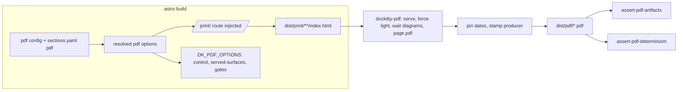

# Implementation Plan: Print and PDF output: print layer, section and whole-site PDFs

**Branch**: `feat/print-pdf-output` | **Date**: 2026-11-20 | **Spec**: [spec.md](./spec.md)
**Input**: Mission specification from `kitty-specs/print-pdf-output-01M7X19V/spec.md`

Planning ran unattended. The operator's stored brief supplies the architecture choices (Chromium `page.pdf()` from built HTML, the disclosure-style sheet delivery, emitter-derived print tokens, config-driven expectations, an advisory lane). The remaining choices are cheap to reverse and are taken here and logged in [research.md](./research.md) and the decision log.

## Summary

Every page gets a print layer: a print stylesheet imported by a client script that every docs page loads (disclosure precedent, no new global sheet), a generated print-token fallback derived from the resolved theme, and a `beforeprint`/`afterprint` hook that forces `data-theme="light"`. A new `pdf` configuration (per section in `sections.yaml`, site-wide in `defineDocKittyIntegrations`) drives an injected print route, `/print/<section>/` and `/print/` (whole site), that renders each page through the content collection's own `render()` inside `StarlightPage`, namespacing ids and rewriting links. A `dockitty-pdf` CLI serves a built dist, forces light, waits for client diagrams to report a light render, prints each print document with Chromium, then pins dates and stamps the producer with Node built-ins only. A PDF gate and a determinism check run in an advisory, path-scoped CI lane on the drafts-off dist; the deploy prints and publishes the PDFs on main. An opt-in print control, enabled through `chromeOptions`, offers print and the section PDF.

## Technical Context

**Language/Version**: TypeScript 5.9 and ESM JavaScript on Node >= 22.22; Astro 7.4 + Starlight 0.42.6 components (`.astro`); CSS
**Primary Dependencies**: existing only: Astro, Starlight, the optional `playwright@1.62.1` peer (Chromium 157), Node built-ins (`node:http`, `node:zlib`). No new dependency (NFR-004).
**Storage**: files: `dist/print/**/index.html` (build), `dist/pdf/*.pdf` (post-build)
**Testing**: Vitest unit tests in `src/tests/` (toolkit), Playwright specs in `tests/a11y/` (print-media and print control, a11y lane), the bare-Node gates `src/scripts/assert-build-artifacts.mjs` and the new `assert-pdf-artifacts.mjs`, and a determinism script run in the PDF lane
**Target Platform**: static site (GitHub Pages); CI on ubuntu runners and the `mcr.microsoft.com/playwright:v1.62.1-noble` container
**Project Type**: single project (toolkit `src/` + worked example `example/`)
**Performance Goals**: the example's PDFs print in under 5 minutes of lane time (NFR-003); no second site build
**Constraints**: byte-deterministic PDFs (NFR-001); sitemap 78 / index 73 pins unchanged (NFR-005); deck route untouched; `ci-ok` untouched (C-004)
**Scale/Scope**: about 25 source files; example enables two section PDFs plus the whole-site PDF

## Charter Check

*GATE: Must pass before Phase 0 research. Re-check after Phase 1 design.*

| Charter rule | How the plan complies |
|---|---|
| Three separated axes | Which sections print is information architecture (`sections.yaml` `pdf`); print styling is presentation (theme-overridable `print.css`, `@page`); content is untouched. |
| Theme layer swappable (ADR-0008, ADR-0011) | `print.css` and the print-token fallback load before brand/consumer sheets can override them; the fallback is generated from the resolved theme, never hand-restated. |
| Path-scoped CI, `ci-ok` the one required check (ADR-0007) | New `pdf` lane gated on `run_build_example`; not added to `REQUIRED_LANES` (advisory; joining later is an operator decision listed in the PR). |
| Doc-sanity, living documentation | Guide, configuration reference, section-registry page, CI/CD docs, migration note and changelog fragments ship in the same change. |
| Tests: Vitest + example build gates; Playwright | Unit tests per module, gate assertions, Playwright print-media and control specs. |
| ADRs immutable; a decision is a new ADR | ADR-0081 records the PDF contract; no accepted ADR is edited. |
| Accessibility WCAG 2.2 AA | Print control: keyboard, accessible name, 24 px target, AA in both themes; axe run. |
| Deploy to Pages on mainline only | PDFs are printed in `deploy.yml` (main only); PRs publish nothing. |

No violations. Post-design re-check: unchanged (the design adds no new runtime dependency, no new required lane, and edits no accepted ADR).

## Project Structure

### Documentation (this mission)

```
kitty-specs/print-pdf-output-01M7X19V/
├── spec.md
├── plan.md
├── research.md
├── research/code-grounding.md
├── data-model.md
├── quickstart.md
├── contracts/
│   ├── pdf-config.md
│   ├── print-route.md
│   └── dockitty-pdf-cli.md
└── tasks.md            (by /spec-kitty.tasks)
```

### Source Code (repository root)

```
src/
├── styles/print.css                         NEW  print layer rules (@media print, @page A4)
├── lib/print/print.client.ts                NEW  force-light hook; imports print.css + print-token module
├── lib/print/rewrite.ts                     NEW  id namespacing, link rewriting, heading demotion
├── lib/print/order.ts                       NEW  reading-order walk + exclusion filter (pure)
├── lib/pdf-options.ts                       NEW  resolve/validate the `pdf` settings; DK_PDF_OPTIONS reader
├── lib/routes/print-injected.astro          NEW  /print/[...name]/ page (StarlightPage)
├── components/print/PrintPage.astro         NEW  one page: hero + rewritten content
├── components/print/PrintCover.astro        NEW  cover + table of contents
├── components/slots/PrintControl.astro      NEW  print control (opt-in)
├── lib/integrations/print-route.ts          NEW  injectRoute + sitemap predicate + collision check
├── lib/manifest.ts                          EDIT serve virtual:doc-kitty/print-tokens.css
├── lib/theme.ts                             EDIT emitPrintTokenSheet beside emitTokenSheet
├── lib/sections.ts, lib/vocabulary-loader.mjs  EDIT carry `pdf`
├── lib/chrome-options.ts                    EDIT `printControl` option
├── lib/config.ts                            EDIT `pdf` option, route integration, env handoffs
├── lib/served-surfaces.ts                   EDIT `pdf` record
├── lib/diagram/diagram-render.client.ts     (superseded 2026-11-25: left as on main)
├── components/PageTitle.astro               EDIT load print.client, render PrintControl
├── scripts/dockitty-pdf.mjs                 NEW  CLI (bin)
├── scripts/pdf-postprocess.mjs              NEW  date pinning + producer incremental update
├── scripts/pdf-inspect.mjs                  NEW  minimal PDF reader for the gate
├── scripts/assert-pdf-artifacts.mjs         NEW  PDF gate
├── scripts/assert-pdf-determinism.mjs       NEW  two runs, byte compare
├── scripts/assert-build-artifacts.mjs       EDIT print-route assertions
├── scripts/assert-no-broken-links.mjs       EDIT accept expected /pdf/ targets
├── tests/*.test.ts                          NEW  unit tests per module
tests/a11y/print.spec.ts, print-control.spec.ts   NEW
.github/workflows/ci.yml, deploy.yml         EDIT pdf lane, deploy step
example/docs/_meta/sections.yaml, example/astro.config.mjs  EDIT enable PDFs
docs/adr/0081-print-and-pdf-output-from-built-html-via-chromium.md  NEW
docs/guides/printing-and-pdf.md              NEW
docs/… configuration, section registry, CI/CD, migrations, changelog fragments  EDIT/NEW
```

**Structure Decision**: single project. Toolkit code under `src/`, worked example under `example/`, repo docs under `docs/`, CI under `.github/`.

## Design



Key decisions (full rationale in research.md):

1. **Print sheet delivery**: `print.client.ts` imports `print.css` and `virtual:doc-kitty/print-tokens.css`; `PageTitle.astro` loads the script. Every in-frame page (including the print route, which uses `StarlightPage`) gets it; the deck route does not. No change to `GLOBAL_COMPONENT_SHEETS` or `DeckLayout`.
2. **Print-token fallback**: `emitPrintTokenSheet(resolved)` writes `@media print { :root:root[data-theme='dark'] { <each mode-varying token: its resolved light value>; color-scheme: light } }` at (0,3,0). Light-theme prints keep brand values; dark prints without the hook get the resolved light palette.
3. **Diagram completion signal**: the client render sets `data-dk-diagram-theme` on `<html>` to the theme it last finished rendering; the CLI waits for `light` when any `pre.mermaid` exists. *(Superseded 2026-11-25, see research.md "Rework for SC-004": the renderer carries no signal or pause; `dockitty-pdf` waits on `pre.mermaid[data-processed]` holding an `<svg>`, and the hook skips pages with client-mode diagrams.)*
4. **`pdf` key shape**: `pdf: true | false` or `pdf: { section: boolean, site: main | appendix | omit }`. Site option `pdf: { sections?: boolean, site?: boolean, exclude?: { sections?: string[], kinds?: string[] } }`. Fixed exclusion floor: `kind: Presentation` pages and OpenAPI reference pages (never collection entries).
5. **Routes**: `/print/<section>/` for each section with its own PDF; `/print/` for the whole site. `noindex`, `pagefind: false`, filtered from the sitemap by a registered predicate. `site` is reserved as a PDF name.
6. **Headings and outline**: the cover title is the one `<h1>`; section print: page titles `<h2>`, content headings demoted one level; whole-site: section dividers `<h2>`, page titles `<h3>`, content demoted two levels. The gate counts outline entries at the page-title depth.
7. **PDF post-pass**: fixed-width overwrite of `/CreationDate` and `/ModDate`, plus an appended incremental update replacing the Info dictionary (`Title`, `Producer: doc-kitty-pdf/<version>`, pinned dates). Classic xref tables only (Skia writes them); anything else fails with exit 1.
8. **Expectations from config**: `DK_PDF_OPTIONS` (internal env, written by `defineDocKittyIntegrations`) and a JSON manifest written at build end to `dist/print/manifest.json` (names, titles, page counts, page-title level) are what the control, served-surfaces, link check and gates read. Never `dist/pdf/` on disk.
9. **CI**: `pdf` job needs `build-example`, runs in the Playwright container on `example-dist-nodrafts`, not in `REQUIRED_LANES`. Deploy runs `dockitty-pdf` after the composite build; a failure fails the deploy.

## Complexity Tracking

None.

## Implementation Concern Map

### IC-01 — Print layer

- **Purpose**: every page prints clean and light in either theme.
- **Relevant requirements**: FR-001 to FR-009, FR-008a, SC-001, SC-005 (FR-010 guide: IC-07)
- **Affected surfaces**: `src/styles/print.css`, `src/lib/print/print.client.ts`, `src/lib/print/print-tokens.ts`, `src/lib/manifest.ts`, `src/lib/theme.ts`, `src/components/PageTitle.astro`, `src/lib/diagram/diagram-render.client.ts`, `src/styles/dk-components.css`, chrome-baseline harness, `tests/a11y/print.spec.ts`
- **Sequencing/depends-on**: none
- **Risks**: `print.<hash>.css` is emitted as a file, so the chrome-baseline `css.txt` and `page.html` goldens change; a literal normaliser removes exactly that block and link (D-01a). Brand CSS-file tokens are unknown to the emitter (documented). Client-mode diagrams pause their re-render during a browser print (D-03a).

### IC-02 — PDF configuration and ADR

- **Purpose**: one resolved `pdf` model every consumer reads.
- **Relevant requirements**: FR-011, FR-012, FR-013, FR-027
- **Affected surfaces**: `src/lib/sections.ts`, `src/lib/vocabulary-loader.mjs`, `src/lib/pdf-options.ts`, `src/lib/config.ts`, `src/lib/internal-env.mjs`, ADR-0081, docs
- **Sequencing/depends-on**: none
- **Risks**: `config.ts` shared with IC-03, IC-05, IC-06; sequence.

### IC-03 — Print route

- **Purpose**: section and whole-site print documents rendered through the content pipeline.
- **Relevant requirements**: FR-014 to FR-019, NFR-005
- **Affected surfaces**: `src/lib/print/order.ts`, `src/lib/print/rewrite.ts`, `src/lib/routes/print-injected.astro`, `src/components/print/*`, `src/lib/integrations/print-route.ts`, `src/package.json` exports, `assert-build-artifacts.mjs`, example config
- **Sequencing/depends-on**: IC-01 (styles), IC-02 (options)
- **Risks**: one-`<h1>` gate and its title-repeat check (index page becomes the cover body), sitemap pins, anchors in SVG `<style>` blocks, absolute links invisible to the link checkers (gate maps them back), gate expectations derived independently of the route's manifest, outline headings limited to page titles (cover/TOC use no `h2`/`h3`; chrome headings hidden).

### IC-04 — PDF CLI, post-pass, gate, determinism

- **Purpose**: deterministic, tagged PDFs and their checks.
- **Relevant requirements**: FR-020 to FR-023, NFR-001, NFR-004
- **Affected surfaces**: `src/scripts/dockitty-pdf.mjs`, `pdf-postprocess.mjs`, `pdf-inspect.mjs`, `assert-pdf-artifacts.mjs`, `assert-pdf-determinism.mjs`, `src/package.json` bin
- **Sequencing/depends-on**: IC-03
- **Risks**: Chromium output changing structure; classic-xref assumption guarded.

### IC-05 — CI lane, deploy, served surfaces

- **Purpose**: the PDFs are built, checked and published.
- **Relevant requirements**: FR-024, FR-025, NFR-003
- **Affected surfaces**: `.github/workflows/ci.yml`, `deploy.yml`, `src/lib/served-surfaces.ts`, `assert-no-broken-links.mjs`, CI/CD docs
- **Sequencing/depends-on**: IC-04
- **Risks**: workflow tests pin job shapes (`draft-publication-workflows.test.ts` etc.); adding `pdf` to `ServedSurfaces` touches `page-formats.test.ts` and `served-surfaces*.test.ts`, and is config-derived where the rest is route-derived (documented in the module).

### IC-06 — Print control

- **Purpose**: discoverable print and section PDF download.
- **Relevant requirements**: FR-026, NFR-002
- **Affected surfaces**: `src/lib/chrome-options.ts`, `src/components/slots/PrintControl.astro`, `src/components/PageTitle.astro`, `tests/a11y/print-control.spec.ts`, docs
- **Sequencing/depends-on**: IC-01, IC-02
- **Risks**: chrome goldens (off by default, so none); a dist with the control on must exist for the a11y spec (example or a chrome fixture dist, D-13).

### IC-07 — Documentation

- **Purpose**: living documentation for the shipped behaviour.
- **Relevant requirements**: FR-010, FR-027
- **Affected surfaces**: `docs/guides/printing-and-pdf.md`, `docs/guides/consumer-setup.md`, `docs/architecture/section-registry.md`, CI/CD docs, `docs/migrations/`, `docs/changelog/unreleased/`
- **Sequencing/depends-on**: IC-01 to IC-06
- **Risks**: Vale/markdownlint prose rules.
