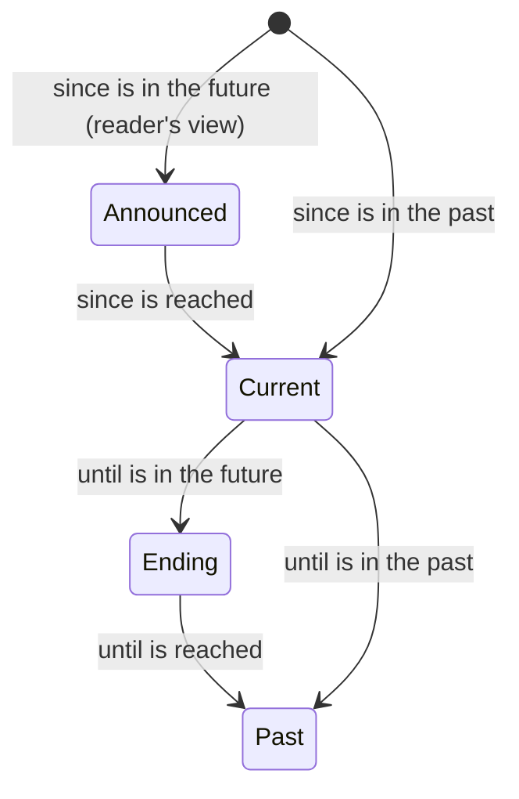

# Data Model: Sub-processor catalog

## SubprocessorRecord (one entry in `docs/_meta/subprocessors.yaml`)

| Field | Type | Required | Rule |
|-------|------|----------|------|
| `id` | string | yes | Kebab-case `^[a-z0-9]+(-[a-z0-9]+)*$`, unique in the file |
| `name` | string | yes | Non-empty |
| `address` | string | no | Non-empty when present |
| `contact` | string | no | Non-empty when present (an email, URL or role, as free text) |
| `processing` | string | yes | Non-empty. Describes the processing (2021/915 Annex IV) |
| `location` | string[] | yes | Non-empty. Each entry is an assigned ISO 3166-1 alpha-2 code in upper case. No duplicates |
| `location_note` | string | no | Non-empty when present |
| `responsibilities` | string | yes | Non-empty. The division of responsibilities |
| `since` | date | yes | `YYYY-MM-DD` |
| `until` | date | no | `YYYY-MM-DD`, and `>= since` |
| `external_references` | ExternalReference[] | no | The existing page shape: inline `{url, title, note?}` or `{type: biblio\|tool, id}`. Catalog ids must resolve |
| `tom_classification` | ClassificationEntry[] | no | The ADR-0080 page shape: a bare measure id, or `{measure, scope?, note?}`. Measures resolve against the effective measures catalog |

Any other key is an error (research R-06). ⚖ The field set awaits counsel.

The file is a top-level YAML sequence. An empty sequence is valid. Any other
top-level type is an error. An absent file means "no catalog".

## ChangeEntry (derived, never authored)

| Field | Type | Rule |
|-------|------|------|
| `date` | string | `YYYY-MM-DD` |
| `kind` | `"added"` \| `"removed"` | `added` from `since`, `removed` from `until` |
| `id` | string | The record id |
| `name` | string | The record name, for display |

Order: `date` descending, then `id` ascending, then `added` before `removed`.
The order is total and deterministic.

## CatalogRead (loader result)

| Field | Type | Meaning |
|-------|------|---------|
| `present` | boolean | The file exists |
| `source` | string | Path used in messages (`docs/_meta/subprocessors.yaml`) |
| `records` | SubprocessorRecord[] | Normalised records (dates as strings), in file order |
| `problems` | string[] | Parse and shape problems, each naming the file, the record (id or `#index`) and the field |

Reference checks (`external_references`, `tom_classification`) run in the core
against the injected reference data and append to `problems`.

## Invariants

1. Neither the derived output nor the problem list depends on the clock or the time zone.
2. The same file and reference data yield the same problems, in the same order and with the same text, in the gate and in the build.
3. `present: false` means no routes, no links and no problems.

## Lifecycle of a record (as read from the dates)

The toolkit never computes these states for the API or the feed (C-005). Only the
gated page (FR-017) renders a current/past split, under ADR-0087's rules.
