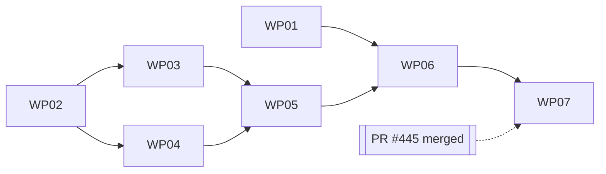

# Tasks: Sub-processor catalog

**Mission**: `subprocessor-catalog-01M84X07` (issue #403, epic #400)
**Planning branch / merge target**: `feat/403-subprocessor-catalog`
**Inputs**: [spec.md](spec.md), [plan.md](plan.md), [research.md](research.md), [data-model.md](data-model.md), [contracts/](contracts/), [quickstart.md](quickstart.md)

> Not legal advice. The toolkit ships structure only. ⚖ marks counsel items.

Every code WP is red-first: write the failing tests, watch them fail, then implement.
Before every hand-off, run the full `pnpm test` (both tiers and mcp).

## Subtask Index

| ID | Description | WP | Parallel |
|----|-------------|----|----------|
| T001 | Write ADR-0086 (Proposed) | WP01 | [P] |
| T002 | Regenerate the ADR index | WP01 | |
| T003 | Run the ADR and docs validators | WP01 | |
| T004 | Red-first tests for the core and the loader, with fixtures | WP02 | |
| T005 | Embedded ISO 3166-1 alpha-2 constant | WP02 | [P] |
| T006 | Core: file and record shape validation | WP02 | |
| T007 | Core: reference checks with injected reference data | WP02 | |
| T008 | Core: change derivation and total order | WP02 | |
| T009 | Loader: read the file, citation ids, `checkSubprocessorCatalog` | WP02 | |
| T010 | Red-first gate tests and gate fixtures | WP03 | |
| T011 | Wire the catalog into `validate-catalog.mjs` | WP03 | |
| T012 | Gate speed test, 200 records | WP03 | [P] |
| T013 | Gate stays clean on `docs` and `example/docs` | WP03 | |
| T014 | Red-first render tests | WP04 | |
| T015 | `renderSubprocessorsApi` | WP04 | |
| T016 | `renderSubprocessorsFeed` | WP04 | |
| T017 | Byte-stability across clocks | WP04 | |
| T018 | Red-first integration tests | WP05 | |
| T019 | Integration, route factories, injected entrypoints, package exports | WP05 | |
| T020 | Register the integration in `config.ts` | WP05 | |
| T021 | Served surfaces, `IndexLinks` and agent-index links | WP05 | |
| T022 | Build-versus-gate parity test | WP05 | [P] |
| T023 | Fixture-site build test: no file vs file | WP05 | |
| T024 | Fictional example records | WP06 | [P] |
| T025 | Example-site artifact assertions | WP06 | |
| T026 | Guide section with ⚖ notes | WP06 | [P] |
| T027 | Changelog fragment | WP06 | [P] |
| T028 | Full build and `pnpm test` | WP06 | |
| T029 | Confirm #445 merged; rebase; re-read ADR-0087 as merged | WP07 | |
| T030 | Red-first page tests | WP07 | |
| T031 | Page generator with the ADR-0087 stamp and producer registration | WP07 | |
| T032 | `--check` drift gate wiring | WP07 | |
| T033 | Feed items link to the page | WP07 | |
| T034 | Docs and changelog update for the page | WP07 | |

## Phase 1: Foundation

### WP01 — ADR-0086: the sub-processor catalog

- **Prompt**: [tasks/WP01-adr-0086-subprocessor-catalog.md](tasks/WP01-adr-0086-subprocessor-catalog.md)
- **Goal**: Record the catalog, field set, outputs, sequencing and ⚖ items as an architecture decision.
- **Priority**: P1. **Independent test**: `pnpm validate:adr-index`, `validate:adr-ids` and `validate:links` pass. ADR-0086 appears in `docs/adr/README.md` as Proposed.
- **Subtasks**:
  T001 Write ADR-0086 (Proposed) (WP01)
  T002 Regenerate the ADR index (WP01)
  T003 Run the ADR and docs validators (WP01)
- **Dependencies**: none. **Parallel**: with WP02.
- **Risks**: The ADR must not claim legal sufficiency, and only the operator accepts it.

### WP02 — Validation core and loader

- **Prompt**: [tasks/WP02-validation-core-and-loader.md](tasks/WP02-validation-core-and-loader.md)
- **Goal**: One pure core and one bare-Node loader that every surface shares.
- **Priority**: P1. **Independent test**: `vitest run src/tests/subprocessors-core.test.ts src/tests/subprocessors-loader.test.ts`.
- **Subtasks**:
  T004 Red-first tests for the core and the loader, with fixtures (WP02)
  T005 Embedded ISO 3166-1 alpha-2 constant (WP02)
  T006 Core: file and record shape validation (WP02)
  T007 Core: reference checks with injected reference data (WP02)
  T008 Core: change derivation and total order (WP02)
  T009 Loader: read the file, citation ids, `checkSubprocessorCatalog` (WP02)
- **Dependencies**: none. **Parallel**: with WP01.
- **Risks**:
  - Date scalars must not pick up the local time zone.
  - The citation-id reader must not double-report bibliography problems that the existing gate already reports.

## Phase 2: Surfaces

### WP03 — Build-free gate

- **Prompt**: [tasks/WP03-build-free-gate.md](tasks/WP03-build-free-gate.md)
- **Goal**: `validate-catalog.mjs` checks each root's sub-processor catalog with the shared loader.
- **Priority**: P1. **Independent test**: `vitest run src/tests/validate-catalog-subprocessors.test.ts`. `pnpm validate:catalog` exits 0.
- **Subtasks**:
  T010 Red-first gate tests and gate fixtures (WP03)
  T011 Wire the catalog into `validate-catalog.mjs` (WP03)
  T012 Gate speed test, 200 records (WP03)
  T013 Gate stays clean on `docs` and `example/docs` (WP03)
- **Dependencies**: WP02. **Parallel**: with WP04.

### WP04 — API and feed renderers

- **Prompt**: [tasks/WP04-api-and-feed-renderers.md](tasks/WP04-api-and-feed-renderers.md)
- **Goal**: Pure functions that turn a checked catalog into the exact `api/subprocessors.json` and `subprocessors.xml` bytes.
- **Priority**: P1. **Independent test**: `vitest run src/tests/subprocessors-render.test.ts`.
- **Subtasks**:
  T014 Red-first render tests (WP04)
  T015 `renderSubprocessorsApi` (WP04)
  T016 `renderSubprocessorsFeed` (WP04)
  T017 Byte-stability across clocks (WP04)
- **Dependencies**: WP02. **Parallel**: with WP03.

### WP05 — Integration, routes and agent discovery

- **Prompt**: [tasks/WP05-integration-routes-and-discovery.md](tasks/WP05-integration-routes-and-discovery.md)
- **Goal**: A file-gated integration that fails early and injects both routes. The agent index then links them.
- **Priority**: P1. **Independent test**: the integration, parity and fixture-site build tests pass, and the no-file fixture emits nothing new.
- **Subtasks**:
  T018 Red-first integration tests (WP05)
  T019 Integration, route factories, injected entrypoints, package exports (WP05)
  T020 Register the integration in `config.ts` (WP05)
  T021 Served surfaces, `IndexLinks` and agent-index links (WP05)
  T022 Build-versus-gate parity test (WP05)
  T023 Fixture-site build test: no file vs file (WP05)
- **Dependencies**: WP03, WP04.
- **Risks**:
  - The agent-index contract stays at version `"3"`, with additive links only.
  - The MCP package must stay green.

## Phase 3: Polish

### WP06 — Example content, assertions, guide and changelog

- **Prompt**: [tasks/WP06-example-guide-and-changelog.md](tasks/WP06-example-guide-and-changelog.md)
- **Goal**: Show the feature end to end on the example site and document it with its ⚖ limits.
- **Priority**: P2. **Independent test**: the example build passes `assert-build-artifacts.mjs`. `validate:links` and `validate:changelog` pass.
- **Subtasks**:
  T024 Fictional example records (WP06)
  T025 Example-site artifact assertions (WP06)
  T026 Guide section with ⚖ notes (WP06)
  T027 Changelog fragment (WP06)
  T028 Full build and `pnpm test` (WP06)
- **Dependencies**: WP01, WP05.

## Phase 4: Gated

### WP07 — Generated sub-processor list page (blocked on PR #445)

- **Prompt**: [tasks/WP07-generated-list-page.md](tasks/WP07-generated-list-page.md)
- **Goal**: A generated page listing current and past sub-processors, stamped and drift-checked per ADR-0087.
- **Priority**: P3. **Independent test**: the page tests pass, `--check` fails on a stale page, and the example page is current.
- **Subtasks**:
  T029 Confirm #445 merged; rebase; re-read ADR-0087 as merged (WP07)
  T030 Red-first page tests (WP07)
  T031 Page generator with the ADR-0087 stamp and producer registration (WP07)
  T032 `--check` drift gate wiring (WP07)
  T033 Feed items link to the page (WP07)
  T034 Docs and changelog update for the page (WP07)
- **Dependencies**: WP06. **External gate**: PR #445 merged to `main` (C-004). Do not claim it before then.

## Dependency graph

**MVP**: WP01 to WP05, which gives a validated catalog, the agent API and the feed.
WP06 makes it shippable. WP07 follows #445.
