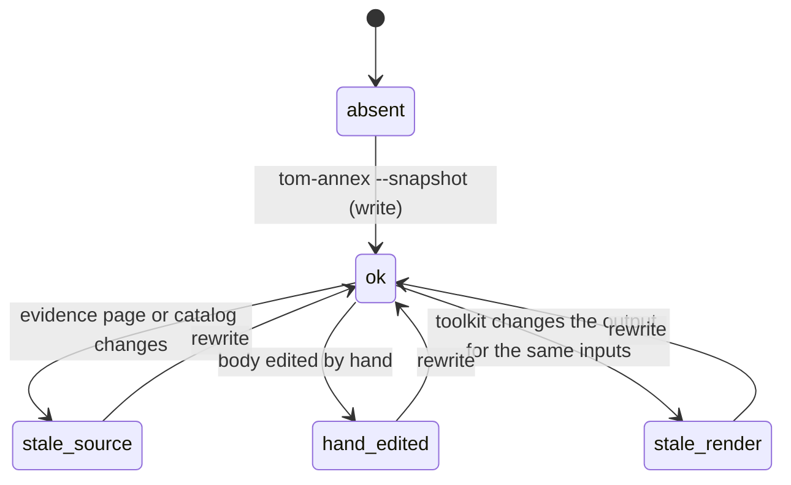

# Data model: the evidence index (format 1.0)

The normative shape is in `contracts/tom-annex.schema.json`. Keys are serialised
in the order listed. Every list is sorted as stated.

## EvidenceIndex (the file)

| Field | Type | Rule |
|---|---|---|
| `format` | `"doc-kitty/tom-annex"` | constant |
| `format_version` | `"1.0"` | major.minor. A rename or removal bumps the major; an addition bumps the minor (NFR-003). |
| `label` | string | exactly `"Evidence index, not the contractual annex."` ⚖ |
| `notice` | string | the not-legal-advice sentence ⚖ |
| `generated` | GeneratedStamp | ADR-0087. Required in format 1.0. WP06 adds it, and no release happens before then. |
| `catalog` | `{ source: string, default: boolean }` | from `loadMeasuresCatalog` |
| `scopes` | `{ system: MeasureEntry[], organisation: MeasureEntry[] }` | each sorted by `id` (code-unit order). An empty scope is `[]`. |
| `uncovered` | UncoveredMeasure[] | sorted by `id` |
| `counsel` | string[] | the ⚖ items, in fixed order |

## MeasureEntry

| Field | Type | Rule |
|---|---|---|
| `id` | string | catalog id (kebab-case) |
| `label` | string | catalog label |
| `nature` | `technical`, `organisational`, `legal` or `physical` | catalog |
| `frameworks` | `{framework, ref}[]` | catalog order is kept |
| `dpv` | string, optional | omitted when the catalog has none |
| `evidence` | EvidenceRef[] | non-empty, sorted by `url` |

**Invariant:** a measure appears in a scope group once. It may appear in both
groups when pages classify it under both scopes (FR-002).

## EvidenceRef

| Field | Type | Rule |
|---|---|---|
| `title` | string | page node |
| `description` | string or null | page node |
| `url` | string | absolute: `site` + `base` + the page's `href` |
| `updated` | string or null | instant, as in the graph |
| `doc_status` | string | page node |
| `verified` | `{by, at}[]` | page node, normalised list (may be empty) |
| `note` | string or null | the classification entry's note, with whitespace flattened |

## UncoveredMeasure

`{ id, label, nature }` for each catalog measure with no published evidence in
either scope.

## GeneratedStamp (ADR-0087)

`{ by, at, source_digest, content_hash }`. See research R-05. `at` may be `null`.

## Snapshot

Same bytes as the built `api/tom-annex.json` at the time it was written. It is
committed at the `--snapshot` path. Its verdicts are those of ADR-0087 D3: `ok`,
`missing`, `stale-source`, `hand-edited` or `stale-render`.

## State: snapshot lifecycle

