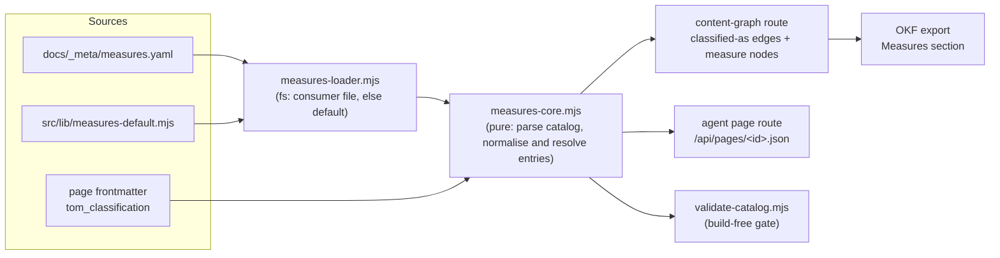

# Implementation Plan: TOM classification and measures catalog

**Branch**: `feat/406-tom-classification` | **Date**: 2026-11-22 | **Spec**: [spec.md](./spec.md)
**Input**: Mission specification from `kitty-specs/tom-classification-measures-catalog-01M81M7T/spec.md`

## Summary

Add an optional `tom_classification` frontmatter field, resolve it against a measures catalog (the consumer's `docs/_meta/measures.yaml`, else a default shipped in the toolkit), and emit a `classified-as` relation into the content graph, the per-page agent record and the OKF bundle. One pure, Astro-free core owns the parsing and the resolution, and both the build and the build-free catalog gate import it. That makes gate parity structural rather than a re-implementation kept in step.

## Technical Context

**Language/Version**: TypeScript 5 and ES modules (`.mjs` with JSDoc types) on Node 22+
**Primary Dependencies**: Astro 5 + Starlight (existing), Zod 4 via `astro/zod` in the build schema and `zod` in the gate (existing), `gray-matter` for YAML (existing). No new dependency.
**Storage**: Files only: `docs/_meta/measures.yaml` (consumer) and `src/lib/measures-default.mjs` (shipped, a statically imported data module; amended in WP05, see research R1a)
**Testing**: Vitest unit tests in `src/tests/`; fixture docs trees under `src/tests/fixtures/`; the example build and `assert-build-artifacts.mjs`
**Target Platform**: Static site build (Astro) and bare-Node CI gates
**Project Type**: Single package library (`src/`, `@spec-kitty/doc-toolkit`) plus the `example/` site
**Performance Goals**: The catalog is parsed once per build surface; resolution is a map lookup per entry
**Constraints**: No consumer config change; byte-identical surfaces for trees that never use the field (FR-010); deterministic output (NFR-001)
**Scale/Scope**: About 8 source files touched, 3 new modules, 1 shipped YAML, 5 docs pages, example pages and fixtures

## Charter Check

| Charter rule | Verdict |
|---|---|
| Three separated axes (content, IA, presentation) | Pass. The field is content metadata and the catalog is a `_meta` registry. No theme or IA change. |
| Metadata contract changes through ADRs | Pass. ADR-0080 decides it; this mission accepts it (C-004). |
| Living documentation | Pass. The metadata model, content-graph, consumer-setup, glossary and an authoring guide change in the same mission (FR-011). |
| Build fails on a dangling reference | Pass. An unknown measure id is build-fatal, like a dangling `related` ref or a missing citation key. |
| Tests: Vitest, example build | Pass. Red-first unit tests per concern; the example build exercises the edges. |
| Changelog by fragment, ADR index by bot | Pass. One fragment; no hand edit of `docs/adr/README.md`. |
| Writing style (sentence case, no AI tells) | Applies to every docs change; checked by markdownlint and Vale. |

Supply-chain check (DIRECTIVE_051): no dependency is added, upgraded or removed. Nothing to audit.

Post-design re-check: no new conflict.

## Design



- **Core (`src/lib/measures-core.mjs`)**: `parseMeasuresCatalog(text, label)` returns `{ records, problems }`, and `buildMeasuresIndex(records)` keys them by id. `normaliseClassification(value)` turns bare ids into `{ measure, scope: 'system' }`, then `resolveClassification(entries, index, page)` returns resolved entries or throws `[dk-measures] <page>: unknown measure id "<id>" (not in <catalog>)`. `classificationProblems(entries, index)` returns the same verdicts as strings for the gate. The core has no fs and no Astro dependency.
- **Loader (`src/lib/measures-loader.mjs`)**: `loadMeasuresCatalog(docsRoot)` reads `<docsRoot>/_meta/measures.yaml` when it exists, else the shipped default (`DEFAULT_MEASURES` from `./measures-default.mjs`, statically imported). It returns `{ index, source }`, where `source` is the path used in messages. A malformed catalog throws, naming the file and the record.
- **Schemas**: `tom_classification` is added to `docKittyFields` (build) and `frontmatterSchema` (gate) with the same Zod shape. The gate also warns on any case variant of the key (FR-014).
- **Content graph**: `GraphRel` gains `classified-as`. `GraphEdge` gains an optional `scope`, written only on `classified-as` edges, and always written there (explicit `system` default). `GraphNode` gains an optional `measure: { nature, frameworks }`. A measure node is `{ id: 'catalog:measure:<id>', kind: 'catalog', title: label, url: dpv?, measure }`. `ContentGraphContext` gains `measures`. The route loads it from the same `docsDir` it walks.
- **Agent page**: the payload gains `tom_classification: [{ measure, label, nature, scope, note? }]`, present only when the page has the field, so other pages stay byte-identical.
- **OKF export**: `RELATION_SECTIONS` gains `['classified-as', 'Measures']`, placed after References. A line is the label linked to its DPV IRI, then ` (organisation)` when the scope is organisation, then the note.
- **Gate**: `validate-catalog.mjs` imports the core and loader (both bare-Node safe), checks each root's catalog, then resolves every page's `tom_classification`. It keeps the citation check as is.

See [contracts/](./contracts/) for the exact shapes and [data-model.md](./data-model.md) for invariants.

## Implementation Concern Map

| ID | Concern | Requirements | Depends on |
|---|---|---|---|
| IC-01 | Accept ADR-0080 | FR-001 | none; first commit |
| IC-02 | Measures core, loader and shipped default catalog | FR-003, FR-004, FR-005 (resolver), NFR-001, NFR-004 | none |
| IC-03 | Field shape in build schema and gate, case-variant warning | FR-002, FR-014 | none |
| IC-04 | Build-free gate parity | FR-006, NFR-002 | IC-02 |
| IC-05 | Content graph edge and nodes, route wiring | FR-005, FR-007, FR-010 | IC-02, IC-03 |
| IC-06 | Agent page record | FR-005, FR-008, FR-010 | IC-02, IC-03 |
| IC-07 | OKF Measures section | FR-009 | IC-05 (edge shape only; can use a fixture graph) |
| IC-08 | Docs, glossary, example pages, artifact assertions, changelog | FR-011, FR-012, FR-013 | IC-05, IC-06, IC-07 |

### IC-01 — Accept ADR-0080

- **Purpose**: Mark the decision Accepted as the work's first commit (operator ruling).
- **Relevant requirements**: FR-001
- **Affected surfaces**: `docs/adr/0080-tom-classification-field-and-measures-catalog.md`
- **Sequencing/depends-on**: none
- **Risks**: The ADR index table must not be touched (C-006). `validate:adr-index --check` may flag a stale status column; verify it reads the bot-regenerated table only.

### IC-02 — Measures core, loader and shipped default

- **Purpose**: One parser and resolver that the build and the gate share.
- **Relevant requirements**: FR-003, FR-004, FR-005, NFR-001, NFR-004
- **Affected surfaces**: new `src/lib/measures-core.mjs`, `src/lib/measures-loader.mjs`, `src/lib/measures-default.mjs` (was `measures.default.yaml`; see research R1a), `src/tests/measures-core.test.ts`, `src/tests/measures-loader.test.ts`
- **Sequencing/depends-on**: none
- **Risks**: The default YAML must ship in the package (`files: ["lib", …]` covers it). DPV IRIs are the nearest concept (research R2).

### IC-03 — Field shape

- **Purpose**: Accept the shape everywhere and reject anything else.
- **Relevant requirements**: FR-002, FR-014
- **Affected surfaces**: `src/lib/schema.ts`, `src/lib/metadata.ts` (types), `src/scripts/validate-frontmatter.mjs`, `src/tests/schema-validator-parity.test.ts` and new fixtures
- **Sequencing/depends-on**: none
- **Risks**: The schema and the gate drift apart. The existing parity test gets `tom_classification` fixtures (ok and err).

### IC-04 — Gate parity

- **Purpose**: Catch an unknown id in CI without a build.
- **Relevant requirements**: FR-006, NFR-002
- **Affected surfaces**: `src/scripts/validate-catalog.mjs`, `src/tests/catalog-fixtures.test.ts` and new fixture roots
- **Sequencing/depends-on**: IC-02
- **Risks**: The repo's own `docs/` and `example/docs` must still pass `pnpm validate:catalog`.

### IC-05 — Content graph

- **Purpose**: Queryable evidence: one edge per page-measure pair.
- **Relevant requirements**: FR-005, FR-007, FR-010
- **Affected surfaces**: `src/lib/docs-index.ts`, `src/lib/routes/content-graph.ts`, `src/tests/content-graph.test.ts`
- **Sequencing/depends-on**: IC-02, IC-03
- **Risks**: Byte-identity for unclassified trees. Measure nodes appear only when used.

### IC-06 — Agent page record

- **Purpose**: Show the resolved classification on the per-page record.
- **Relevant requirements**: FR-005, FR-008, FR-010
- **Affected surfaces**: `src/lib/routes/agent-page.ts`, its payload type in `src/lib/metadata.ts`, `src/tests/agent-api.test.ts`
- **Sequencing/depends-on**: IC-02, IC-03
- **Risks**: The route is mounted by the site; the graph route stays the always-on fatal check.

### IC-07 — OKF Measures section

- **Purpose**: Carry the edges into the exported bundle.
- **Relevant requirements**: FR-009
- **Affected surfaces**: `src/lib/okf-export/core.mjs`, `src/tests/okf-export.test.ts`, `src/tests/fixtures/okf-export/graph.json`
- **Sequencing/depends-on**: the IC-05 edge contract (a fixture graph is enough to start)
- **Risks**: OKF conformance checks must still pass (`okf-export/conformance.mjs`).

### IC-08 — Docs, example, assertions, changelog

- **Purpose**: Living docs and an end-to-end exercise in the example build.
- **Relevant requirements**: FR-011, FR-012, FR-013
- **Affected surfaces**: `docs/architecture/metadata-model.md`, `docs/architecture/content-graph.md`, `docs/guides/consumer-setup.md`, `docs/guides/authoring.md`, `docs/context/domain.md`, `example/docs/…` (two pages), `src/scripts/assert-build-artifacts.mjs`, `docs/changelog/unreleased/406-tom-classification.md`
- **Sequencing/depends-on**: IC-05, IC-06, IC-07
- **Risks**: Vale and markdownlint on the new prose; the example pages must pass `validate:example` and `validate:catalog`.

## Extension points and parallel-edit registry

| Shared file | Owner | Others |
|---|---|---|
| `src/lib/metadata.ts` | IC-03 adds `TomClassificationEntry` and the frontmatter field | IC-06 adds the payload field only |
| `src/lib/measures-core.mjs` | IC-02 | IC-04, IC-05, IC-06 import only |
| `src/lib/docs-index.ts` | IC-05 | none |
| `src/scripts/assert-build-artifacts.mjs` | IC-08 | none |

## Risks

| Risk | Mitigation |
|---|---|
| Parallel runners (#330 pack reader, #341 sidebar cap) touch `schema.ts` or `docs-index.ts` | Small additive hunks; rebase onto latest `main` before the PR and coordinate through the dispatcher |
| Byte-identity regression for unclassified trees | Ratchet tests compare graph and page payloads with and without the field on the same fixture |
| Counsel later changes the default labels | Ids stay stable and labels live in one YAML file, so a label change is a one-file bug fix |
| MCP corpus fixtures are snapshots of the example build | They do not regenerate from the build; the example additions do not touch them |

## Project Structure

### Documentation (this mission)

```
kitty-specs/tom-classification-measures-catalog-01M81M7T/
├── spec.md
├── plan.md
├── research.md
├── data-model.md
├── quickstart.md
├── contracts/
│   ├── frontmatter-and-catalog.md
│   └── machine-surfaces.md
└── tasks/
```

### Source Code (repository root)

```
src/lib/
├── measures-core.mjs        # new: pure parse + resolve
├── measures-loader.mjs      # new: consumer file or shipped default
├── measures-default.mjs     # new: 17 default measures (data module)
├── schema.ts                # + tom_classification shape
├── metadata.ts              # + types
├── docs-index.ts            # + classified-as edge, measure nodes
├── routes/content-graph.ts  # + load catalog
├── routes/agent-page.ts     # + resolved classification
└── okf-export/core.mjs      # + Measures section
src/scripts/
├── validate-frontmatter.mjs # + shape, case-variant warning
├── validate-catalog.mjs     # + measure resolution
└── assert-build-artifacts.mjs # + example classified-as assertion
src/tests/                   # + red-first tests and fixtures
example/docs/                # + organisation page, system page
docs/                        # contract, graph, consumer-setup, authoring, glossary, changelog fragment
```

## Complexity Tracking

No charter violations to justify.
